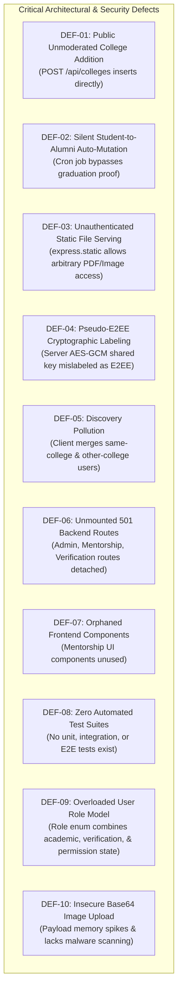

# Document ID: DOC-GOV-002
# Repository Audit & Baseline Defect Report

> **Document Version:** 1.0.0  
> **Classification:** Engineering Baseline Assessment  
> **Status:** APPROVED  
> **Authoring Team:** Principal Software Architect, Application Security Engineer, Backend Architect, Frontend Architect  
> **Audit Date:** October 2026  
> **Target System:** AlumniConnect (`alumini-platform-for-students-1`)  

---

## 1. Executive Summary & Audit Scope

This document provides a comprehensive, forensic engineering audit of the existing codebase located at `d:\Projects\alumini-platform-for-students-1`. The inspection was executed across the root orchestration, backend services (`backend/`), frontend single-page application (`frontend/`), and database layer (`backend/prisma/`) in strict conformance with **Rule B (Inspect before assuming)** and **Rule C (Separate facts from proposals)**.

### Key Audit Findings Summary

| Dimension | Audit Verdict | Severity / Impact | Evidence Summary |
| :--- | :--- | :---: | :--- |
| **Core Architecture** | Monorepo structure with decoupled Express backend and React Vite frontend. | Medium | Root uses `concurrently` to spawn both tiers. Backend runs on Node ESM (`"type": "module"`), Express 4.21, Prisma 5.22. Frontend runs on React 19, Tailwind CSS v4, DaisyUI 5, Zustand, TanStack Query. |
| **Institution Governance** | **CRITICAL DEFECT** | **HIGH** | `POST /api/colleges` is publicly accessible without authentication and immediately inserts raw college records into the production `colleges` table. Zero approval or moderation workflow exists. |
| **Student-to-Alumni Lifecycle** | **CRITICAL DEFECT** | **HIGH** | A background cron job (`node-cron` running hourly in `engagement.service.js`) automatically updates user roles from `STUDENT` to `ALUMNI` based purely on chronological date calculation without requiring degree verification or proof. |
| **Discovery & Recommendations** | **ARCHITECTURAL FLAW** | **HIGH** | The frontend discovery mechanism in `platformApi.js` and `Search.jsx` silently merges same-college users and other-college users into a single combined array, violating the foundational principle of institution-isolated discovery. |
| **File Storage & Privacy** | **SECURITY VULNERABILITY** | **HIGH** | Uploaded PDF files and profile images are stored directly on the local filesystem (`uploads/`) and served through public `express.static()` middleware with zero authorization guards (IDOR / unauthenticated direct object access). |
| **Messaging & Cryptography** | **MISLABELED SECURITY CLAIM** | **MEDIUM** | Chat messages are encrypted at rest using server-side AES-256-GCM with a shared static environment key (`MESSAGE_ENCRYPTION_SECRET`). This is **not End-to-End Encryption (E2EE)**. Transport encryption is handled via TLS/WSS. |
| **Routing & Code Organization** | **DEAD CODE & STUBS** | **MEDIUM** | Six route files (`admin.routes.js`, `mentorship.routes.js`, `verification.routes.js`, `profile.routes.js`, `chat.routes.js`, `search.routes.js`) contain 100% `501 Not Implemented` stubs and are completely unmounted in `backend/src/routes/index.js`. |
| **Frontend Component Utilization** | **ORPHANED COMPONENTS** | **LOW** | Dedicated mentorship components (`MentorshipCard`, `MentorshipSidebar`, `MentorshipNavbar`, `MentorshipRequestCard`, `MentorshipFooter`) exist under `components/mentorship/` but are never imported or rendered anywhere in the application. |
| **Quality & Test Automation** | **ZERO AUTOMATED TESTS** | **CRITICAL** | Zero test files exist in either backend or frontend. No Jest, Vitest, Cypress, or Supertest configurations exist. Neither `package.json` contains a `test` script. |

---

## 2. Technology Stack & Runtime Verification

The active repository components and dependencies have been verified against active configuration files:

### 2.1 Workspace & Root Tier
- **Package Manager:** NPM
- **Orchestration:** Root `package.json` utilizing `concurrently ^9.1.2` (`npm run dev` triggers backend on port 5000 and frontend on port 5173).
- **Git State:** Clean working tree on `main` branch. Commit history indicates iterative prototype feature additions (graduation tracking, multipart PDF upload, call signaling, opportunities).

### 2.2 Backend Tier (`backend/`)
- **Runtime Environment:** Node.js v18+ (ES Modules, `"type": "module"`).
- **Core HTTP Framework:** Express `^4.21.2`.
- **Database & ORM:** PostgreSQL accessed via Prisma Client & CLI `^5.22.0`.
- **Authentication & Security:**
  - `bcryptjs ^2.4.3` for password hashing (10 salt rounds verified in code).
  - `jsonwebtoken ^9.0.2` for JWT access and refresh token generation.
  - `cookie-parser ^1.4.7` for HTTP-only cookie management (`refreshToken`).
  - `helmet ^8.0.0` for HTTP security header injection.
  - `cors ^2.8.5` configured against `CLIENT_ORIGIN` environment parameter.
  - `express-rate-limit ^7.5.0` applied to general API routes (100 req / 15 min) and auth routes (5 req / 15 min).
  - `zod ^3.23.8` for declarative request schema validation.
- **Real-Time & Background:**
  - `socket.io ^4.8.0` with custom JWT handshake authentication middleware.
  - `node-cron ^4.2.1` running an hourly scheduled task (`0 * * * *`).
- **Media & File Processing:** Custom streaming multipart parser (`src/utils/multipart.js`) writing to disk under `backend/uploads/`.
- **Email Service:** Integration stub for Resend API (`resendApiKey` configured in `env.js` and `email.service.js`).

### 2.3 Frontend Tier (`frontend/`)
- **Build System & Tooling:** Vite `^8.0.4` with `@vitejs/plugin-react ^6.0.1`.
- **Core Library:** React `^19.2.4` and React DOM `^19.2.4`.
- **Styling Framework:** Tailwind CSS `^4.1.0` (with `@tailwindcss/vite ^4.2.2`) and DaisyUI `^5.0.0`.
- **Client State Management:** Zustand `^5.0.12` (`authStore.js` and `themeStore.js`).
- **Server State & Data Fetching:** TanStack React Query `^5.96.2` and Axios `^1.15.0`.
- **Client Routing:** React Router DOM `^7.14.0`.
- **Real-Time Client:** `socket.io-client ^4.8.3`.
- **Document Viewing:** `@react-pdf-viewer/core ^3.12.0` and `@react-pdf-viewer/default-layout ^3.12.0`.
- **Micro-Interactions & Audio:** Framer Motion `^12.38.0`, React Confetti `^6.4.0`, Web Audio API synthesized tones (`src/utils/audio.js`).

---

## 3. Exhaustive Functionality Matrix

The following matrix documents the operational reality of every feature area in the repository.

| Module ID | Feature / Submodule | Existing Files | Implementation Status | Detailed Audit Findings |
| :--- | :--- | :--- | :---: | :--- |
| **MOD-AUTH** | User Signup & Registration | `auth.controller.js`<br>`auth.routes.js`<br>`AuthCard.jsx`<br>`Auth.jsx` | **VERIFIED WORKING** | Implements password hashing, email uniqueness checks, college affiliation linking, and initial profile record creation. |
| **MOD-AUTH** | Email OTP Verification | `auth.controller.js`<br>`otp.service.js`<br>`EmailOtp` model | **INCOMPLETE** | OTP generation and hashing working; fallback console logging enabled when Resend API key is missing. Rate limits enforced. |
| **MOD-AUTH** | Login & Refresh Rotation | `auth.controller.js`<br>`token.service.js`<br>`RefreshToken` model | **VERIFIED WORKING** | JWT access token (15m) returned in JSON payload; refresh token (7d) stored in HTTP-only cookie with hash stored in DB. Revocation supported. |
| **MOD-AUTH** | Google OAuth | `auth.controller.js`<br>`googleAuthSchema` | **INCOMPLETE** | Backend accepts `googleId`, `email`, and `idToken`, but relies on client-provided token verification. Account linking conflicts are partially handled. |
| **MOD-AUTH** | Password Reset Lifecycle | `password-reset.service.js`<br>`PasswordResetToken` model | **VERIFIED WORKING** | Generates SHA-256 hashed reset tokens with expiration. Consumed tokens are invalidated. |
| **MOD-COL** | State & District Cascades | `locations.controller.js`<br>`locations.routes.js`<br>`CollegeSelector.jsx` | **VERIFIED WORKING** | Hierarchical loading: State -> District -> College. Backed by `LocationState` and `LocationDistrict` models. |
| **MOD-COL** | College Addition & Moderation | `college.routes.js`<br>`location.service.js` | **CRITICAL DEFECT** | `POST /api/colleges` creates active colleges directly without moderation. No `CollegeRequest` entity exists in Prisma schema. |
| **MOD-DISC** | Same-College Discovery | `users.controller.js`<br>`Search.jsx`<br>`Dashboard.jsx` | **BROKEN LOGIC** | Controller supports same-college scoping, but frontend (`platformApi.js` & `Search.jsx`) merges same-college and cross-college lists together. |
| **MOD-CONN** | Connection Requests & Lifecycle | `connections.controller.js`<br>`connections.routes.js`<br>`ConnectionRequest` model | **VERIFIED WORKING** | Supports `sendConnectionRequest` and `acceptOrRejectConnection` (`ACCEPTED` / `REJECTED`). Bi-directional checks enforced. |
| **MOD-CHAT** | Messaging & 2-Minute Window | `messages.controller.js`<br>`chat.service.js`<br>`Messages.jsx` | **VERIFIED WORKING** | Server calculates elapsed time from first message. If unconnected and elapsed > 120s, server throws 403 (`locked: true`). Enforced on backend. |
| **MOD-CALL** | WebRTC Calls & Signaling | `calls.controller.js`<br>`socket.handler.js`<br>`CallProvider.jsx`<br>`CallWindow.jsx` | **VERIFIED WORKING** | Socket.IO relays `call:join`, `call:accept`, `call:reject`, `call:end`, and `call:signal` (SDP offer/answer and ICE candidates). Voice & Video modes supported. |
| **MOD-MENT** | Mentorship Marketplace | `mentorship.routes.js`<br>`Mentorship.jsx`<br>`components/mentorship/*` | **STUBBED / BROKEN** | Backend route contains 100% 501 Not Implemented stubs. Frontend `Mentorship.jsx` merely lists connections. All mentorship components orphaned. |
| **MOD-OPP** | Opportunities & Referral Matching | `opportunities.controller.js`<br>`Opportunities.jsx` | **VERIFIED WORKING** | Supports creation and listing of Jobs, Internships, Events. Profile-based matching queries match user skills against `skills_required`. |
| **MOD-POST** | Social Feed & PDF Attachment | `posts.controller.js`<br>`uploads.controller.js`<br>`PostFilePreview.jsx` | **VERIFIED WORKING** | Supports text, image URLs, and uploaded PDF files. PDF rendered with `@react-pdf-viewer`. Comments, likes, shares functional. |
| **MOD-LEAD** | Alumni Engagement Leaderboard | `leaderboard.controller.js`<br>`leaderboard.routes.js` | **VERIFIED WORKING** | Ranks alumni based on completed profile, post volume, and connection count. Scoped to user's college. |
| **MOD-NOTIF** | Notifications & Alerts | `notifications.controller.js`<br>`notification.service.js`<br>`NotificationBell.jsx` | **VERIFIED WORKING** | Real-time notifications pushed via Socket.IO (`user:${userId}` room) and persisted to `notifications` table. Read receipts functional. |
| **MOD-ADM** | Administrative Moderation | `admin.routes.js`<br>`Report` model<br>`Block` model | **UNMOUNTED / MISSING** | `admin.routes.js` is unmounted and contains 501 stubs. No frontend administration screens or reviewer tools exist. |
| **MOD-VERIF** | Identity & Degree Verification | `verification.routes.js`<br>`VerificationLog` model | **UNMOUNTED / STUBBED** | Route unmounted. Schema has `VerificationStatus` (`PENDING`, `APPROVED`, `REJECTED`, `MANUAL_REVIEW`), but no execution workflow exists. |

---

## 4. Architectural Defect & Security Vulnerability Register

The audit has uncovered ten primary defects, architectural flaws, and security exposures that must be resolved in the target engineering specifications.



### DEF-01: Unmoderated Institution Addition
- **Classification:** Architectural Defect / Data Poisoning Risk
- **Location:** [backend/src/routes/college.routes.js](file:///d:/Projects/alumini-platform-for-students-1/backend/src/routes/college.routes.js#L128-L170)
- **Observed Behavior:** The `POST /api/colleges` route does not have `requireAuth` middleware attached. Any anonymous internet actor can send an HTTP POST request with arbitrary college name, state, and district, and `ensureCollegeForSignup()` immediately commits it to the database.
- **Impact:** Threat actors can inject duplicate, spoofed, derogatory, or fraudulent institutions into the shared database, polluting the directory for all users.
- **Required Specification:** Decouple college creation into an `InstitutionAdditionRequest` workflow requiring administrator or institutional reviewer approval before addition to canonical colleges.

### DEF-02: Silent Student-to-Alumni Auto-Mutation
- **Classification:** Business Logic / Compliance Violation
- **Location:** [backend/src/services/engagement.service.js](file:///d:/Projects/alumini-platform-for-students-1/backend/src/services/engagement.service.js#L51-L86)
- **Observed Behavior:** The hourly cron worker `syncGraduationStatuses` queries all users with `role: 'STUDENT'`, checks if `graduationDate <= now`, and silently executes:
  ```javascript
  await prisma.user.update({
    where: { id: user.id },
    data: { role: 'ALUMNI' },
  })
  ```
- **Impact:** Violates the fundamental product principle defined in Master Prompt Section 4.4: *"Do not classify a user as an alumnus solely because of inactivity or chronological expiry. Define how graduation is established and verified. Record status changes and their source."*
- **Required Specification:** Create an explicit `GRADUATION_REVIEW` lifecycle state. When expected graduation date passes, trigger a formal notification prompting the user to submit degree completion proof (provisional certificate, marksheet, or registrar verification).

### DEF-03: Unauthenticated Static File Serving & Direct Object Access
- **Classification:** Security Vulnerability (OWASP A01: Broken Access Control / IDOR)
- **Location:** [backend/src/app.js](file:///d:/Projects/alumini-platform-for-students-1/backend/src/app.js#L40) and [backend/src/controllers/uploads.controller.js](file:///d:/Projects/alumini-platform-for-students-1/backend/src/controllers/uploads.controller.js#L25-L35)
- **Observed Behavior:** Uploaded PDFs (which may contain resumes, academic transcripts, or personal ID documents) are written to `uploads/pdfs/` with predictable UUID names and served publicly via `app.use('/uploads', express.static(...))`.
- **Impact:** Any individual with the link or conducting filename enumeration can view confidential student identity documents and resumes without authentication.
- **Required Specification:** Implement private storage with signed, time-limited download URLs or an authenticated streaming proxy endpoint (`GET /api/v1/files/:fileId`) that verifies user permissions before streaming content.

### DEF-04: Pseudo-E2EE Cryptographic Labeling
- **Classification:** Cryptographic & Architecture Inaccuracy
- **Location:** [backend/src/services/message-crypto.service.js](file:///d:/Projects/alumini-platform-for-students-1/backend/src/services/message-crypto.service.js#L1-L50)
- **Observed Behavior:** Messages are encrypted before database insertion using AES-256-GCM. However, the symmetric encryption key is held on the server (`env.messageEncryptionSecret` or `env.jwtAccessSecret`).
- **Impact:** The server possesses the key and decrypts the message whenever queried. This is **Database Field-Level Encryption at Rest**, not End-to-End Encryption. Any claim of E2EE in marketing or documentation is false.
- **Required Specification:** Explicitly document this mechanism as *Server-Side Field-Level Data at Rest Encryption (AES-256-GCM)*. Detail the requirements for an authentic Signal Protocol / WebCrypto client-side E2EE protocol as a proposed future module.

### DEF-05: Discovery Pollution & Violation of Same-College Isolation
- **Classification:** UX Architecture & Core Product Requirement Violation
- **Location:** [frontend/src/services/platformApi.js](file:///d:/Projects/alumini-platform-for-students-1/frontend/src/services/platformApi.js#L83-L94) and [frontend/src/pages/Search.jsx](file:///d:/Projects/alumini-platform-for-students-1/frontend/src/pages/Search.jsx#L46-L50)
- **Observed Behavior:** When a student navigates to Directory or suggestions fail, the frontend fetches both same-college and other-college users and merges them into a single array:
  ```javascript
  const merged = [
    ...(sameCollegeResponse.data?.users || []),
    ...(otherUsersResponse.data?.users || []),
  ]
  ```
- **Impact:** Violates Master Prompt Section 4.2: *"The default discovery experience must not silently replace same-college recommendations with users from unrelated institutions. Other Colleges must be a separate browsing experience."*
- **Required Specification:** Separate discovery into distinct viewports: (1) *Alma Mater Alumni (Default)*, and (2) *Explore Other Institutions (Explicit Filter & Opt-in)*.

### DEF-06: Unmounted and Stubbed Backend Route Files
- **Classification:** Code Maintenance & Operational Gap
- **Location:** `backend/src/routes/`: `admin.routes.js`, `mentorship.routes.js`, `verification.routes.js`, `profile.routes.js`, `chat.routes.js`, `search.routes.js`.
- **Observed Behavior:** These six files exist on disk, return `501 Not Implemented`, and are completely absent from `backend/src/routes/index.js`.
- **Impact:** Misleads developers into believing modules are wired up. Creates duplicate route confusion (e.g., profile operations are handled in `users.routes.js`, while `profile.routes.js` sits orphaned).
- **Required Specification:** Reconcile all endpoints into a unified API catalog with unambiguous controllers, service contracts, and route mounts.

### DEF-07: Orphaned Frontend Components
- **Classification:** UI Architecture Defect
- **Location:** `frontend/src/components/mentorship/`: `MentorshipCard.jsx`, `MentorshipSidebar.jsx`, `MentorshipNavbar.jsx`, `MentorshipRequestCard.jsx`, `MentorshipFooter.jsx`.
- **Observed Behavior:** These five components are not imported in `Mentorship.jsx` or anywhere else in `frontend/src`.
- **Impact:** Dead code in bundle; page renders a barebones list of connections rather than a functional mentorship hub.
- **Required Specification:** Complete the UI component hierarchy specifications for the Mentorship Marketplace, integrating mentor discovery, booking slots, and active session cards.

### DEF-08: Complete Absence of Automated Testing
- **Classification:** Quality Assurance & Reliability Critical Gap
- **Location:** Repository-wide.
- **Observed Behavior:** 0 test files exist. No test framework (Vitest, Jest, Supertest, Playwright) is installed or configured.
- **Impact:** High regression risk; inability to automatically verify auth guards, rate limits, race conditions, or state machine transitions.
- **Required Specification:** Formulate an exhaustive Test Automation Strategy covering unit, integration, security, and E2E acceptance criteria.

### DEF-09: Overloaded User Role Model
- **Classification:** Domain Modeling Defect
- **Location:** [backend/prisma/schema.prisma](file:///d:/Projects/alumini-platform-for-students-1/backend/prisma/schema.prisma#L10-L14)
- **Observed Behavior:** The Prisma schema uses a single enum `Role` (`STUDENT`, `ALUMNI`, `ADMIN`).
- **Impact:** Fails to represent distinct domain properties such as platform authorization role, academic enrollment status, verification tier, and account standing.
- **Required Specification:** Refactor the domain model into distinct attributes:
  - `PlatformRole`: `STUDENT`, `ALUMNUS`, `MENTOR`, `INSTITUTION_ADMIN`, `SYSTEM_ADMIN`
  - `AcademicStatus`: `ENROLLED`, `GRADUATED`, `ALUMNI_VERIFIED`, `WITHDRAWN`
  - `VerificationTier`: `UNVERIFIED`, `EMAIL_VERIFIED`, `DOCUMENT_VERIFIED`, `INSTITUTION_VERIFIED`
  - `AccountStanding`: `ACTIVE`, `PROBATION`, `RESTRICTED`, `SUSPENDED`, `BANNED`

### DEF-10: Insecure Base64 Image Upload
- **Classification:** Application Performance & Security Risk
- **Location:** [backend/src/controllers/users.controller.js](file:///d:/Projects/alumini-platform-for-students-1/backend/src/controllers/users.controller.js#L361-L394)
- **Observed Behavior:** Profile images are converted on the frontend to raw Base64 Data URLs and sent via JSON payload to `POST /api/upload`. The backend decodes the Base64 string directly into Node.js buffer memory and writes to disk.
- **Impact:** 33% payload inflation, high Node.js event loop memory pressure, and lack of MIME magic number verification (relies on basic regex check).
- **Required Specification:** Standardize all file uploads on streaming multipart/form-data with file size limits, MIME magic byte sniffing, and cloud object storage adapters (S3 / Cloudflare R2).

---

## 5. Database Schema & Data Architecture Audit

The PostgreSQL schema contains **31 models and enums** defined in `backend/prisma/schema.prisma`. Below is the audit evaluation of the existing entity coverage against enterprise product requirements:

```
Existing Models (Verified in Prisma):
1.  LocationState          12. Message               23. ConnectionRequest
2.  LocationDistrict       13. CallSession           24. Post
3.  College                14. Mentorship            25. PostFile
4.  User                   15. MentorshipNote        26. PostLike
5.  Profile                16. MentorshipGoal        27. PostComment
6.  Skill                  17. VerificationLog       28. PostShare
7.  ProfileSkill           18. Block                 29. Opportunity
8.  Experience             19. Report                30. OpportunityApplication
9.  Achievement            20. Notification          31. RefreshToken
10. Chat                   21. PasswordResetToken
11. ChatParticipant        22. EmailOtp
```

### Gap Analysis & Missing Entities
To satisfy the full product vision, the following entities are **MISSING** from the active schema and must be specified:

1. **`InstitutionAdditionRequest`**: For user-submitted colleges pending admin moderation.
2. **`InstitutionReviewer`**: To delegate college approval to designated university staff.
3. **`Campus` & `Department`**: Physical campus sites and academic faculties within an institution.
4. **`GraduationVerificationProof`**: Document hashes, OCR logs, and registrar approvals for alumni status.
5. **`MentorshipSlot` & `BookingSession`**: Concrete calendar time slots, meeting links, and feedback ratings.
6. **`ReferralRequest`**: Formal alumni referral requests tied to internal job openings.
7. **`AuditLog`**: System-wide immutable security audit trail for privileged admin actions.
8. **`ExternalAccount`**: Storage of OAuth provider tokens (Google, LinkedIn) with granular sync scopes.

---

## 6. Audit Conclusion & Baseline Sign-Off

The existing repository represents a high-potential full-stack prototype with functioning core mechanisms (JWT rotation, WebRTC call signaling, 2-minute introductory chat gate, and dynamic feed posting). However, it suffers from critical architectural shortcuts, security vulnerabilities, and unintegrated stub files that prevent it from functioning as an enterprise-grade platform or a defensible Major Project.

The subsequent phases of this documentation repository will provide the complete, authoritative engineering blueprint required to remediate these defects and scale the platform.
