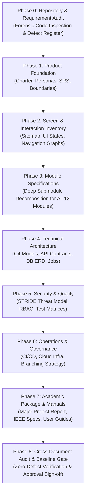

# Document ID: DOC-GOV-004
# Documentation Roadmap & Multi-Phase Execution Plan

> **Document Version:** 1.0.0  
> **Classification:** Project Engineering Blueprint  
> **Status:** APPROVED  
> **Authoring Lead:** Principal Software Architect & Product Manager  
> **Target Timeline:** October 2026  
> **Execution Strategy:** Strict Phase-Gated Quality Lifecycle  

---

## 1. Executive Strategy & Phased Lifecycle Overview

To deliver an industry-grade, implementation-ready engineering specification that serves both a **University Major Project** and a **commercial EdTech/HRTech startup**, the documentation must avoid superficial summaries. It must follow a disciplined, phased execution lifecycle where each phase produces verified, traceable deliverables governed by explicit quality gates.

---

## 2. Work Breakdown Structure (WBS) & Deliverables by Phase

### Phase 0: Repository & Requirement Audit (STATUS: COMPLETED)
- **Objective:** Forensic inspection of repository structure, active dependencies, routes, schema, defects, and configuration.
- **Deliverables:**
  1. `docs/README.md`: Master documentation hub, directory structure, and document register.
  2. `docs/00-governance/01-repository-audit-report.md`: Forensic audit report, functionality matrix, and 10 critical defect findings.
  3. `docs/00-governance/02-decision-and-assumptions-register.md`: Authoritative decision register, assumptions log, and release scope boundaries.
  4. `docs/00-governance/03-documentation-execution-plan.md`: Multi-phase roadmap and quality gates.
- **Quality Gate:** Confirmed zero source code modification; 100% of existing routes and Prisma models cataloged.

---

### Phase 1: Product Foundation & Core Requirements (STATUS: IN PROGRESS)
- **Objective:** Establish the product vision, market rationale, stakeholder personas, glossary, and formal System Requirements Specification (SRS).
- **Target Deliverables under `docs/01-project-charter/` & `docs/02-product-requirements/` & `docs/03-personas-and-user-journeys/`:**
  1. `docs/01-project-charter/01-project-charter.md`: Problem statement, startup vision, institutional value proposition, success metrics (KPIs).
  2. `docs/02-product-requirements/01-system-requirements-specification.md`: Numbered functional requirements (`REQ-FND`, `REQ-COL`, `REQ-DISC`, `REQ-CONN`, `REQ-LIFE`, `REQ-CHAT`, `REQ-CALL`, `REQ-MENT`, `REQ-OPP`, `REQ-POST`, `REQ-LEAD`, `REQ-MOD`, `REQ-AUTH`, `REQ-RBAC`).
  3. `docs/02-product-requirements/02-non-functional-requirements.md`: Performance, reliability, availability, security, and scalability benchmarks.
  4. `docs/03-personas-and-user-journeys/01-user-personas.md`: Primary personas (Undergraduate Student, Senior Jobseeker, Alumni Mentor, Institution Reviewer, System Admin).
  5. `docs/03-personas-and-user-journeys/02-end-to-end-user-journeys.md`: Granular step-by-step user journeys including alternate and failure flows.
- **Quality Gate:** Every requirement assigned a unique, stable ID; clear differentiation between verified requirements and proposed enhancements.

---

### Phase 2: Screen & Interaction Specifications
- **Objective:** Document every screen, viewport, modal, and interactive element across the entire frontend application.
- **Target Deliverables under `docs/04-information-architecture/` & `docs/05-screen-and-interaction-specifications/`:**
  1. `docs/04-information-architecture/01-sitemap-and-taxonomies.md`: Comprehensive sitemap and role-based route hierarchies.
  2. `docs/04-information-architecture/02-navigation-graph-and-state-machines.md`: Mermaid state machines (Connection lifecycle, 2-minute chat countdown, WebRTC call state, Mentorship booking, Account verification).
  3. `docs/05-screen-and-interaction-specifications/01-screen-inventory.md`: Complete screen catalog with responsive behavior and layout hierarchies.
  4. `docs/05-screen-and-interaction-specifications/02-interactive-elements-specification.md`: Element-by-element behavior specifications (buttons, inputs, dropdowns, modals, uploads).
- **Quality Gate:** Zero "decorative" elements undocumented; every interactive trigger maps to an immediate UI response, validation rule, API call, or local state change.

---

### Phase 3: Module Specifications (Deep Decomposition)
- **Objective:** Exhaustive architectural specification of every functional module and submodule in the platform.
- **Target Deliverables under `docs/07-module-specifications/`:**
  1. `01-module-institutional-governance.md`: College hierarchies, state/district catalogs, college addition request queue, campus/department entities.
  2. `02-module-discovery-and-matching.md`: Same-college prioritized discovery, cross-college exploration, domain and skill gap filtering.
  3. `03-module-connection-and-networking.md`: Request sending, withdrawal, acceptance, rejection, blocking, connection state synchronizer.
  4. `04-module-messaging-and-calls.md`: Socket.IO messaging, 2-minute trial countdown server enforcement, WebRTC audio/video call signaling.
  5. `05-module-mentorship-marketplace.md`: Mentor availability, session booking, goal setting, post-session notes, and rating reviews.
  6. `06-module-opportunities-and-referrals.md`: Job/internship postings, skill-matching radar, applicant management, alumni referral requests.
  7. `07-module-social-feed-and-files.md`: Feed publication, PDF certificate viewer, likes, comments, shares, media storage pipeline.
  8. `08-module-alumni-lifecycle-and-verification.md`: Graduation review triggers, document upload, OCR verification, registrar review workflow.
  9. `09-module-gamification-and-leaderboard.md`: Engagement scoring algorithm, reputation tiers, anti-gaming safeguards.
  10. `10-module-moderation-and-safety.md`: Reporting queue, abuse threshold triggers, automated throttling, admin ban execution.
- **Quality Gate:** Every module defines exact inputs, outputs, data dependencies, business rules, error codes, and acceptance criteria.

---

### Phase 4: Technical Architecture & System Engineering
- **Objective:** Document the underlying software architecture, backend service contracts, database physical design, and API contracts.
- **Target Deliverables under `docs/06-system-architecture/`, `docs/08-authentication-and-authorization/`, `docs/09-api-contracts/`, `docs/10-database-and-data-dictionary/`, `docs/12-external-integrations/`, `docs/13-background-jobs-and-events/`:**
  1. `docs/06-system-architecture/01-high-level-architecture.md`: C4 Context, Container, and Component diagrams; request lifecycles.
  2. `docs/08-authentication-and-authorization/01-identity-and-access-architecture.md`: JWT rotation, refresh token invalidation, RBAC/ABAC permission matrix.
  3. `docs/09-api-contracts/01-rest-api-catalog.md` & `openapi.yaml`: Complete endpoint inventory, request/response schemas, validation rules.
  4. `docs/09-api-contracts/02-socket-io-event-contracts.md`: Real-time WebSocket event catalog (payloads, acknowledgements, error handling).
  5. `docs/10-database-and-data-dictionary/01-relational-schema-and-erd.md`: Logical/Physical ERD, 35+ table data dictionary, indexing, foreign keys.
  6. `docs/12-external-integrations/01-external-services-architecture.md`: Google OAuth, Resend Email, LinkedIn Profile Sync, Coturn STUN/TURN.
  7. `docs/13-background-jobs-and-events/01-background-jobs-and-cron.md`: Asynchronous task queue, transactional outbox, scheduled cron workers.
- **Quality Gate:** Complete parity between database models, service method signatures, and API response shapes.

---

### Phase 5: Security, Threat Modeling & Quality Assurance
- **Objective:** Harden the platform with an authoritative threat model, security controls, and traceable test engineering plans.
- **Target Deliverables under `docs/11-security-and-privacy/` & `docs/14-testing-and-quality/`:**
  1. `docs/11-security-and-privacy/01-stride-threat-model.md`: Detailed STRIDE analysis across all trust boundaries with concrete mitigations.
  2. `docs/11-security-and-privacy/02-data-privacy-and-compliance.md`: PII classification, data retention, account deletion, encryption at rest/transit.
  3. `docs/14-testing-and-quality/01-quality-assurance-and-test-strategy.md`: Unit, integration, E2E, security, and load testing frameworks.
  4. `docs/14-testing-and-quality/02-test-case-catalog.md`: Traceable test cases mapped to acceptance criteria.
- **Quality Gate:** 100% of critical defects identified in Phase 0 possess formal threat mitigations and test scenarios.

---

### Phase 6: Operations, DevOps & Release Governance
- **Objective:** Define production cloud deployment, CI/CD automation, branching strategy, and operational monitoring.
- **Target Deliverables under `docs/15-deployment-and-operations/`, `docs/16-accessibility-and-ui-standards/`, `docs/17-release-and-branch-strategy/`:**
  1. `docs/15-deployment-and-operations/01-devops-and-cloud-infrastructure.md`: Docker multi-stage builds, docker-compose, Kubernetes specs, S3 storage.
  2. `docs/15-deployment-and-operations/02-monitoring-logging-and-slas.md`: Prometheus/Grafana metrics, Winston logging, health probes, uptime SLAs.
  3. `docs/16-accessibility-and-ui-standards/01-ui-design-tokens-and-a11y.md`: WCAG 2.1 AA compliance, DaisyUI color tokens, responsive breakpoints.
  4. `docs/17-release-and-branch-strategy/01-branching-and-release-lifecycle.md`: Git Flow, Conventional Commits, Semantic Versioning, PR quality gates.
- **Quality Gate:** Complete deployment instructions allowing another engineer to containerize and spin up the environment with zero guesswork.

---

### Phase 7: Academic Major Project Submission & User Manuals
- **Objective:** Produce the academic project thesis documentation and operational operating manuals.
- **Target Deliverables under `docs/18-user-and-admin-manuals/` & `docs/19-college-submission/`:**
  1. `docs/18-user-and-admin-manuals/01-student-and-alumni-user-guide.md`: Illustrated step-by-step end-user guide.
  2. `docs/18-user-and-admin-manuals/02-platform-administrator-manual.md`: Administrative operational handbook for moderation and college verification.
  3. `docs/19-college-submission/01-major-project-report.md`: IEEE-style formal academic project report (Abstract, Introduction, Existing System Limitations, Proposed System Architecture, DFDs, Use-Case Diagrams, Test Results, Future Scope, References).
- **Quality Gate:** Comprehensive academic rigor adhering to standard University engineering evaluation rubrics.

---

### Phase 8: Traceability Matrix & Baseline Sign-Off Gate
- **Objective:** Final verification pass checking cross-document references, requirement coverage, and formal baseline sign-off.
- **Target Deliverables under `docs/20-traceability-and-appendices/`:**
  1. `docs/20-traceability-and-appendices/01-master-traceability-matrix.md`: End-to-end mapping: `REQ` -> `MOD` -> `SCR` -> `INT` -> `API` -> `DB` -> `SEC` -> `TEST`.
  2. `docs/20-traceability-and-appendices/02-compliance-and-consistency-audit.md`: Verification audit report certifying zero orphan entities, broken links, or contradictory business rules.
- **Quality Gate:** Formal sign-off readiness. Zero implementation coding begins until this baseline is approved by the Product Owner.

---

## 3. Immediate Next Execution Tasks

Following approval of this governance baseline, execution immediately proceeds to:
1. **Deliver Phase 1 Package:**
   - `docs/01-project-charter/01-project-charter.md`
   - `docs/02-product-requirements/01-system-requirements-specification.md`
   - `docs/02-product-requirements/02-non-functional-requirements.md`
   - `docs/03-personas-and-user-journeys/01-user-personas.md`
   - `docs/03-personas-and-user-journeys/02-end-to-end-user-journeys.md`
