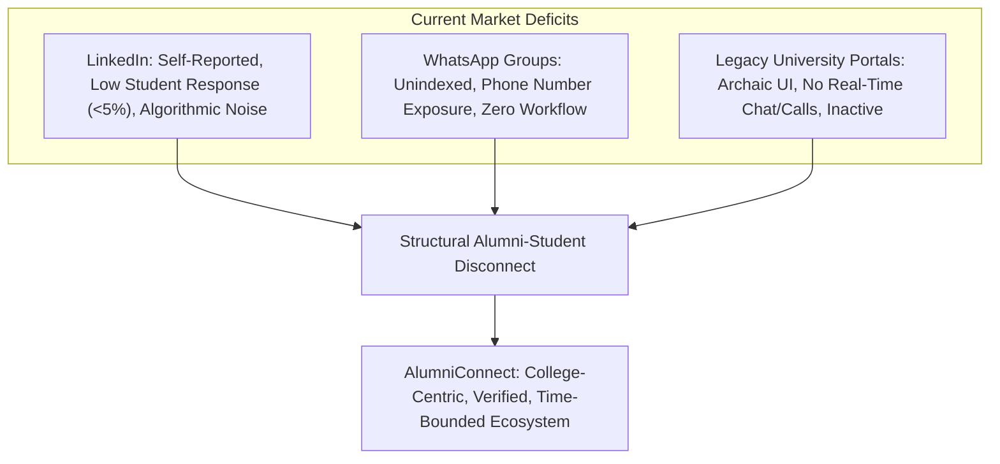
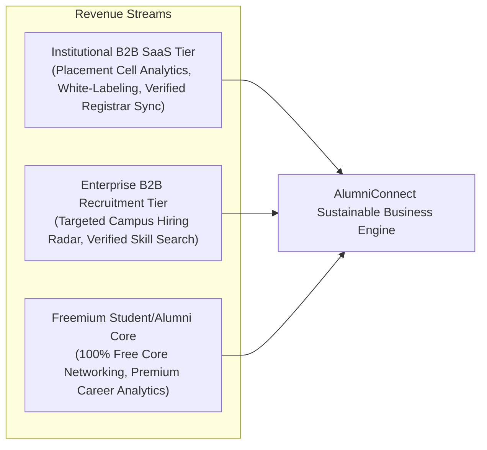

# Document ID: DOC-CHA-001
# Project Charter & Strategic Product Vision

> **Document Version:** 1.0.0  
> **Classification:** Product Strategy & Project Charter  
> **Status:** APPROVED  
> **Authoring Lead:** Startup Product Strategist & Principal Software Architect  
> **Review Date:** October 2026  
> **Target Scope:** Academic Major Project & Scalable Commercial Startup Baseline  

---

## 1. Executive Summary & Problem Statement

### 1.1 The Problem
In modern higher education, professional networking is critical for internship placement, career mentorship, skill development, and employment opportunities. However, existing networking channels suffer from structural failure modes:

1. **The "LinkedIn Paradox" for Students:**
   - On generic platforms such as LinkedIn, university identity is completely self-reported and unverified.
   - Cold outreach from students to senior alumni is overwhelmed by algorithmic noise, recruiter spam, and commercial sales pitches, resulting in response rates under 5%.
   - Students lack institutional context: they do not know which alumni genuinely care about giving back to their specific alma mater or which alumni have active referral bandwidth.

2. **The "WhatsApp / Telegram Silo" Deficit:**
   - Ad-hoc college WhatsApp groups and Telegram channels are transient, chaotic, unindexed, and limited by participant caps.
   - They lack privacy controls (exposing personal phone numbers), offer zero structured mentorship workflows, and decay rapidly after seniors graduate.

3. **The "Traditional University Portal" Stagnation:**
   - Legacy university alumni portals (often built decades ago) feature archaic, desktop-only user interfaces, static database directories, zero real-time interaction capabilities (no instant messaging or WebRTC calls), and virtually zero student engagement.

---

## 2. The Proposed Solution: AlumniConnect

**AlumniConnect** is a college-centric professional networking and career development ecosystem engineered specifically for higher education institutions. The platform is designed around four foundational pillars:

1. **Institutional Boundary & Verified Identity:**
   - Every university and college is a canonical, verified institutional entity.
   - Users are anchored to their verified college ID, distinguishing enrolled students from verified graduates, preventing fake profiles, predatory recruiters, and institutional impersonation.

2. **Alma Mater-First Discovery Engine:**
   - The default discovery experience isolates and prioritizes eligible peers and alumni belonging exclusively to the user's institution.
   - Cross-college exploration is treated as an explicit, intentional opt-in experience, preserving institutional community warmth.

3. **Time-Bounded, Safe Networking:**
   - To eliminate predatory spam while allowing students to introduce themselves, unconnected users operate under a **server-enforced 2-minute introductory chat window**.
   - Meaningful long-term communication and WebRTC audio/video calls require mutual connection acceptance.

4. **Structured Career Acceleration Workflows:**
   - Beyond casual posting, the platform natively facilitates formal **Mentorship Sessions** (with goal tracking and ratings), **Alumni Referrals**, and **Academic Achievement Showcases** with inline PDF previewing for certificates and research papers.

---

## 3. Product Vision & Value Proposition

### 3.1 Vision Statement
> *"To bridge the multi-generational gap between higher education students and industry-leading alumni by creating a trusted, institution-anchored ecosystem that turns college identity into lifelong career capital."*

### 3.2 Value Proposition Matrix

| Stakeholder Group | Core Value Delivered | High-Impact Features |
| :--- | :--- | :--- |
| **Current Students** | Authentic, high-response access to seniors and alumni from their exact department, branch, and college who have successfully entered industry. | Same-College Discovery, 2-Minute Warm Outreach, Skill-Matched Opportunities, Verified Referral Requests, WebRTC Mentorship Calls. |
| **Graduated Alumni** | A clean, focused way to give back to their alma mater without being inundated with generic stranger spam; ability to recruit verified talent from their home college. | Availability Toggle, Max Mentee Caps, Structured 1-on-1 Sessions, Dedicated Job/Internship Posting with Skill Filtering, Alumni Spotlight Leaderboard. |
| **College Administration & Placement Cells** | Real-time visibility into alumni career progression, employment outcomes, and institutional networking health for accreditation (NAAC, NIRF, ABET). | Administrative Analytics, Institutional Addition Review Queue, Enrollment Verification Portal, Student-to-Alumni Transition Tracking. |

---

## 4. Startup Business Model & Monetization Strategy

While functioning as an academic Major Project, AlumniConnect is architected with a sustainable commercialization pathway as a B2B2C SaaS startup:

1. **Tier 1: B2B Institutional SaaS (Colleges & Universities):**
   - Annual licensing fee charged to university career centers and placement cells.
   - Delivers automated alumni outcome tracking, accreditation compliance reports (NAAC/NIRF metrics), verified registrar roster syncing, and custom college branding.
2. **Tier 2: Enterprise B2B Campus Recruitment:**
   - Corporate recruiters pay for access to verified campus talent pipelines, posting sponsored opportunities directly to specific colleges with zero fake applicant profiles.
3. **Tier 3: Core Community Access (100% Free for Students & Alumni):**
   - Core discovery, messaging, calling, and connection features remain completely free to maximize student adoption and institutional network effects.

---

## 5. Strategic Objectives & Success Metrics (KPIs)

The platform's operational success is measured across four engineering and product dimensions:

| Category | Key Performance Indicator (KPI) | 6-Month MVP Target | 18-Month Startup Target |
| :--- | :--- | :---: | :---: |
| **Adoption & Growth** | Registered & Verified Student Accounts | 2,500 students | 50,000 students |
| | Verified Alumni Onboarding Rate | 500 alumni | 10,000 alumni |
| | Participating Academic Institutions | 5 pilot institutions | 50 institutions |
| **Engagement** | Same-College Outreach Response Rate | > 45% (vs <5% LinkedIn) | > 50% |
| | Active Connections Formed per User | 12 connections | 25 connections |
| | Monthly Active Users (MAU / WAU) | > 60% active weekly | > 65% active weekly |
| **Career Impact** | Verified Mentorship Sessions Completed | 250 sessions | 5,000 sessions |
| | Referral Requests Submitted & Actioned | 100 requests | 2,500 requests |
| **System Reliability** | API Latency (p95) | < 150 ms | < 100 ms |
| | Real-Time Message Delivery Latency | < 50 ms (via Socket.IO) | < 30 ms |
| | Platform Uptime Availability | 99.9% | 99.95% |

---

## 6. Project Governance & Stakeholder Matrix

| Stakeholder Role | Responsibilities | Key Deliverables |
| :--- | :--- | :--- |
| **Principal Software Architect** | Technical feasibility, architecture governance, C4 models, security architecture. | System Architecture, Tech Stack Decisions, Code Reviews. |
| **Product Manager** | Scope boundaries, roadmap prioritization, user requirements, KPI tracking. | SRS, PRDs, Roadmap, Release Planning. |
| **Senior Business Analyst** | Requirements capture, traceability matrix, business rules, acceptance criteria. | Use Cases, Process Workflows, Decision Register. |
| **UX Architect** | Information architecture, user journeys, accessibility standards, design system. | Sitemap, Interaction Specs, Design Tokens. |
| **Backend & Database Architects** | API contracts, relational data models, transactions, realtime gateways. | OpenAPI Specs, Prisma Schemas, Service Contracts. |
| **Security & Privacy Engineers** | STRIDE threat model, OWASP mitigations, auth tokens, privacy compliance. | Threat Model, Security Testing Guidelines, RBAC Matrix. |
| **QA & DevOps Engineers** | Test automation, CI/CD pipelines, containerization, cloud infrastructure. | Automated Test Suites, Docker/K8s Specs, Runbooks. |
| **Academic Guide / College Evaluator** | Project syllabus alignment, thesis defense evaluation, viva voce compliance. | Major Project Report, IEEE Documentation, Academic Review. |
