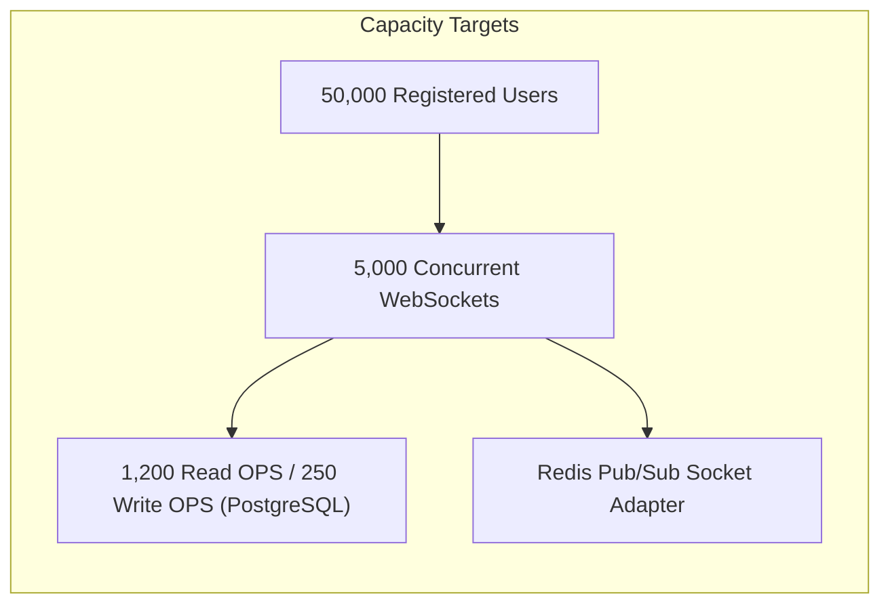

# Document ID: DOC-REQ-002
# Non-Functional Requirements (NFR) Specification

> **Document Version:** 1.0.0  
> **Classification:** Engineering Quality Standards  
> **Status:** APPROVED  
> **Authoring Lead:** Principal Software Architect & QA Architect  
> **Review Date:** October 2026  
> **Target System:** AlumniConnect Platform Specification Baseline  

---

## 1. Performance & Latency Requirements (`NFR-PERF`)

| Identifier | Metric / Dimension | Specification Standard | Measurement & Verification Method |
| :--- | :--- | :--- | :--- |
| **NFR-PERF-001** | **API Response Time (Read Operations)** | 95th percentile (p95) latency $\le 150 \text{ ms}$ for standard queries (profile fetch, discovery lists, notifications). | Measured via Prometheus HTTP histogram metrics and k6 load testing under 1,000 concurrent virtual users. |
| **NFR-PERF-002** | **API Response Time (Write Operations)** | 95th percentile (p95) latency $\le 250 \text{ ms}$ for transactional writes (signup, post creation, connection response). | Monitored via Express server middleware telemetry; database transaction profiling. |
| **NFR-PERF-003** | **Real-Time Message Latency** | One-way transit latency $\le 50 \text{ ms}$ from client emission to recipient socket delivery over domestic broadband/4G. | Measured via end-to-end timestamp delta injection in Socket.IO automated probe test. |
| **NFR-PERF-004** | **WebRTC Call Signaling Setup Time** | Call state transition from `RINGING` to `ACTIVE` (ICE negotiation complete) $\le 2000 \text{ ms}$. | WebRTC stats probe tracking `iceConnectionState: 'connected'`. |
| **NFR-PERF-005** | **Frontend Core Web Vitals** | - Largest Contentful Paint (LCP) $\le 2.0 \text{ s}$ - First Input Delay (FID) / INP $\le 100 \text{ ms}$ - Cumulative Layout Shift (CLS) $\le 0.05$ | Evaluated using Google Lighthouse and Chrome DevTools telemetry on 4G emulation. |
| **NFR-PERF-006** | **Static Asset Delivery** | Initial single-page application JavaScript bundle $\le 350 \text{ KB}$ gzipped. Code-split routes loaded on demand. | Monitored via Vite build bundle analyzer in CI quality pipeline. |

---

## 2. Scalability & Capacity Requirements (`NFR-SCAL`)

| Identifier | Metric / Target | Operational Rule |
| :--- | :--- | :--- |
| **NFR-SCAL-001** | **Concurrent WebSocket Connections** | The real-time cluster must support $\ge 5,000$ simultaneous active Socket.IO connections without degradation or memory leak. |
| **NFR-SCAL-002** | **Database Connection Pooling** | PostgreSQL connection pool managed via Prisma with maximum 50 pooled connections per backend container instance. |
| **NFR-SCAL-003** | **Horizontal Service Scaling** | Stateless backend container design enabling dynamic horizontal pod scaling (HPA) from 2 to 10 instances based on CPU ($>70\%$) or active socket count. |
| **NFR-SCAL-004** | **Pagination & Result Capping** | All list endpoints (`/posts`, `/users/same-college`, `/notifications`, `/opportunities`) must enforce pagination with default limit = 20, max limit = 50. Unlimited full-table scans are strictly prohibited. |

---

## 3. Reliability, Availability & Disaster Recovery (`NFR-REL`)

| Identifier | Dimension | Target SLA & Recovery Objective |
| :--- | :--- | :--- |
| **NFR-REL-001** | **Platform Availability (Uptime)** | $\ge 99.9\%$ uptime measured on a monthly basis (excluding scheduled maintenance windows $\le 2$ hours/month during off-peak hours). |
| **NFR-REL-002** | **Recovery Point Objective (RPO)** | $\text{RPO} \le 1 \text{ hour}$. Automated automated incremental PostgreSQL WAL backups pushed to secure cloud object storage. |
| **NFR-REL-003** | **Recovery Time Objective (RTO)** | $\text{RTO} \le 2 \text{ hours}$ in the event of total datacenter / container host outage. Infrastructure defined fully as code (IaC) via Docker/Terraform. |
| **NFR-REL-004** | **Graceful Service Degradation** | If real-time Socket.IO gateway becomes unreachable, the client frontend must gracefully fall back to HTTP polling for messages and notifications. |
| **NFR-REL-005** | **Zero-Downtime Deployments** | Production upgrades execute via rolling container updates with Kubernetes/Docker health checks ensuring traffic switchover only after `/api/health` succeeds. |

---

## 4. Security & Cryptographic Standards (`NFR-SEC`)

| Identifier | Security Control | Standard Specification |
| :--- | :--- | :--- |
| **NFR-SEC-001** | **Transport Encryption** | All external communication strictly enforced over **TLS 1.3** (HTTPS) and Secure WebSockets (**WSS**). HSTS header enforced with `max-age=31536000; includeSubDomains`. |
| **NFR-SEC-002** | **Password Hashing** | User passwords hashed using `bcrypt` with a minimum work factor (salt rounds) of **12** (upgraded from prototype round 10). |
| **NFR-SEC-003** | **Token Storage & Lifetime** | - Access Token: JWT signed with HMAC-SHA256, lifetime = **15 minutes**. - Refresh Token: Opaque cryptographically random token, stored hashed (SHA-256) in DB, transmitted strictly via **HttpOnly, Secure, SameSite=Strict** cookies with lifetime = **7 days**. |
| **NFR-SEC-004** | **Data at Rest Encryption** | Relational database volume encrypted using AES-256. Chat message bodies encrypted at rest using column-level AES-256-GCM. |
| **NFR-SEC-005** | **OWASP Top 10 Defenses** | - Injection: Prisma parameterized queries prevent SQL injection. - XSS: React DOM auto-escaping + strict CSP headers via Helmet. - CSRF: SameSite cookie policy + Origin header verification on mutations. - Rate Limiting: 5 attempts/15 min on auth routes; 100 requests/15 min on general APIs. |
| **NFR-SEC-006** | **Anti-Enumeration Responses** | Login and password reset endpoints return identical generic error messages (*"If an account exists with this email, instructions have been sent"*) to prevent user enumeration attacks. |

---

## 5. Privacy, Compliance & Data Governance (`NFR-PRIV`)

| Identifier | Governance Mandate | Concrete Operational Rule |
| :--- | :--- | :--- |
| **NFR-PRIV-001** | **PII Minimization** | Student mobile numbers and government/institutional identity card images are classified as **Confidential PII**. They must never be exposed over public profile APIs. |
| **NFR-PRIV-002** | **Right to Erasure (Account Deletion)** | Invoking account deletion permanently invalidates all active sessions, cascades deletes to personal profile details, and anonymizes historical post authorship to *"Deleted User"* to preserve community thread integrity. |
| **NFR-PRIV-003** | **Identity Document Retention** | Uploaded student/alumni verification documents (ID cards, marksheets) are retained in private storage for **30 days** post-approval for audit compliance, after which binary files are permanently purged. |
| **NFR-PRIV-004** | **Explicit External Integration Consent** | Connecting an external account (Google OAuth, LinkedIn) requires unambiguous user opt-in detailing exactly what profile attributes are synchronized. Scraping is strictly prohibited. |

---

## 6. Accessibility, Usability & UI Standards (`NFR-A11Y`)

| Identifier | Accessibility Standard | Implementation Requirement |
| :--- | :--- | :--- |
| **NFR-A11Y-001** | **WCAG 2.1 Level AA Compliance** | All web pages and UI components must achieve WCAG 2.1 Level AA contrast ratios ($\ge 4.5:1$ for normal text, $\ge 3:1$ for large text and interactive components). |
| **NFR-A11Y-002** | **Keyboard Navigation** | 100% of interactive controls (buttons, links, form inputs, modals, dropdowns) must be reachable and operable using `Tab`, `Enter`, `Space`, and `Esc` keys with visible focus rings. |
| **NFR-A11Y-003** | **Screen Reader Optimization** | Semantic HTML5 structure (`<main>`, `<nav>`, `<header>`, `<article>`), ARIA labels on icon-only buttons (`aria-label="Toggle Theme"`), and live regions for dynamic alerts (`role="status"`). |
| **NFR-A11Y-004** | **Responsive Viewport Support** | Fluid responsive layouts supporting viewport widths from **320px (mobile)** to **2560px (ultra-wide desktop)** with zero horizontal scrollbar clipping. |
| **NFR-A11Y-005** | **Reduced Motion Support** | Honor `prefers-reduced-motion` media query by disabling non-essential CSS and Framer Motion layout transitions for users with vestibular sensitivities. |

---

## 7. Supported Software & Browser Matrix (`NFR-COMPAT`)

| Layer | Environment / Software | Supported Versions | Notes |
| :--- | :--- | :--- | :--- |
| **Desktop Web** | Google Chrome | Version 115+ | Full WebRTC & PDF viewer support. |
| | Mozilla Firefox | Version 115+ | Full WebRTC & PDF viewer support. |
| | Apple Safari | Version 16.4+ | Full WebRTC & PWA support. |
| | Microsoft Edge | Version 115+ | Chromium-aligned. |
| **Mobile Web** | Mobile Safari (iOS) | iOS 16.4+ | Camera/Mic permissions require user gesture. |
| | Chrome for Android | Android 10+ (v115+) | Full WebRTC support. |
| **Server Runtime** | Node.js | v20.x LTS or v22.x LTS | Active Node.js LTS with ES Modules. |
| **Database** | PostgreSQL | Version 15.x or 16.x | Requires standard `pgcrypto` extension for UUIDs. |
