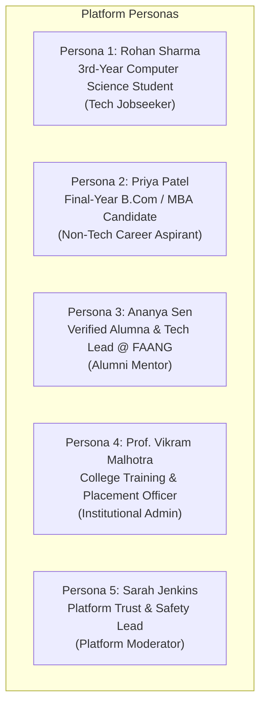

# Document ID: DOC-UX-001
# User Personas & Stakeholder Archetypes

> **Document Version:** 1.0.0  
> **Classification:** User Experience & Product Architecture Baseline  
> **Status:** APPROVED  
> **Authoring Lead:** UX Architect & Senior Business Analyst  
> **Review Date:** October 2026  
> **Target System:** AlumniConnect Platform Specification  

---

## 1. Persona Overview & Archetype Architecture

To ground engineering decisions in authentic user needs and pain points, five primary stakeholder personas have been developed. These personas cover the diverse spectrum of undergraduate students, transitioning seniors, established alumni, university placement officers, and platform security moderators.

---

## 2. Persona 1: Rohan Sharma — The 3rd-Year Undergraduate Tech Jobseeker

### 2.1 Profile & Demographics
- **Age:** 20
- **Academic Role:** Current Student (`role: STUDENT`, `academicStatus: ENROLLED`)
- **Institution:** State Technical Institute of Science & Technology
- **Department:** Computer Science & Engineering (Batch of 2026)
- **Domain:** Tech (`domain: tech`)
- **Devices:** Windows Laptop (Chrome), Android Smartphone (Chrome Mobile)
- **Technical Literacy:** Advanced (Comfortable with GitHub, coding platforms, modern web apps).

### 2.2 Background & Goals
Rohan is preparing for upcoming campus placement season and off-campus tech internships. He has solved 250+ LeetCode problems and built two full-stack projects, but lacks professional network connections. He struggles to get replies on LinkedIn, where cold InMails to senior engineers are ignored.
- **Primary Goals:**
  1. Find alumni from his exact college who currently work at top tech companies.
  2. Send a respectful introductory message and request a 1-on-1 mock interview.
  3. Secure verified employee referrals for summer internships.
- **Key Frustrations:**
  - *"I sent 40 connection requests on LinkedIn to alumni; only 2 accepted, and neither replied to my messages."*
  - Unsure if alumni listed on LinkedIn actually graduated from his college or just took an online certificate.
  - Anxious about spamming seniors; prefers a structured, time-bounded way to introduce himself.

### 2.3 User Story
> *"As a 3rd-year CS student, I want to filter verified alumni from my college by tech stack and company, so that I can send a 2-minute introductory message and book a mock interview session without feeling like an intrusive spammer."*

---

## 3. Persona 2: Priya Patel — The Non-Tech Career Aspirant

### 3.1 Profile & Demographics
- **Age:** 21
- **Academic Role:** Final-Year Student (`role: STUDENT`, `academicStatus: ENROLLED`)
- **Institution:** Apex College of Commerce & Business Studies
- **Department:** Bachelor of Commerce & Finance (Batch of 2025)
- **Domain:** Non-Tech (`domain: non-tech`)
- **Devices:** MacBook Air (Safari), iPhone (Mobile Safari)
- **Technical Literacy:** Intermediate (Daily user of Notion, Canva, Instagram, LinkedIn).

### 3.2 Background & Goals
Priya is seeking entry-level roles in financial analyst and consulting firms. Her college placement cell primarily brings local accounting firms, whereas Priya aspires to join multinational management consultancies.
- **Primary Goals:**
  1. Connect with alumni who transitioned from general commerce into top consulting/finance firms.
  2. Review alumni career journeys to understand necessary certifications (CFA, FRM, Excel modeling).
  3. Explore opportunities outside her immediate college network if her home college has few finance alumni.
- **Key Frustrations:**
  - Tech-dominated networking platforms make non-tech students feel marginalized.
  - Difficulty verifying if an alumnus's career advice is still relevant to current hiring markets.

### 3.3 User Story
> *"As a final-year finance student, I want to browse alumni from other business schools when my college lacks senior finance mentors, so that I can understand the exact certification path needed to break into consulting."*

---

## 4. Persona 3: Ananya Sen — The Verified Alumna & Senior Tech Lead

### 4.1 Profile & Demographics
- **Age:** 28
- **Academic Role:** Verified Alumna (`role: ALUMNI`, `verificationTier: INSTITUTION_VERIFIED`)
- **Institution:** State Technical Institute of Science & Technology (Batch of 2018)
- **Current Position:** Senior Software Engineer / Tech Lead at Google
- **Domain:** Tech (`domain: tech`)
- **Devices:** MacBook Pro, iPhone
- **Technical Literacy:** Expert.

### 4.2 Background & Goals
Ananya remembers how difficult it was to navigate placements without guidance. She genuinely wants to mentor promising students from her alma mater and recruit junior talent, but her time is scarce. On LinkedIn, her inbox is bombarded with generic template messages asking for referrals from strangers.
- **Primary Goals:**
  1. Give back to her college community in a structured, time-controlled manner (e.g. 2 hours on weekends).
  2. Cap active mentees (maximum 3 concurrent mentees) to maintain high mentoring quality.
  3. Post high-quality internship openings directly to her college talent pool and review pre-filtered applicant resumes.
- **Key Frustrations:**
  - Unstructured student outreach on WhatsApp/LinkedIn leads to persistent messaging and boundaries being crossed.
  - Zero platform tools to track student progress across sessions.

### 4.3 User Story
> *"As a senior alumna working in Big Tech, I want to set a hard cap of 3 active mentees and schedule structured video calls, so that I can give meaningful guidance without my inbox becoming overwhelmed with spam."*

---

## 5. Persona 4: Prof. Vikram Malhotra — Training & Placement Officer (TPO)

### 5.1 Profile & Demographics
- **Age:** 52
- **Academic Role:** Institutional Admin / Reviewer (`platformRole: INSTITUTION_ADMIN`)
- **Institution:** State Technical Institute of Science & Technology
- **Devices:** Windows Desktop (Edge/Chrome), Android Tablet
- **Technical Literacy:** Moderate (Proficient with Excel, institutional ERPs, email systems).

### 5.2 Background & Goals
Professor Vikram is responsible for maximizing college placement statistics and gathering alumni data for national accreditation audits (NAAC and NIRF). Currently, alumni data is maintained across fragmented Excel sheets that become outdated within months of graduation.
- **Primary Goals:**
  1. Verify current student enrollment documents and approve newly submitted institution requests.
  2. Monitor aggregated alumni employment outcomes, top recruiting companies, and average package trends.
  3. Broadcast institutional events, annual alumni reunions, and campus placement drives directly to verified alumni.
- **Key Frustrations:**
  - Inability to contact alumni after their personal college email addresses expire.
  - Lack of verified metrics on alumni mentorship activities for accreditation documentation.

### 5.3 User Story
> *"As a college Placement Officer, I want an administrative dashboard to verify graduating student records and monitor alumni employment distribution, so that our institution maintains accurate data for national accreditation audits."*

---

## 6. Persona 5: Sarah Jenkins — Platform Trust & Safety Lead

### 6.1 Profile & Demographics
- **Age:** 34
- **Academic Role:** System Superadministrator (`platformRole: SYSTEM_ADMIN`)
- **Devices:** Dual-Monitor Workstation (Ubuntu / Chrome)
- **Technical Literacy:** Expert (DevOps, database operations, security incident response).

### 6.2 Background & Goals
Sarah is responsible for maintaining the safety, integrity, and regulatory compliance of the platform. She oversees moderation queues, reviews reported accounts, and monitors platform-wide abuse heuristics.
- **Primary Goals:**
  1. Prevent malicious actors from submitting spoofed colleges or uploading fraudulent identity documents.
  2. Investigate user abuse reports (harassment, spam, recruiter scraping) with complete audit trail evidence.
  3. Enforce automated throttling on abusive accounts to protect students from predatory behavior.
- **Key Frustrations:**
  - Platforms that lack immutable audit logs, making it impossible to determine who initiated an abusive call or message.
  - Systems that lack automated circuit-breakers when a bad actor begins spamming multiple users.

### 6.3 User Story
> *"As the platform Trust & Safety lead, I want automated threshold alerts when an account receives 5 user reports, so that the suspect user is immediately restricted from placing calls while our moderation team inspects the evidence."*
