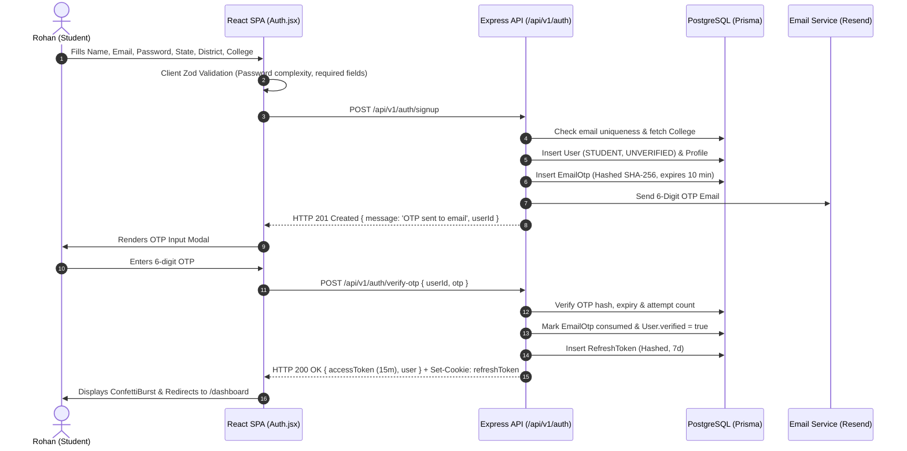

# Document ID: DOC-UX-002
# End-to-End User Journeys & Interaction Workflows

> **Document Version:** 1.0.0  
> **Classification:** Engineering Specification Baseline  
> **Status:** APPROVED  
> **Authoring Lead:** UX Architect & Senior Business Analyst  
> **Review Date:** October 2026  
> **Target System:** AlumniConnect Platform Specification  

---

## 1. Journey Architecture & Specification Template

Every user journey in this document follows an exhaustive, engineering-grade specification format. Each journey documents the happy path, alternate paths, validation failures, backend service responsibilities, database state transitions, security checks, and automated acceptance criteria.

---

## 2. Journey Catalog

### JRN-AUTH-001: Student Registration, Email OTP Verification & College Selection
- **Journey ID:** `JRN-AUTH-001`
- **Goal:** New undergraduate student registers, verifies their institutional email via a 6-digit OTP, selects their college, and accesses the Dashboard.
- **Actor:** Unregistered Student (Rohan Sharma)
- **Preconditions:** User has a valid email address; user is not currently authenticated.
- **Trigger:** Rohan clicks "Sign Up" on the landing page hero section.



#### Step-by-Step Execution:
1. **Screen 1 (`SCR-AUTH-001`):** User lands on `/signup`. Selects State (Madhya Pradesh) -> District (Bhopal) -> College (State Technical Institute). Enters Full Name, Email, and Password.
2. **Frontend Validation:** Form checks password ($\ge 8$ chars, $\ge 1$ digit, $\ge 1$ special symbol). Submit button enables.
3. **API Mutation:** `POST /api/v1/auth/signup` invoked.
4. **Backend Processing:**
   - Auth controller executes `bcrypt.hash(password, 12)`.
   - Generates random 6-digit cryptographic OTP (`crypto.randomInt(100000, 999999)`).
   - Hashes OTP with SHA-256; writes record to `email_otps` table with `expiresAt = now + 10 min`.
   - Dispatches transactional email via Resend API.
5. **Screen 2 (`SCR-AUTH-002`):** Client opens OTP Verification Modal with a 60-second "Resend OTP" countdown timer.
6. **Verification Submission:** User inputs code `849201`. Client invokes `POST /api/v1/auth/verify-otp`.
7. **Session Issuance:** Backend invalidates OTP, updates `users.verified = true`, generates JWT access token (15m), sets HTTP-only `refreshToken` cookie, and returns user profile payload.
8. **Success Outcome:** Client stores access token in Zustand memory (`authStore`), triggers `ConfettiBurst` animation, and navigates to `/dashboard`.

#### Alternate & Failure Paths:
- **Path 1A (Email Already Registered):** Backend catches unique constraint violation on `users.email`. Returns HTTP `409 Conflict` (*"An account with this email already exists"*). Client highlights email field in red with a direct *"Forgot Password?"* link.
- **Path 1B (Invalid or Expired OTP):** User enters incorrect OTP. Backend increments `attempts` counter. If `attempts > 5`, OTP is permanently invalidated and user must request a fresh OTP. Returns HTTP `400 Bad Request` (*"Invalid or expired OTP. 2 attempts remaining"*).
- **Path 1C (Network Failure during Verify):** Client catches Axios network timeout. Displays a toast alert: *"Network connection lost. Your code has not been submitted. Click to retry."*
- **Audit Trail:** Logged in security audit table: `AUTH_SIGNUP_INITIATED`, `AUTH_OTP_VERIFIED` with IP address and user agent.
- **Related Test IDs:** `TEST-AUTH-001`, `TEST-AUTH-002`, `TEST-AUTH-003`.

---

### JRN-COL-001: Missing Institution Addition Request & Admin Review
- **Journey ID:** `JRN-COL-001`
- **Goal:** User cannot find their college in the dropdown, submits an addition request, and an administrator approves it into the canonical college directory.
- **Actor:** Prospective Student & Platform Administrator (Sarah Jenkins)
- **Preconditions:** User is on the College Selection modal; institution does not exist in the database.
- **Trigger:** User clicks *"Can't find your college? Request to add it."*

```mermaid
sequenceDiagram
    autonumber
    actor User as Submitting User
    actor Admin as System Administrator
    participant Client as React SPA
    participant API as Express API
    participant DB as PostgreSQL

    User->>Client: Clicks "Request to add college"
    User->>Client: Enters College Name, State, District, Website, Domain
    Client->>API: POST /api/v1/colleges/requests { name, stateId, districtName, website }
    API->>DB: Insert InstitutionAdditionRequest (status: PENDING_REVIEW)
    API-->>Client: HTTP 201 Created { ticketId, status: 'PENDING_REVIEW' }
    Client->>User: Shows confirmation badge; allows temporary signup
    Note over Admin,API: Later: Admin visits Moderation Dashboard
    Admin->>Client: Navigates to /admin/institutions
    Client->>API: GET /api/v1/admin/colleges/requests?status=PENDING
    API-->>Client: Returns list of pending college requests
    Admin->>Client: Inspects accreditation proof & clicks "Approve"
    Client->>API: POST /api/v1/admin/colleges/requests/:id/approve
    API->>DB: Begin Transaction
    API->>DB: Insert College (canonical colleges table)
    API->>DB: Update InstitutionAdditionRequest (status: APPROVED)
    API->>DB: Update linked users (collegeId = new College.id)
    API->>DB: Commit Transaction
    API-->>Client: HTTP 200 OK { collegeId, name }
    Client->>Admin: Displays green success toast; college now globally searchable
```

#### Step-by-Step Execution:
1. **Screen 1 (`SCR-COL-001`):** In `CollegeSelector`, user selects State: "Maharashtra", District: "Pune". College dropdown is empty.
2. **Action:** User clicks *"Request to add college"*. Modal opens (`MOD-COL-ADD-001`).
3. **Input:** User fills College Name: *"Symbiosis Institute of Advanced Technology"*, Official Website: `https://siat.edu.in`, Email Domain: `@siat.edu.in`.
4. **Backend Processing:** `POST /api/v1/colleges/requests` validates input via Zod. Inserts `InstitutionAdditionRequest` record with `status: PENDING_REVIEW`.
5. **Temporary Affiliation:** User account registration completes with `collegeAffiliationStatus: PENDING_VERIFICATION`.
6. **Screen 2 (`SCR-ADM-002`):** Administrator logs into `/admin/colleges`. Sees pending request with geographic metadata.
7. **Approval Execution:** Admin clicks *"Verify & Approve"*.
8. **Transaction:** Backend executes atomic database transaction:
   - Creates new `College` in `colleges` table.
   - Updates `InstitutionAdditionRequest.status = APPROVED`.
   - Dispatches email notification to original submitter: *"Your college Symbiosis Institute of Advanced Technology has been approved and is now active on AlumniConnect!"*
9. **Acceptance Criteria:** Newly approved college is immediately selectable by any user across the platform without server restart.
- **Related Test IDs:** `TEST-COL-001`, `TEST-COL-002`.

---

### JRN-DISC-001: Isolated Same-College Alumni Discovery & Profile Exploration
- **Journey ID:** `JRN-DISC-001`
- **Goal:** Student discovers verified alumni from their own college, filters by department and tech domain, and inspects an alumnus profile.
- **Actor:** Verified Student (Rohan Sharma)
- **Preconditions:** Rohan is logged in with `collegeId = "col-tech-01"`.
- **Trigger:** Rohan clicks "Directory" in the top navigation bar.

#### Step-by-Step Execution:
1. **Screen 1 (`SCR-DIR-001`):** Navigates to `/directory`. Page renders two distinct tabs: `My Alma Mater (Active)` and `Explore Other Colleges`.
2. **Data Fetching:** Client fires `GET /api/v1/users/same-college?page=1&limit=20`.
3. **Backend Filtering:** Server executes SQL query strictly parameterized with `WHERE college_id = :callerCollegeId AND id != :callerId AND role = 'ALUMNI'`.
4. **UI State:** Renders grid of alumni profile cards. Each card displays: Full Name, Graduation Batch, Current Role, Current Company, Skill Tags, and a connection badge (`Not Connected`).
5. **Filtering Action:** Rohan selects department filter: "Computer Science" and domain filter: "Tech".
6. **Card Click:** Rohan clicks on Ananya Sen's card.
7. **Screen 2 (`SCR-PROF-002`):** Client navigates to `/profile/ananya-sen`. Renders full profile: Verified Alumna Badge, Experience Timeline, Skills, Projects, and Availability Status (*"Open to Mentorship • 1 Slot Available"*).
8. **Available Actions:** Action buttons displayed: `Connect` (Blue Primary), `Send Intro Message (2-Min Trial)` (Secondary), `Request Mentorship` (Outline).
- **Acceptance Criteria:** Under no circumstances does the alumni list show graduates from other colleges while the "My Alma Mater" tab is active.
- **Related Test IDs:** `TEST-DISC-001`, `TEST-DISC-002`.

---

### JRN-CONN-001: Bilateral Connection Request, Acceptance & Permission Unlock
- **Journey ID:** `JRN-CONN-001`
- **Goal:** Student sends a connection request to an alumna; alumna accepts; unlimited messaging and call permissions unlock.
- **Actor:** Student (Rohan) & Alumna (Ananya)
- **Preconditions:** Both users are authenticated; relationship is currently `NONE`.
- **Trigger:** Rohan clicks "Connect" on Ananya's profile.

#### Step-by-Step Execution:
1. **Action:** Rohan clicks `Connect`.
2. **Immediate UI Feedback:** Button transitions to disabled state with spinner: *"Sending..."*.
3. **API Mutation:** Client sends `POST /api/v1/connections/request` with `{ targetUserId: ananya.id }`.
4. **Backend Transaction:**
   - Validates caller and target are not blocked.
   - Inserts record into `connection_requests` with `status: PENDING`.
   - Creates in-app notification in `notifications` table for Ananya.
   - Emits real-time Socket event `notification:new` to room `user:${ananya.id}`.
5. **UI State Update:** Rohan's button changes to an amber pill: `Request Sent` (with option to `Withdraw`).
6. **Recipient Experience (`SCR-DASH-001`):** Ananya logs into AlumniConnect. The Notification bell shows an unread badge counter `(1)`.
7. **Action:** Ananya navigates to Dashboard "Pending Requests" widget. Card displays: Rohan Sharma (3rd-Year CS Student, Same College).
8. **Acceptance:** Ananya clicks `Accept`.
9. **API Mutation:** Client invokes `POST /api/v1/connections/respond` with `{ requestId, action: 'ACCEPT' }`.
10. **Backend Transaction:**
    - Updates `connection_requests.status = ACCEPTED` and sets `respondedAt = now()`.
    - Dispatches notification to Rohan: *"Ananya Sen accepted your connection request."*
    - Emits real-time Socket event `connection:accepted` to Rohan's session.
11. **Permission Unlock:** Both users now have mutual connection state (`CONNECTED`). The 2-minute introductory chat restriction is permanently lifted between these two users; WebRTC audio/video call buttons become enabled.
- **Acceptance Criteria:** Database confirms record status is `ACCEPTED`; subsequent API calls to `/api/v1/messages` execute without trial time limit.
- **Related Test IDs:** `TEST-CONN-001`, `TEST-CONN-002`, `TEST-CONN-003`.

---

### JRN-CHAT-001: Introductory Messaging & 2-Minute Window Server Enforcement Expiry
- **Journey ID:** `JRN-CHAT-001`
- **Goal:** Unconnected student initiates a permitted introductory message, converses within the 2-minute trial window, and encounters strict server-enforced lockout upon expiration.
- **Actor:** Student (Rohan) & Alumnus (Not Connected)
- **Preconditions:** Rohan and Target Alumnus are unconnected (`connectionStatus !== 'ACCEPTED'`).
- **Trigger:** Rohan clicks "Message" on the alumnus profile.

```mermaid
sequenceDiagram
    autonumber
    actor Rohan as Student (Rohan)
    participant Client as React SPA (/messages)
    participant Server as Express Server
    participant DB as PostgreSQL

    Rohan->>Client: Types introductory message & clicks Send
    Client->>Server: POST /api/v1/messages { toUserId, content: "Hello! Quick question..." }
    Server->>DB: Check connection status (false)
    Server->>DB: Query first message timestamp in chat (null)
    Note over Server: First message: Start 120s timer
    Server->>DB: Encrypt AES-256-GCM & insert Message
    Server-->>Client: HTTP 201 Created { message, trialRemainingSeconds: 120 }
    Client->>Rohan: Message rendered; Amber badge shows "Free chat: 120s remaining"
    Note over Rohan,Client: 120 seconds elapse without connection acceptance...
    Rohan->>Client: Types follow-up message & clicks Send (at t = 125s)
    Client->>Server: POST /api/v1/messages { toUserId, content: "Can we talk more?" }
    Server->>DB: Query first message timestamp (t = 125s ago)
    Note over Server: Timer Expired (125s > 120s)! Reject write.
    Server-->>Client: HTTP 403 Forbidden { locked: true, trialRemainingSeconds: 0 }
    Client->>Rohan: Message blocked; UI locks input; renders "2-minute window ended. Send connection request to continue."
```

#### Step-by-Step Execution:
1. **Screen 1 (`SCR-MSG-001`):** Rohan opens `/messages?with=target-user-id`. The header shows: *"Introductory Window • 2 Minutes Free Chat"*.
2. **First Message:** Rohan sends: *"Hi! I saw your work at Amazon and had a quick question regarding backend internship preparation."*
3. **Backend Storage:** Server records first message at `14:00:00`.
4. **Countdown Display:** Client renders countdown pill: `119s... 118s... 117s...`.
5. **Expiration Event:** Clock reaches `14:02:01` (121 seconds elapsed).
6. **Attempted Write:** Rohan sends: *"Also, which projects stand out most?"*.
7. **Server Enforcement:** Backend checks: `Date.now() - firstMessage.createdAt = 121000 ms > 120000 ms`.
8. **Rejection:** Server rejects request with HTTP `403 Forbidden` (`{ error: 'TRIAL_EXPIRED', locked: true, trialRemainingSeconds: 0 }`). Message is NOT written to database.
9. **UI Lockout:** Frontend disables textarea; replaces send button with: *"2-minute introductory window has ended. Send a Connection Request to unlock unlimited messaging."*
- **Acceptance Criteria:** Bypassing frontend UI via Postman/cURL after 120 seconds returns HTTP 403; database retains zero messages sent after the 120-second threshold.
- **Related Test IDs:** `TEST-CHAT-001`, `TEST-CHAT-002`.

---

### JRN-CALL-001: 1-on-1 WebRTC Video Call Initiation, Signaling & Teardown
- **Journey ID:** `JRN-CALL-001`
- **Goal:** Connected users start a bilateral WebRTC video call with real-time Socket.IO signaling, camera permissions, live audio/video streaming, and clean termination.
- **Actor:** Mentee (Rohan) & Mentor (Ananya)
- **Preconditions:** Both users are connected; browser microphone and camera permissions granted.
- **Trigger:** Rohan clicks the "Start Video Call" button in their direct message header.

#### Step-by-Step Execution:
1. **Action:** Rohan clicks `Video Call` icon.
2. **Device Acquisition:** Frontend calls `navigator.mediaDevices.getUserMedia({ video: true, audio: true })`. Local media stream rendered in small preview picture-in-picture window.
3. **API Call:** Client invokes `POST /api/v1/calls` with `{ toUserId: ananya.id, mode: 'VIDEO' }`.
4. **Backend Processing:**
   - Server creates `CallSession` record (`status: RINGING`, `mode: VIDEO`).
   - Server emits `call:incoming` via Socket.IO to room `user:${ananya.id}`.
5. **Recipient Experience (`SCR-CALL-POPUP`):** Full-screen incoming call modal appears on Ananya's screen with synthesized ringing tone: *"Incoming Video Call from Rohan Sharma"*.
6. **Acceptance:** Ananya clicks `Accept`.
7. **Signaling Exchange:**
   - Ananya's client emits `call:accept` via socket. Server updates `CallSession.status = ACTIVE`.
   - Caller creates WebRTC `RTCPeerConnection`, generates SDP Offer, emits `call:signal` (`type: 'offer'`).
   - Recipient receives offer, generates SDP Answer, emits `call:signal` (`type: 'answer'`).
   - Both peers exchange ICE candidates via `call:signal` (`type: 'candidate'`) to establish optimal P2P media stream (or relay through TURN server if behind symmetric NAT).
8. **Active Call State:** Remote video streams render in main view; call timer starts ticking (`00:01... 00:02...`).
9. **Teardown Action:** After 25 minutes, Ananya clicks `End Call` (Red button).
10. **Session Closure:** Client emits `call:end`. Server sets `CallSession.status = ENDED`, calculates `durationSeconds = 1500`, and notifies both peers. Media stream tracks are stopped (`track.stop()`), releasing camera and microphone hardware.
- **Acceptance Criteria:** Camera LED turns off immediately upon call teardown; database records exact call duration.
- **Related Test IDs:** `TEST-CALL-001`, `TEST-CALL-002`, `TEST-CALL-003`.

---

### JRN-MENT-001: Mentorship Booking, Goal Formulation, Session Completion & Survey
- **Journey ID:** `JRN-MENT-001`
- **Goal:** Student books a structured mentorship session with an alumna mentor; establishes goals; completes session; both submit ratings.
- **Actor:** Student (Rohan) & Mentor (Ananya)
- **Preconditions:** Ananya has `openToMentorship: true` and current active mentees $< 3$.
- **Trigger:** Rohan clicks "Book Mentorship" on Ananya's profile.

#### Step-by-Step Execution:
1. **Screen 1 (`SCR-MENT-BOOK-001`):** Booking modal opens. Rohan enters:
   - Topic: *"Resume Review & Mock System Design Interview"*.
   - Goals: (1) Review distributed systems project; (2) Practice behavioral questions.
   - Proposed Date & Time.
2. **Submission:** Invokes `POST /api/v1/mentorship/request`. Record created with `status: PENDING`.
3. **Mentor Review:** Ananya receives notification. Reviews Rohan's profile and goals; clicks `Accept`.
4. **Session Activation:** Mentorship workspace opens (`/mentorship/workspace/:id`). Status transitions to `ACTIVE`.
5. **Shared Notes:** During their video call, Ananya adds shared notes: *"Focus on database sharding and caching tradeoffs in project architecture."* Note syncs in real-time.
6. **Completion:** Session concludes. Ananya clicks `Mark as Completed`.
7. **Survey Trigger:** Modal opens for both users (`SCR-MENT-SURVEY-001`):
   - Rohan rates 5 stars: *"Incredible guidance; identified major gaps in my system design explanations."*
   - Ananya rates 5 stars: *"Well prepared and receptive to feedback."*
8. **Reputation Update:** Ananya's profile updates: `Mentorships Completed: +1`; Engagement score increases on Leaderboard.
- **Acceptance Criteria:** Mentorship cannot be marked complete without prompting for the completion survey; mentor active mentee slot frees up for next student.
- **Related Test IDs:** `TEST-MENT-001`, `TEST-MENT-002`.

---

### JRN-OPP-001: Job/Internship Posting, Skill-Matching & Referral Request
- **Journey ID:** `JRN-OPP-001`
- **Goal:** Alumna posts an internal software engineer internship opening; student receives skill-matched alert and submits referral request with resume PDF.
- **Actor:** Alumna (Ananya) & Student (Rohan)
- **Preconditions:** Ananya is verified alumna; Rohan has updated skills on profile.
- **Trigger:** Ananya clicks "Post Opportunity" in Opportunities Hub.

#### Step-by-Step Execution:
1. **Screen 1 (`SCR-OPP-CREATE-001`):** Ananya fills Opportunity Form:
   - Type: `INTERNSHIP`, Title: *"Software Engineering Intern (Summer 2027)"*, Company: *"Google"*, Location: *"Bangalore / Hybrid"*, Compensation: *"₹1,25,000 / month"*.
   - Skills Required: `["React", "Node.js", "PostgreSQL", "Data Structures"]`.
   - Accepting Referrals: `Yes (Toggle Enabled)`.
2. **Submission:** `POST /api/v1/opportunities` commits record.
3. **Radar Matching:** Background matching algorithm compares Rohan's skills (`["React", "Node.js", "PostgreSQL", "Docker"]`) against requirements. Match Score = **75%**.
4. **Opportunity Radar View (`SCR-OPP-001`):** Rohan opens Opportunities Hub. Opportunity card is highlighted with a green badge: *"75% Skill Match • Referral Available"*.
5. **Referral Application:** Rohan clicks `Request Referral`. Enters cover note highlighting his contributions and selects his uploaded resume PDF.
6. **Review & Status:** Ananya receives application in her dashboard. Inspects resume via inline PDF viewer. Updates status to `REFERRED` with note: *"Submitted internally via Google referral portal; check your email for career portal link."*
7. **Outcome:** Rohan receives real-time notification with referral confirmation.
- **Acceptance Criteria:** Student can track referral status progression: `APPLIED` -> `REVIEWED` -> `REFERRED`.
- **Related Test IDs:** `TEST-OPP-001`, `TEST-OPP-002`.

---

### JRN-POST-001: Multipart Feed Post Creation & Embedded PDF Viewer Preview
- **Journey ID:** `JRN-POST-001`
- **Goal:** Student publishes an academic achievement post attaching a verified certificate in PDF format; viewers interact and read the PDF directly within the feed card.
- **Actor:** Student (Rohan)
- **Preconditions:** Rohan has an active account; has earned a certificate PDF (`aws-cloud-practitioner.pdf`, 1.2MB).
- **Trigger:** Rohan clicks "Share an update or certificate" on Dashboard.

#### Step-by-Step Execution:
1. **Screen 1 (`SCR-POST-MODAL-001`):** Post creation modal opens.
2. **Input:** Post Type: `CERTIFICATE`. Title: *"Cleared AWS Certified Cloud Practitioner Certification!"*. Description: *"Completed 2 months of cloud architecture training."*
3. **File Attachment:** Rohan drags and drops `aws-cloud-practitioner.pdf`.
4. **Upload Pipeline:** Client sends multipart file to `POST /api/v1/upload/pdf`. Server validates MIME type (`application/pdf`) and size ($\le 15\text{MB}$); saves to private storage; returns file metadata and URL.
5. **Post Creation:** Client invokes `POST /api/v1/posts` with `{ title, description, type, fileUrl, fileType: 'pdf' }`.
6. **Feed Card Rendering (`SCR-FEED-CARD-001`):** Feed updates dynamically. Card renders title, description, and an interactive **PDF Document Viewer** component (`PdfDocumentViewer.jsx`).
7. **Interaction:** Viewers can page through the PDF, zoom in/out, and toggle full-screen preview directly on the post card without downloading the raw file.
8. **Social Reactions:** Viewers like and comment: *"Congratulations Rohan!"*. Counters update in real-time.
- **Acceptance Criteria:** PDF renders correctly across desktop and mobile without broken canvas errors; non-PDF uploads to the PDF endpoint are rejected with HTTP 400.
- **Related Test IDs:** `TEST-POST-001`, `TEST-POST-002`.

---

### JRN-LIFE-001: Graduation Review Trigger, Document Proof Upload & Alumni Verification
- **Journey ID:** `JRN-LIFE-001`
- **Goal:** Graduating student reaches their expected graduation month; system initiates graduation review; student uploads degree proof; college reviewer approves; user role upgrades to verified alumnus.
- **Actor:** Graduating Student (Senior) & Institutional Reviewer (Prof. Vikram)
- **Preconditions:** Student profile has `graduationYear: 2026, graduationMonth: 5`.
- **Trigger:** System cron job detects graduation month has elapsed.

#### Step-by-Step Execution:
1. **Cron Trigger:** Scheduled worker `syncGraduationStatuses` runs. Detects `graduationDate <= now()` and `role === 'STUDENT'`.
2. **System State Change:** User's `academicStatus` transitions to `GRADUATION_PENDING_VERIFICATION` (remediates `DEF-02`: user role is NOT auto-promoted).
3. **Notification:** User receives high-priority notification and email: *"Congratulations on completing your degree! Please upload your degree certificate to unlock Verified Alumni status."*
4. **Upload Proof (`SCR-VERIF-001`):** User logs in; banner directs them to `/verification/graduation`. User uploads provisional degree certificate PDF and enters enrollment number.
5. **Review Queue (`SCR-ADM-VERIF-001`):** College Placement Officer (Prof. Vikram) accesses the institutional verification portal. Inspects uploaded certificate against university records.
6. **Approval Execution:** Prof. Vikram clicks `Verify & Promote to Alumni`.
7. **Database Mutation:**
   - User `role` updates to `ALUMNI`.
   - `verificationStatus` updates to `APPROVED`.
   - `VerificationLog` entry created with reviewer ID and timestamp.
8. **User Experience:** Upon next login, user is greeted with alumni onboarding modal, access to alumni-only job posting privileges, and a verified alumni profile badge.
- **Acceptance Criteria:** Student role never changes to `ALUMNI` until reviewer commits approval; audit log records reviewer identity.
- **Related Test IDs:** `TEST-LIFE-001`, `TEST-LIFE-002`.

---

### JRN-MOD-001: Harassment Reporting, Automated Throttling & Admin Suspension
- **Journey ID:** `JRN-MOD-001`
- **Goal:** Student experiences harassment in chat; submits abuse report; system enforces automated throttle upon reaching threshold; admin reviews and permanently bans bad actor.
- **Actor:** Victim Student, Harassing User, Platform Moderator (Sarah)
- **Preconditions:** Both users have active accounts.
- **Trigger:** Harassing user sends abusive messages in direct chat.

#### Step-by-Step Execution:
1. **Reporting Action:** Victim clicks `Report User` in chat settings menu (`SCR-REPORT-MODAL`).
2. **Submission:** Victim selects Category: `HARASSMENT`, enters description: *"Persistent abusive language and unwanted calls"*, and checks *"Include last 5 chat messages as evidence"*.
3. **Backend Processing:** `POST /api/v1/reports` creates `Report` entity (`status: OPEN`).
4. **Automated Circuit-Breaker:** Server checks report tally for target user. Target user now has **5 unique reports** within 14 days.
5. **Automated Throttling Engaged:**
   - Server updates user `accountStanding: RESTRICTED`.
   - Socket connection forcibly drops active call signaling; rejects new call initiation with HTTP `403 Account Restricted`.
   - High-priority alert dispatched to Admin moderation queue.
6. **Admin Triage (`SCR-ADM-MOD-001`):** Moderator Sarah inspects report evidence, confirms persistent violation of community standards, and clicks `Permanently Ban Account`.
7. **Ban Execution:**
   - Backend updates user `isBanned = true`, `accountStanding = BANNED`.
   - Increments `tokenVersion = tokenVersion + 1`, immediately invalidating all outstanding JWT access tokens.
   - Revokes all active refresh tokens in `refresh_tokens` table.
   - Emits socket event `auth:banned` forcing immediate client logout.
8. **Outcome:** Banned user is immediately disconnected; subsequent login attempts return HTTP `403 Forbidden: Account permanently suspended for community violations`.
- **Acceptance Criteria:** Banned user cannot execute any API calls or reconnect WebSocket sessions.
- **Related Test IDs:** `TEST-MOD-001`, `TEST-MOD-002`.

---

### JRN-AUTH-002: Password Reset via Secure Expiring Token
- **Journey ID:** `JRN-AUTH-002`
- **Goal:** User forgets their password; requests reset link; verifies secure token; updates password; all prior sessions are revoked.
- **Actor:** Registered User
- **Preconditions:** User has forgotten their password; has access to registered email.
- **Trigger:** User clicks "Forgot Password?" on login screen.

#### Step-by-Step Execution:
1. **Screen 1 (`SCR-AUTH-FORGOT-001`):** User navigates to `/forgot-password`. Enters registered email: `rohan@student.ac.in`.
2. **API Call:** Client sends `POST /api/v1/auth/forgot-password` with `{ email }`.
3. **Anti-Enumeration Defense:** Regardless of whether the email exists in the database, server returns HTTP `200 OK` with generic message: *"If an account is associated with this email, password reset instructions have been sent."*
4. **Backend Processing:**
   - Generates 32-byte cryptographically secure random token (`crypto.randomBytes(32).toString('hex')`).
   - Hashes token using SHA-256; stores `tokenHash` in `password_reset_tokens` with `expiresAt = now + 15 min`.
   - Dispatches email containing link: `https://alumniconnect.edu/reset-password?token=<raw_token>`.
5. **Screen 2 (`SCR-AUTH-RESET-001`):** User clicks email link. Client loads `/reset-password` and validates token format.
6. **Input:** User enters New Password and Confirms Password.
7. **Submission:** Client sends `POST /api/v1/auth/reset-password` with `{ token, newPassword }`.
8. **Backend Transaction:**
   - Hashes incoming token with SHA-256; matches against unconsumed, unexpired token in database.
   - Hashes `newPassword` using `bcrypt.hash(..., 12)`.
   - Updates `users.passwordHash = newHash`.
   - Marks token `consumedAt = now()`.
   - Increments `users.tokenVersion` and revokes all active refresh tokens in `refresh_tokens` table (forcing all other devices to re-login).
9. **Outcome:** User receives success confirmation and logs in with their new credentials.
- **Acceptance Criteria:** Reusing the reset token a second time fails with HTTP 400; previous active sessions on other devices are immediately terminated.
- **Related Test IDs:** `TEST-AUTH-004`, `TEST-AUTH-005`.
