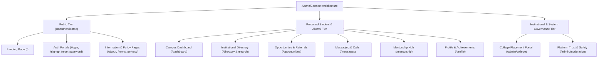

# Document ID: DOC-IA-001
# Information Architecture, Sitemap & Route Taxonomies

> **Document Version:** 1.0.0  
> **Classification:** Information Architecture & UX Engineering  
> **Status:** APPROVED  
> **Authoring Lead:** UX Architect & Frontend Architect  
> **Review Date:** October 2026  
> **Target System:** AlumniConnect Platform Specification  

---

## 1. Information Architecture Overview

AlumniConnect's information architecture is structured around **institutional context**, enabling students and alumni to navigate seamlessly between their home institution network, discovery tools, real-time messaging, career acceleration hubs, and administrative governance.



---

## 2. Complete Sitemap & Route Taxonomy

The following matrix documents every URL route, associated React page component, layout wrapper, required role access level, and navigation guards.

| Route Path | Page Component | Layout Shell | Required Access Level | Route Guard Type | Purpose & Screen Identity |
| :--- | :--- | :--- | :--- | :--- | :--- |
| `/` | `Landing.jsx` | Public Layout | Public (Anonymous) | Guest Only (Redirect to `/dashboard` if logged in) | Public marketing, hero value proposition, trust logos, CTA. |
| `/login` | `Auth.jsx` | Auth Shell | Public (Anonymous) | Guest Only (`AuthGate`) | Local email/password login and Google OAuth entry point. |
| `/signup` | `Auth.jsx` | Auth Shell | Public (Anonymous) | Guest Only (`AuthGate`) | Multi-step registration and geographic college selection. |
| `/forgot-password` | `Auth.jsx` | Auth Shell | Public (Anonymous) | Guest Only | Password reset request form (email dispatch). |
| `/reset-password` | `Auth.jsx` | Auth Shell | Public (Anonymous) | Guest Only (Token required in URL query) | Password update form verifying expiring token. |
| `/about` | `InfoPage.jsx` | Public Layout | Public | None | Institutional mission, founders, university partners. |
| `/privacy` | `InfoPage.jsx` | Public Layout | Public | None | Data privacy policy, PII governance, compliance terms. |
| `/terms` | `InfoPage.jsx` | Public Layout | Public | None | Terms of service, community standards, academic conduct. |
| `/contact` | `InfoPage.jsx` | Public Layout | Public | None | Support contact details and university grievance desk. |
| `/dashboard` | `Dashboard.jsx` | `AppShell.jsx` | Authenticated (Student / Alumni) | `ProtectedRoute` | Primary home feed, post creator, connections, leaderboards. |
| `/directory` | `Search.jsx` | `AppShell.jsx` | Authenticated (Student / Alumni) | `ProtectedRoute` | Alma Mater discovery directory and people recommendations. |
| `/search` | `Search.jsx` | `AppShell.jsx` | Authenticated (Student / Alumni) | `ProtectedRoute` | Alias for Directory with pre-populated search queries. |
| `/opportunities` | `Opportunities.jsx` | `AppShell.jsx` | Authenticated (Student / Alumni) | `ProtectedRoute` | Job radar, internships, hackathons, and referral requests. |
| `/messages` | `Messages.jsx` | `AppShell.jsx` | Authenticated (Student / Alumni) | `ProtectedRoute` | Real-time chat, 2-minute trial gate, WebRTC call controls. |
| `/mentorship` | `Mentorship.jsx` | `AppShell.jsx` | Authenticated (Student / Alumni) | `ProtectedRoute` | Mentorship marketplace, mentor booking, shared notes. |
| `/profile` | `Profile.jsx` | `AppShell.jsx` | Authenticated (Student / Alumni) | `ProtectedRoute` | Current user's full editable profile and settings. |
| `/profile/:userId` | `Profile.jsx` | `AppShell.jsx` | Authenticated (Student / Alumni) | `ProtectedRoute` | Public profile view of other students and alumni. |
| `/admin/college` | `CollegeAdmin.jsx` | `AppShell.jsx` | `INSTITUTION_ADMIN` | `RoleGuard(['INSTITUTION_ADMIN', 'SYSTEM_ADMIN'])` | Placement cell dashboard, student enrollment verification. |
| `/admin/moderation`| `Moderation.jsx` | `AppShell.jsx` | `SYSTEM_ADMIN` | `RoleGuard(['SYSTEM_ADMIN'])` | Platform moderation queue, abuse reports, college approvals. |
| `*` | `Navigate to /` | None | Public | Fallback | Catch-all redirect to landing or dashboard based on auth. |

---

## 3. Structural Layout & Component Shell Hierarchy

The frontend application utilizes a persistent, responsive layout shell (`AppShell.jsx`) wrapping all protected views:

```
AppShell Hierarchy:
├── <CallProvider>                         # WebRTC Call state, incoming call modal, ringing audio
│   ├── <Header (Sticky Top Bar)>
│   │   ├── Brand Logo ("AlumniConnect")   # Navigates to /dashboard
│   │   ├── Navigation Menu (Desktop)      # Dashboard, Directory, Opportunities, Messages, Mentorship, Profile
│   │   ├── Notification Bell (<NotificationBell>) # Unread counter badge, dropdown alert drawer
│   │   ├── Theme Toggle (<ThemeToggle>)   # Light / Dark mode toggle (Tailwind 'dark' class & DaisyUI themes)
│   │   ├── User Summary Pill              # Avatar, Name, College Name
│   │   └── Logout Action Button           # Clears session tokens, terminates WebSocket, navigates to /login
│   ├── <Main Viewport Area>               # Page route component content rendered here
│   └── <Mobile Navigation Bar (Bottom)>   # Bottom navigation bar visible on viewports < 768px
```

---

## 4. Role-Based Viewport & Action Visibility Matrix

The platform enforces strict role-aware rendering on the client while guaranteeing that the server independently authorizes every data mutation:

| Feature / UI Component | Anonymous Guest | Unverified Student | Verified Student | Verified Alumnus | Institution Admin | System Admin |
| :--- | :---: | :---: | :---: | :---: | :---: | :---: |
| **Browse Landing Page** | Yes | Yes | Yes | Yes | Yes | Yes |
| **View Own Dashboard** | No | Yes (Banner) | Yes | Yes | Yes | Yes |
| **View Alma Mater Directory** | No | No (Locked) | Yes | Yes | Yes | Yes |
| **Send Connection Request** | No | No | Yes | Yes | Yes | Yes |
| **Send 2-Minute Intro Message** | No | No | Yes | Yes | Yes | Yes |
| **Start WebRTC Audio/Video Call** | No | No | Connected only | Connected only | Yes | Yes |
| **Post Opportunities (Jobs/Internships)**| No | No | No | Yes | Yes | Yes |
| **Apply for Internal Referral** | No | No | Yes | Yes | No | No |
| **Book Mentorship Session** | No | No | Yes | Yes | No | No |
| **Offer Mentorship & Set Max Mentees** | No | No | No | Yes | No | No |
| **Access College Admin Portal** | No | No | No | No | Yes | Yes |
| **Access Trust & Safety Moderation** | No | No | No | No | No | Yes |
