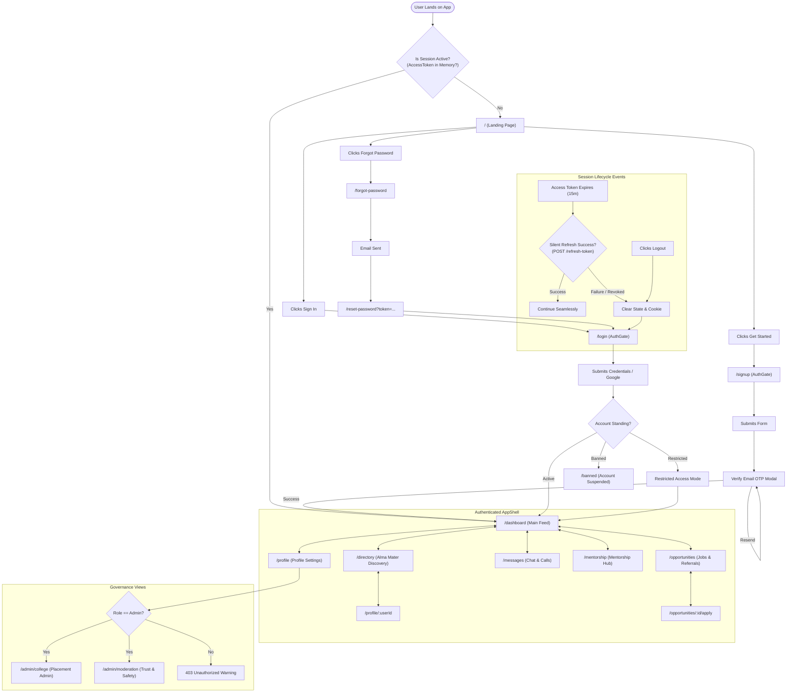
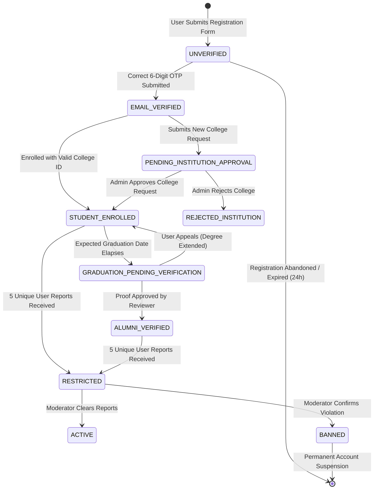
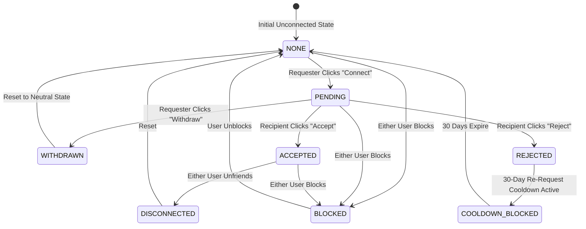
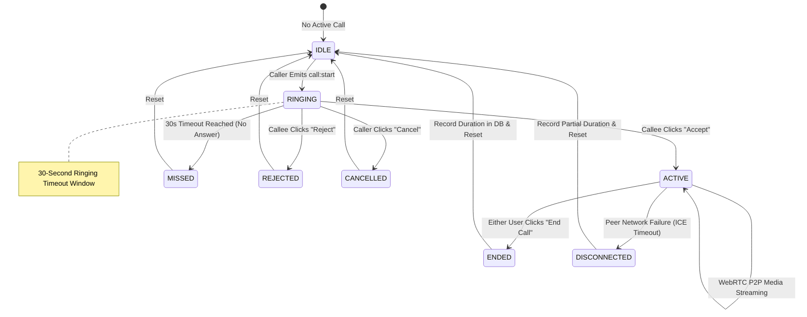
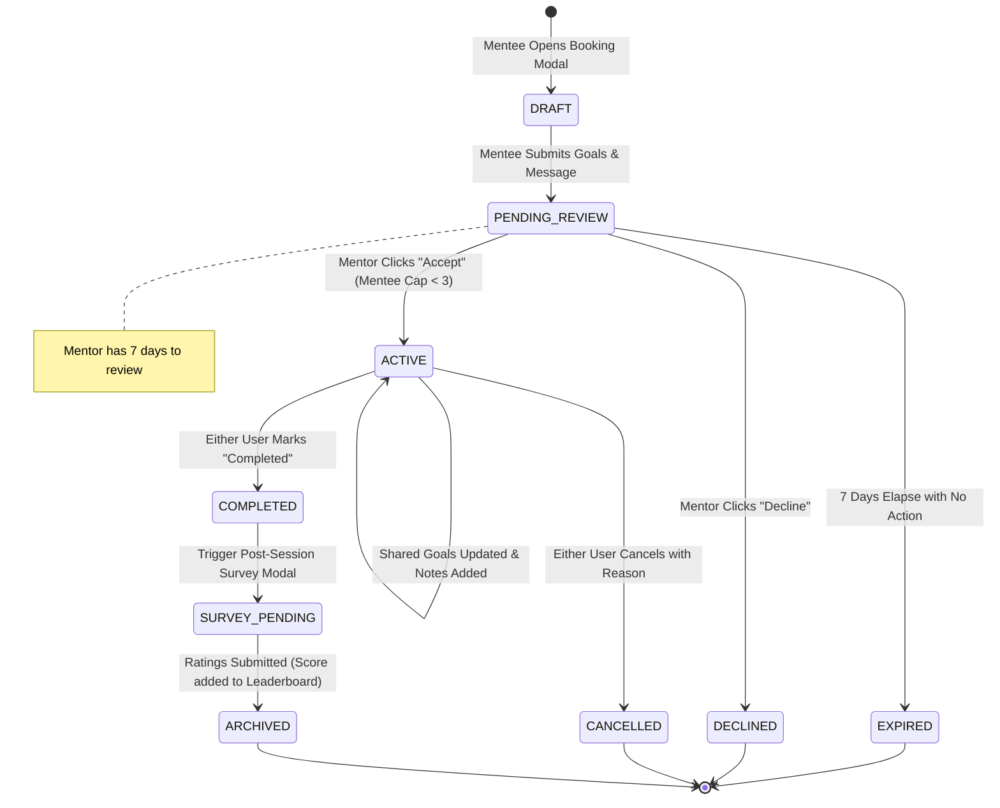
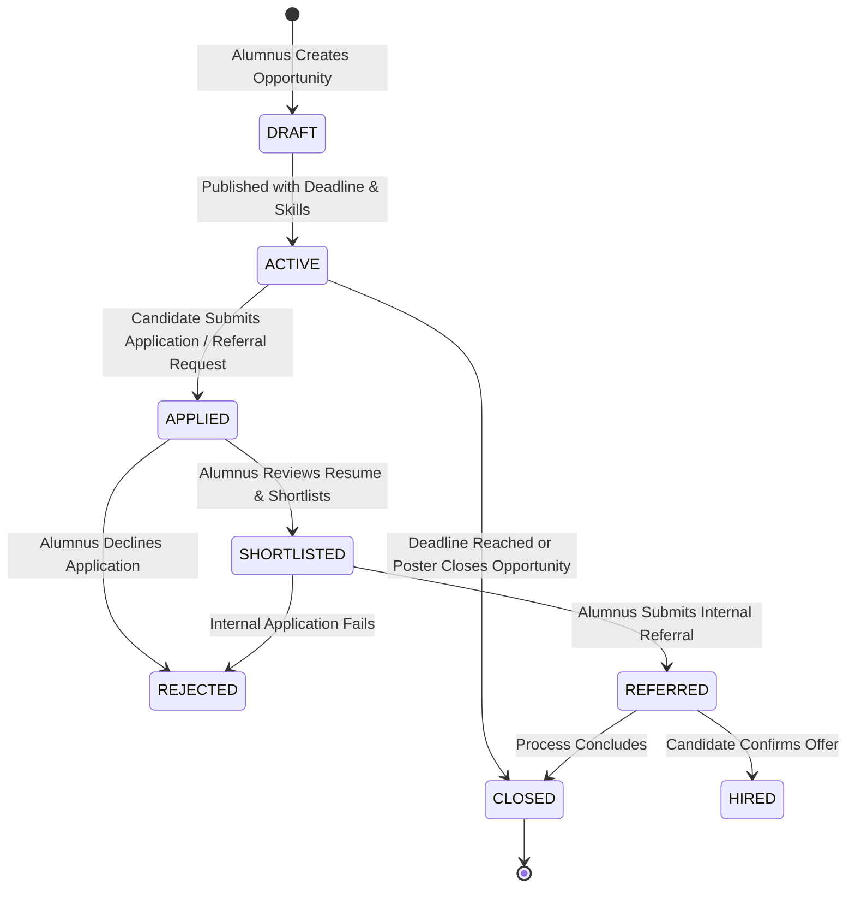

# Document ID: DOC-IA-002
# Navigation Flow Graphs & System State Machines

> **Document Version:** 1.0.0  
> **Classification:** Systems Engineering & Interaction Architecture  
> **Status:** APPROVED  
> **Authoring Lead:** UX Architect & Principal Software Architect  
> **Review Date:** October 2026  
> **Target System:** AlumniConnect Platform Specification  

---

## 1. Master Client Navigation Graph

The flowchart below visualizes all user paths, authentication gates, protected routes, and failure/redirect states across the single-page application.



---

## 2. Formal System State Machines

### 2.1 State Machine 1: Account Standing & Verification Lifecycle
Governs user onboarding, email verification, degree verification, and administrative discipline.



- **Guards & Invariants:**
  - `STUDENT_ENROLLED` cannot transition to `ALUMNI_VERIFIED` without an explicit document approval transaction in `verification_logs`.
  - `BANNED` state forcibly increments `tokenVersion`, invalidating all active JWTs.

---

### 2.2 State Machine 2: Bilateral Connection Request Lifecycle
Governs networking requests between two distinct users.



- **Guards & Invariants:**
  - Users cannot send connection requests to themselves (`requesterId !== receiverId`).
  - Active `BLOCKED` status prevents sending any connection requests or viewing the target profile.

---

### 2.3 State Machine 3: 2-Minute Introductory Chat Window
Enforces the anti-spam introductory chat window between unconnected users.

```mermaid
stateDiagram-v2
    [*] --> TRIAL_NOT_STARTED : Chat Initialized between Unconnected Users
    TRIAL_NOT_STARTED --> TRIAL_ACTIVE : First Message Sent (t = 0s)
    note right of TRIAL_ACTIVE : Server records firstMessage.createdAt<br/>Countdown: 120s remaining

    TRIAL_ACTIVE --> TRIAL_ACTIVE : Subsequent Messages (t < 120s)
    TRIAL_ACTIVE --> TRIAL_EXPIRED_LOCKED : Time Elapses (t >= 120s)
    note right of TRIAL_EXPIRED_LOCKED : Server strictly throws HTTP 403<br/>UI locks textarea & send button

    TRIAL_ACTIVE --> UNLIMITED_CONNECTED : Connection Request Accepted
    TRIAL_EXPIRED_LOCKED --> UNLIMITED_CONNECTED : Connection Request Accepted
    note right of UNLIMITED_CONNECTED : Unlimited messaging & WebRTC calls unlocked
```

- **Guards & Invariants:**
  - Timer calculation is 100% server-authoritative (`Date.now() - firstMessage.createdAt`). Tampering with client clock has zero effect.
  - Connection acceptance immediately transitions chat to `UNLIMITED_CONNECTED`.

---

### 2.4 State Machine 4: WebRTC 1-on-1 Call Session Lifecycle
Governs real-time audio and video call signaling via Socket.IO.



- **Guards & Invariants:**
  - A user cannot initiate or receive a call if they are already in state `RINGING` or `ACTIVE` (returns HTTP `486 Busy Here`).
  - Teardown guarantees that local hardware media streams (`MediaStreamTrack`) are explicitly stopped.

---

### 2.5 State Machine 5: Mentorship Booking & Completion Lifecycle
Governs structured mentorship requests, active sessions, and review surveys.



- **Guards & Invariants:**
  - Transition to `ACTIVE` is guarded by: `mentor.activeMenteesCount < mentor.maxMentees`.
  - Marking `COMPLETED` unlocks survey modals for both participants.

---

### 2.6 State Machine 6: Opportunity & Referral Pipeline Lifecycle
Governs jobs, internships, candidate applications, and internal alumni referrals.



- **Guards & Invariants:**
  - Candidates cannot submit multiple applications to the exact same opportunity (`unique(opportunityId, applicantId)`).
  - Referral requests require an attached PDF resume.

---

### 2.7 State Machine 7: Institution Addition Request Lifecycle
Governs user-submitted colleges pending platform administrative verification.

```mermaid
stateDiagram-v2
    [*] --> SUBMITTED : User Submits Missing College Form
    SUBMITTED --> PENDING_REVIEW : Ticket Enters Admin Moderation Queue

    PENDING_REVIEW --> APPROVED : Admin Validates University Accreditation
    note right of APPROVED : College created in canonical table;<br/>Submitter notified & affiliation updated

    PENDING_REVIEW --> REJECTED : Admin Flags as Duplicate or Spoofed
    note right of REJECTED : Submitter notified; must re-select valid college

    APPROVED --> [*]
    REJECTED --> [*]
```

- **Guards & Invariants:**
  - Submissions matching an existing canonical college's normalized name are rejected automatically.
  - Approved colleges become instantly available in geographic dropdown cascades across all user sessions.
