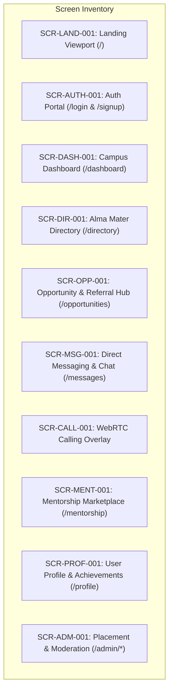

# Document ID: DOC-UI-001
# Screen & Viewport Inventory Specification

> **Document Version:** 1.0.0  
> **Classification:** Frontend Engineering & UI Specification  
> **Status:** APPROVED  
> **Authoring Lead:** Frontend Architect & UX Architect  
> **Review Date:** October 2026  
> **Target System:** AlumniConnect Web Application (React 19 / Vite / Tailwind v4)  

---

## 1. Screen Architecture & State Matrix

Every screen in the AlumniConnect application must support seven deterministic operational states:
1. **Initial / Pristine:** Default clean layout prior to user interaction.
2. **Loading / Skeleton:** Rendered while TanStack Query / Axios fetches asynchronous data. Never shows blank screens.
3. **Active / Populated:** Standard populated view with data cards and interactive elements.
4. **Empty / First-Time:** Rendered when a dataset returns 0 items (e.g., zero alumni, zero notifications). Must provide a constructive call-to-action.
5. **Error / Fault:** Rendered when an API or network operation fails. Must offer a retry trigger.
6. **Unauthorized / Guarded:** Rendered if user lacks required role permissions.
7. **Success / Feedback:** Feedback state with toast or confetti bursts upon mutation completion.

---

## 2. Complete Screen Inventory

---

### SCR-LAND-001: Public Landing Viewport
- **Route:** `/`
- **Access Level:** Public (Anonymous). If session token exists, auto-redirect to `/dashboard`.
- **Purpose:** Communicate value proposition, institutional trust badges, and drive student/alumni registration.
- **Entry Points:** Direct navigation, external referral links, organic search.
- **Exit Points:** `/login`, `/signup`, `/about`, `/terms`, `/privacy`.
- **Component Hierarchy:**
  - `<Navbar>`: Brand logo, navigation anchors (Features, Testimonials, About), "Sign In" button, "Get Started" CTA button.
  - `<Hero>`: Animated headline (*"Connect with Verified Alumni from Your Alma Mater"*), subtext, primary CTA button, animated stat counters.
  - `<TrustLogos>`: University accreditation and placement partner trust badges.
  - `<Features>`: 4-pillar cards (Institutional Identity, Same-College Discovery, 2-Minute Warm Chat, Verified Referrals).
  - `<Testimonials>`: Verified student and alumni success stories with quotes and graduation batches.
  - `<CTA>`: Final enrollment conversion banner.
  - `<Footer>`: Brand links, university support desk, copyright, social handles.
- **Responsive Behavior:** Hero transforms from dual-column layout on desktop ($\ge 1024\text{px}$) to stacked single-column on mobile. Navigation menu collapses into a mobile slide-out drawer on viewports $< 768\text{px}$.
- **Accessibility:** Semantic `<header>`, `<main>`, `<footer>` landmarks. Heading hierarchy begins strictly at `<h1>`.

---

### SCR-AUTH-001: Authentication & Onboarding Portal
- **Routes:** `/login`, `/signup`, `/forgot-password`, `/reset-password`
- **Access Level:** Public / Unauthenticated.
- **Purpose:** Secure user entry, account creation with geographic institution selection, email OTP verification, and password recovery.
- **Component Hierarchy:**
  - `<AuthCard>`: Tab toggle (Sign In / Sign Up), Google OAuth button, divider, input fields.
  - `<CollegeSelector>`: State dropdown, District dropdown, College dropdown, and *"Request to add college"* modal trigger.
  - `<OTPVerificationModal>`: 6-digit numeric input boxes, 60-second countdown timer, resend button.
  - `<AuthFooter>`: Links to Terms of Service, Privacy Policy, and Help Desk.
- **Screen States:**
  - *Loading:* Buttons display loading spinners; inputs disabled to prevent duplicate submissions.
  - *Validation Error:* Red outline on invalid fields with inline error messages (e.g. *"Password must contain at least 8 characters"*).
  - *API Error:* Floating banner (e.g. *"Invalid credentials. 2 attempts remaining"*).
  - *Success:* `ConfettiBurst` triggers upon OTP verification; toast confirms login before redirecting to `/dashboard`.
- **Accessibility:** All inputs have explicit `<label>` tags with matching `htmlFor` attributes; `aria-invalid="true"` injected on validation failure.

---

### SCR-DASH-001: Campus Dashboard & Feed
- **Route:** `/dashboard`
- **Access Level:** Authenticated (Student / Alumni).
- **Purpose:** Primary hub displaying academic social feed, post creation modal, pending connection requests, suggested peers, and alumni leaderboard.
- **Layout Grid:** 3-column layout on desktop:
  - *Left Column (25%):* User profile snapshot card, quick navigation links, college identity pill.
  - *Center Column (50%):* Post Creation trigger button, post feed list, inline PDF document viewer.
  - *Right Column (25%):* Alumni Engagement Leaderboard widget, Pending Connection Requests widget, Suggested Alma Mater Peers.
- **Component Hierarchy:**
  - `<AppShell>`: Sticky top bar with navigation, theme toggle, and notification bell.
  - `<CreatePostModal>`: Title input, description textarea, post type selector (`GENERAL`, `CERTIFICATE`, `HACKATHON`, `EVENT`), file dropzone.
  - `<FeedPostCard>`: Author avatar, name, graduation batch, post timestamp, text content, media carousel, `<PdfDocumentViewer>`, like/comment/share buttons.
  - `<LeaderboardWidget>`: Ranked list of top 5 alumni with scores and badges.
- **Screen States:**
  - *Loading:* Feed displays 3 animated `<Skeleton>` cards with pulsing shimmer effects.
  - *Empty:* If 0 posts exist in college feed, renders: *"Your college feed is waiting for its first post. Share a project or achievement!"* with a prominent "Create Post" button.
  - *Error:* Renders error banner with a "Retry Feed" button invoking React Query `refetch()`.
- **Responsive Behavior:** On mobile ($< 768\text{px}$), left and right columns collapse into accessible tabs or drawer widgets; center feed takes 100% width.

---

### SCR-DIR-001: Alma Mater Directory & Discovery
- **Routes:** `/directory`, `/search`
- **Access Level:** Authenticated (Student / Alumni).
- **Purpose:** Find and connect with students and alumni from one's institution with branch, batch, and skill filters.
- **Layout:**
  - *Top Header:* Search bar with instant keyboard debounce (300ms); Tab switcher: `[My Alma Mater (Active)]` and `[Explore Other Colleges]`.
  - *Filter Bar:* Department dropdown, Graduation Batch dropdown, Domain selector (`Tech`, `Non-Tech`, `Both`), Skills multi-select filter.
  - *Main Grid:* Responsive cards displaying eligible peers.
- **Component Hierarchy:**
  - `<DirectoryHeader>`: Search query input with clear (`X`) button and result counter.
  - `<AlumniCard>`: Avatar, Name, Graduation Year, Department, Current Role & Company, Domain badge, Skill tags list, Action button (`Connect` / `Message` / `Request Sent`).
- **Screen States:**
  - *Loading:* Grid of 6 pulsing skeleton profile cards.
  - *Empty (Same-College):* *"No alumni found matching your filter criteria. Try clearing filters or inviting your batchmates."*
  - *Empty (No Alumni in College):* *"Be the pioneer! Invite your college seniors to join AlumniConnect."*
  - *Populated:* Smooth fade-in card transitions via Framer Motion.
- **Responsive Behavior:** 1 column on mobile, 2 columns on tablet ($\ge 768\text{px}$), 3 columns on desktop ($\ge 1024\text{px}$).

---

### SCR-OPP-001: Opportunities & Referral Hub
- **Route:** `/opportunities`
- **Access Level:** Authenticated (Student / Alumni).
- **Purpose:** Discover jobs, internships, and hackathons posted by alumni; submit internal referral applications.
- **Layout:**
  - *Header:* Opportunity type filter tabs (`All`, `Jobs`, `Internships`, `Events`); "Post Opportunity" button (visible to Alumni/Admins only).
  - *Search & Skill Match Bar:* Filter by target domain and minimum skill match percentage.
  - *Main Content:* Dual-pane layout on desktop: Left pane lists opportunities; right pane displays selected opportunity details and applicant review form.
- **Component Hierarchy:**
  - `<OpportunityCard>`: Company logo, Title, Company Name, Location, Compensation, Skill match indicator badge (e.g. *"80% Match"*), Deadline countdown.
  - `<OpportunityDetailPane>`: Full role description, required qualifications, poster profile card, `<ReferralApplicationModal>`.
- **Screen States:**
  - *Loading:* Dual-pane skeleton loaders.
  - *Empty:* *"No active job openings currently posted for your college. Check back soon or browse events."*
  - *Application Submitted:* Confirmation toast with application ticket ID; button changes to *"Applied"*.

---

### SCR-MSG-001: Direct Messaging & Communication Hub
- **Route:** `/messages` (supports query param `?with=:userId`)
- **Access Level:** Authenticated (Student / Alumni).
- **Purpose:** Real-time 1-on-1 chat, introductory chat countdown timer display, typing indicators, and WebRTC call initiation.
- **Layout:** Master-Detail dual-pane layout:
  - *Left Pane (35%):* Active conversation threads list, user avatar, last message preview, unread badge counter, online presence dot.
  - *Right Pane (65%):* Active chat header (peer name, college, call buttons), scrollable message history, typing indicator, message input bar.
- **Component Hierarchy:**
  - `<ConversationList>`: Search filter, conversation list items with active selection highlight.
  - `<ChatHeader>`: Peer profile summary, Audio Call button, Video Call button, More Options menu (Report / Block).
  - `<TrialCountdownBanner>`: Amber banner displaying remaining trial seconds (e.g. *"Introductory Chat: 84s remaining"*).
  - `<MessageBubble>`: Outgoing (blue, right-aligned) vs Incoming (slate, left-aligned) bubbles with timestamps and read checkmarks.
  - `<TypingIndicator>`: Three animated bouncing dots rendered when peer emits socket `typing` event.
  - `<MessageInputBar>`: Auto-expanding textarea, emoji picker trigger, Send action button.
- **Screen States:**
  - *Trial Expired / Locked:* Textarea replaced with lock notice: *"2-minute introductory window has ended. Send a Connection Request to continue chatting."* with a direct "Connect" button.
  - *Empty:* If no conversation is selected: *"Select a conversation from the left or discover alumni in the Directory to start chatting."*

---

### SCR-CALL-001: WebRTC Calling Overlay Viewport
- **Screen Type:** Global Modal Overlay managed by `<CallProvider>` in `AppShell`.
- **Access Level:** Authenticated.
- **Purpose:** Full-screen audio/video call interface with remote video stream, local picture-in-picture stream, and device controls.
- **Component Hierarchy:**
  - `<RemoteVideoCanvas>`: Full-screen video element rendering peer's WebRTC media stream.
  - `<LocalVideoPIP>`: Draggable picture-in-picture window rendering user's own camera preview.
  - `<CallStatusBar>`: Peer name, institutional affiliation, call duration timer (`MM:SS`), connection quality indicator.
  - `<CallControls>`: Mute Microphone toggle, Camera On/Off toggle, Screen Share toggle, End Call (Red button).
- **Screen States:**
  - *Ringing / Calling:* Displays pulsing avatar with text *"Calling Ananya Sen..."*.
  - *Connecting:* Displays *"Connecting peer-to-peer..."* while ICE candidates negotiate.
  - *Active:* Live video/audio streaming.
  - *Network Warning:* Displays amber warning banner: *"Poor connection. Audio only mode engaged."* if packet loss exceeds 10%.

---

### SCR-MENT-001: Mentorship Marketplace & Sessions
- **Route:** `/mentorship`
- **Access Level:** Authenticated (Student / Alumni).
- **Purpose:** Discover available alumni mentors, view remaining mentee slots, submit structured booking requests, and manage shared session goals.
- **Component Hierarchy:**
  - `<MentorshipNavbar>`: Sub-navigation between *"Find Mentors"* and *"My Active Sessions"*.
  - `<MentorCard>`: Mentor photo, current title, company, mentorship domain, max mentees capacity bar (e.g. *"2 of 3 slots filled"*), "Book Session" CTA.
  - `<MentorshipBookingModal>`: Topic selection, session goal formulation checklist, message input.
  - `<ActiveSessionCard>`: Shared goals checklist, shared session notes, "Start Mentorship Video Call" button, "Mark Completed" button.
  - `<MentorshipSurveyModal>`: 5-star rating control, feedback textarea.
- **Screen States:**
  - *Capacity Full:* If mentor has reached `maxMentees`, CTA button renders disabled: *"Mentor at Capacity"*.
  - *Empty (No Sessions):* *"You have no active mentorship sessions. Explore mentors above to begin."*

---

### SCR-PROF-001: User Profile & Achievements Hub
- **Routes:** `/profile` (Self), `/profile/:userId` (Peer)
- **Access Level:** Authenticated.
- **Purpose:** Comprehensive professional profile displaying education, career history, skills, achievements, portfolio links, and editing controls.
- **Component Hierarchy:**
  - `<ProfileBanner>`: Header background, avatar, name, verification badge, current headline, college identity pill, Edit Profile button (if self).
  - `<ProfileAbout>`: Bio and career summary.
  - `<ExperienceTimeline>`: Internships, past full-time roles, company logos, date ranges, descriptions.
  - `<SkillsInterestsWidget>`: Tag clouds for verified skills and career interests.
  - `<AchievementsList>`: Certifications, hackathon wins, research publications with embedded certificate view links.
  - `<EditProfileModal>`: Form tabs (Personal, Academic, Experience, Skills, Social Links) with instant form validation.
- **Screen States:**
  - *Self Profile:* Shows "Edit Profile" and account setting buttons.
  - *Peer Profile (Not Connected):* Shows "Connect" and "Send Intro Message" buttons.
  - *Peer Profile (Connected):* Shows "Connected" badge, "Message", and "Call" buttons.
