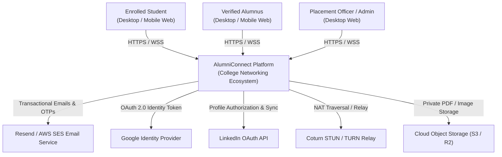
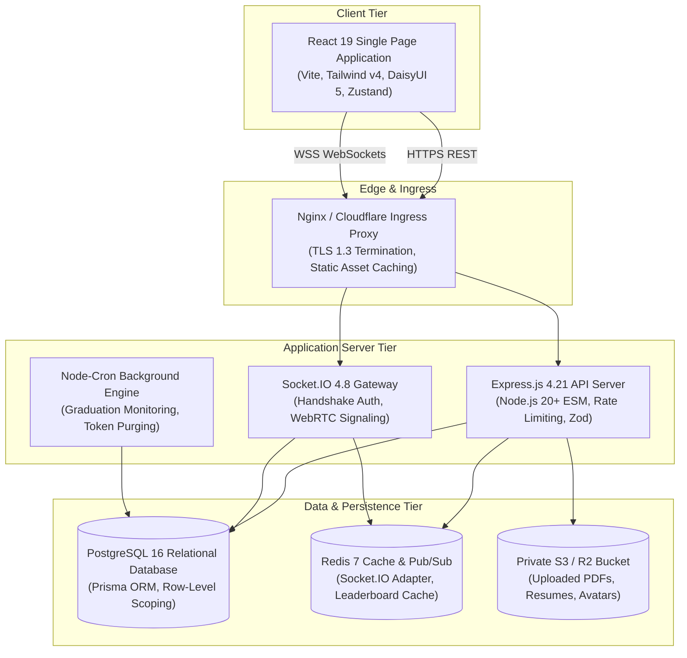
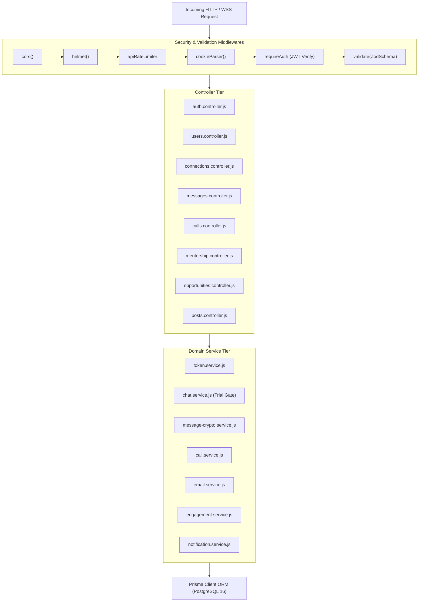

# Document ID: DOC-ARC-001
# High-Level System Architecture & C4 Engineering Models

> **Document Version:** 1.0.0  
> **Classification:** System Architecture & Engineering Blueprint  
> **Status:** APPROVED  
> **Authoring Lead:** Principal Software Architect  
> **Review Date:** October 2026  
> **Target System:** AlumniConnect Platform Specification  

---

## 1. Architectural Philosophy & Guiding Principles

The architecture of **AlumniConnect** is governed by five foundational principles:

1. **Strict Institutional Multi-Tenancy via Row-Level Scoping:**
   - The platform operates as a shared-schema, college-scoped multi-tenant system. Every student, alumnus, post, opportunity, and chat is anchored to a canonical `collegeId`, ensuring strict data isolation without the overhead of physical database splitting.
2. **Stateless Backend Application Tier:**
   - The Express application tier maintains zero in-memory session state. All identity verification is performed via cryptographically signed JWTs and persistent database token hashes, enabling horizontal container autoscaling.
3. **Decoupled Real-Time Gateway:**
   - Real-time communication (Socket.IO) multiplexes user rooms (`user:${userId}`) and college channels (`college:${collegeId}`) independently from the REST API request lifecycle.
4. **Defense-in-Depth Security Architecture:**
   - Multi-layered controls: WAF/Rate-limiting -> Helmet Security Headers -> CORS Origin Validation -> JWT Authentication -> RBAC Authorization -> Zod Request Validation -> Prisma Parameterized Persistence.
5. **Deterministic Transactional Integrity:**
   - Critical workflows (connection acceptance, graduation verification, college addition approval) execute within ACID database transactions, preventing partial-state corruption.

---

## 2. C4 Architecture Models

### 2.1 C4 Level 1: System Context Diagram
Illustrates how AlumniConnect interacts with external actors and third-party cloud services.



---

### 2.2 C4 Level 2: Container Architecture Diagram
Illustrates the high-level deployable containers and datastores.



---

### 2.3 C4 Level 3: Backend Component Diagram
Illustrates the internal software component decomposition of the backend tier.



---

## 3. The Standard Request Lifecycle

Every API request follows a deterministic lifecycle pattern across the server layers:

```
Client Request
  │
  ▼
[1. Network Ingress & TLS Termination] (Cloudflare / Nginx)
  │
  ▼
[2. Global Middlewares]
  ├── CORS Origin Check (clientOrigin whitelist)
  ├── Helmet Header Injection (HSTS, CSP, X-Frame-Options)
  ├── Express Body & Multipart Stream Parsing
  └── Global IP Throttling (express-rate-limit)
  │
  ▼
[3. Route Matcher] (routes/index.js -> /api/v1/:module)
  │
  ▼
[4. Authentication Middleware] (requireAuth)
  ├── Extract Bearer token from header
  ├── Verify HMAC-SHA256 signature against JWT_ACCESS_SECRET
  ├── Validate tokenVersion matches database user.tokenVersion
  └── Attach payload to req.user ({ userId, collegeId, role })
  │
  ▼
[5. Schema Validation Middleware] (validate(ZodSchema))
  ├── Validate req.body, req.query, req.params against Zod contract
  └── Throw AppError(400) if validation fails
  │
  ▼
[6. Controller Handler] (asyncHandler wrapper)
  ├── Extract validated inputs
  └── Delegate business rules to Domain Services
  │
  ▼
[7. Domain Service & Business Logic]
  ├── Enforce domain rules (e.g., 2-minute chat timer, capacity caps)
  └── Coordinate multiple repository actions
  │
  ▼
[8. Database Layer & Transaction] (Prisma Client)
  ├── Execute SQL parameterized queries
  └── Commit ACID transaction boundaries
  │
  ▼
[9. Response Formatter] (sendSuccess utility)
  └── Return standardized JSON: { success: true, data: { ... } }
  │
  ▼
[10. Global Error Middleware] (errorHandler)
  └── Catch unhandled exceptions; return clean JSON; log to Winston
```

---

## 4. Graceful Shutdown & Fault Resilience

The backend application bootstrap in `server.js` implements graceful shutdown lifecycle handling to prevent connection drops and data corruption during container restarts or deployments:

```javascript
const shutdown = async (signal) => {
  console.log(`[backend] received ${signal}, initiating graceful shutdown...`);
  
  // 1. Stop accepting new HTTP / WebSocket connections
  server.close(() => {
    console.log('[backend] HTTP/WSS server closed.');
  });

  // 2. Stop running cron tasks
  cronTasks.forEach((task) => task?.stop?.());

  // 3. Close open database connections
  await prisma.$disconnect();

  // 4. Exit cleanly
  process.exit(0);
};

process.on('SIGTERM', () => shutdown('SIGTERM'));
process.on('SIGINT', () => shutdown('SIGINT'));
```

---

## 5. Architectural Quality Gates & Verification

1. **Gate 1:** Backend tier maintains zero local session state in memory (100% token/DB backed).
2. **Gate 2:** Every write operation involving multiple entity modifications executes within a Prisma transaction (`$transaction`).
3. **Gate 3:** All asynchronous controller handlers are wrapped in `asyncHandler` to guarantee unhandled exceptions reach the global error middleware.
