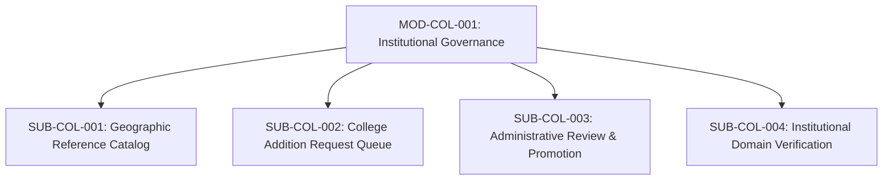

# Document ID: DOC-MOD-001
# Module Specification: Institutional Governance & College Identity

> **Module ID:** `MOD-COL-001`  
> **Module Name:** Institutional Governance & College Identity Subsystem  
> **Classification:** Core Foundation Domain Specification  
> **Status:** APPROVED  
> **Authoring Lead:** Principal Software Architect & Senior Business Analyst  
> **Review Date:** October 2026  
> **Target Release:** v2.0.0 Enterprise & Academic Major Project Baseline  

---

## 1. Module Identity & Purpose

### 1.1 Purpose & Business Value
The Institutional Governance module anchors the entire platform's trust architecture. Unlike generic networks where educational affiliations are unverified and self-reported strings, AlumniConnect establishes canonical, unique, and geographically classified institutional entities (`College`, `LocationState`, `LocationDistrict`, `Campus`, `Department`). 

By enforcing institutional boundary governance, the platform ensures that:
- Every student and alumnus is anchored to an authentic, verified college ID.
- Institution addition follows a controlled pre-moderation approval queue (remediating `DEF-01`).
- Geographic cascades prevent college name collisions across states and districts.
- University administrators gain authoritative ownership over their institution's directory and verification standards.

### 1.2 Scope & Exclusions
- **In-Scope:** Canonical institutional database; 3-tier geographic cascade (`State` -> `District` -> `College`); user-submitted college addition request workflow; administrative college approval/rejection queue; email domain validation (e.g. `@mit.edu`).
- **Out-of-Scope:** Automated SQL synchronization with proprietary university registrar ERP databases (Ellucian Banner, PeopleSoft) is excluded from Milestone 1.0/2.0.

### 1.3 User Roles Involved
- **Anonymous Visitor / Enrolling User:** Browses states and districts; selects existing college or submits an addition request.
- **Enrolled Student / Alumnus:** Associated with their canonical institution ID.
- **Institutional Admin / Placement Officer:** Manages college profile, departments, and enrollment verification.
- **System Administrator:** Reviews and approves/rejects submitted college addition tickets.

### 1.4 Preconditions & Dependencies
- `LocationState` and `LocationDistrict` reference catalogs must be seeded.
- Relational integrity requires `colleges.state_id` and `colleges.district_id` foreign keys.

---

## 2. Submodule Decomposition



### 2.1 Submodule 1: Geographic Reference Catalog (`SUB-COL-001`)
- **Responsibility:** Provide fast, cached, hierarchical querying of States, Districts, and approved Colleges.
- **Inputs:** `stateId` (UUID, optional), `districtId` (UUID, optional), `searchQuery` (string, optional).
- **Outputs:** Filtered JSON array: `[{ id, name, state, district, emailDomain, logoUrl }]`.
- **Data Dependencies:** `location_states`, `location_districts`, `colleges` tables.
- **Business Rules:**
  - Selecting a state filters districts immediately.
  - Selecting a district isolates colleges strictly within that geographic boundary.
  - Colleges must be sorted alphabetically by name.
- **Security Requirements:** Rate-limited to 100 requests per minute per IP to prevent directory scraping.
- **Acceptance Criteria:** Query response time $\le 50\text{ms}$ with full-text indexing on college names.

---

### 2.2 Submodule 2: College Addition Request Queue (`SUB-COL-002`)
- **Responsibility:** Capture user submissions for institutions not present in the database without polluting production records.
- **Inputs:** `collegeName` (string, 3–150 chars), `stateId` (UUID), `districtName` (string), `officialWebsite` (URL, optional), `emailDomain` (string, optional), `submitterUserId` (UUID).
- **Outputs:** `InstitutionAdditionRequest` ticket with status `PENDING_REVIEW`.
- **Data Dependencies:** `institution_addition_requests` table.
- **Business Rules:**
  - Submission must NEVER insert directly into the active `colleges` table (remediates `DEF-01`).
  - Submitter account is tagged with `collegeAffiliationStatus: PENDING_VERIFICATION`.
  - Adding an institution does NOT verify the submitter's student or alumni status.
- **Error Conditions:** Duplicate normalized name within the same district returns HTTP `409 Conflict` with link to existing ticket.
- **Acceptance Criteria:** Unapproved submissions are completely invisible in public dropdown selectors.

---

### 2.3 Submodule 3: Administrative Review & Promotion (`SUB-COL-003`)
- **Responsibility:** Provide platform administrators with an inspection portal to verify, approve, merge, or reject requested institutions.
- **Inputs:** `requestId` (UUID), `action` (`APPROVE` | `REJECT`), `adminNotes` (string, optional).
- **Outputs:** Promoted `College` record; status update on ticket; notification dispatched to submitter.
- **Business Rules:**
  - Promotion executes an atomic database transaction: (1) Inserts canonical `College`; (2) Updates ticket status to `APPROVED`; (3) Updates all users linked to this ticket to `collegeId = newCollege.id`.
  - Rejection notifies the submitter with reason (e.g. *"Duplicate of existing Indian Institute of Technology Bombay"*).
- **Acceptance Criteria:** Approved college is instantly queryable across all active client sessions.

---

### 2.4 Submodule 4: Institutional Domain Verification (`SUB-COL-004`)
- **Responsibility:** Match incoming user registration emails against approved college email domains (e.g., `user@stanford.edu` matches domain `@stanford.edu`).
- **Inputs:** `email` (string), `collegeId` (UUID).
- **Outputs:** Boolean flag `isDomainMatched`.
- **Business Rules:**
  - If a user registers with their college's verified institutional email domain, their `verificationRiskScore` is reduced to 0, and email OTP verification automatically satisfies institutional affiliation proof.
  - Users with generic personal emails (Gmail, Yahoo, Outlook) are accepted but require secondary document verification (student ID card).
- **Acceptance Criteria:** Domain matching correctly parses subdomains (e.g., `@cs.cmu.edu` matches `@cmu.edu`).

---

## 3. Database Schema Implications

To support this module, the following relational schema extensions are specified:

```prisma
model InstitutionAdditionRequest {
  id              String        @id @default(uuid())
  collegeName     String        @map("college_name")
  stateId         String        @map("state_id")
  districtName    String        @map("district_name")
  officialWebsite String?       @map("official_website")
  emailDomain     String?       @map("email_domain")
  submitterId     String        @map("submitter_id")
  status          RequestStatus @default(PENDING_REVIEW)
  reviewedById    String?       @map("reviewed_by_id")
  reviewedAt      DateTime?     @map("reviewed_at")
  rejectionReason String?       @map("rejection_reason")
  createdAt       DateTime      @default(now()) @map("created_at")

  submitter User  @relation("CollegeSubmissions", fields: [submitterId], references: [id])
  state     LocationState @relation(fields: [stateId], references: [id])

  @@index([stateId, status])
  @@map("institution_addition_requests")
}
```

---

## 4. Acceptance & Verification Gates

1. **Gate 1:** Anonymous actor cannot invoke `POST /api/v1/colleges` to create active colleges (returns HTTP 401).
2. **Gate 2:** User-submitted college ticket appears in Admin review queue within <1 second.
3. **Gate 3:** Approving an institution ticket updates all linked pending users atomically in a single database transaction.
