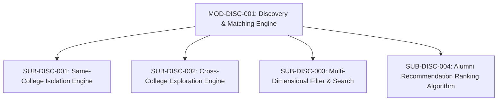

# Document ID: DOC-MOD-002
# Module Specification: Discovery, Search & Matching Engine

> **Module ID:** `MOD-DISC-001`  
> **Module Name:** Discovery, Search & Recommendation Engine  
> **Classification:** Core Platform Capability  
> **Status:** APPROVED  
> **Authoring Lead:** Principal Software Architect & Senior Business Analyst  
> **Review Date:** October 2026  
> **Target System:** AlumniConnect Platform Specification  

---

## 1. Module Identity & Purpose

### 1.1 Purpose & Business Value
The Discovery Engine enables students to find, filter, and connect with verified alumni and peers. In strict conformance with **Master Prompt Section 4.2**, the engine's core purpose is to prioritize same-college connections and prevent the silent pollution of local recommendations with users from unrelated universities.

By establishing strict institutional isolation with intentional opt-in cross-college exploration, the platform preserves the warmth, trust, and high response rates of alumni networking.

### 1.2 Scope & Exclusions
- **In-Scope:** Same-college isolated discovery; cross-college explicit exploration; branch, batch, and domain filtering; skill-tag matching; full-text search indexing; empty state handling.
- **Out-of-Scope:** Inserting fabricated or synthetic profile recommendations to artificially populate empty institutions (strictly prohibited by product guidelines).

---

## 2. Submodule Decomposition

### 2.1 Submodule 1: Same-College Isolation Engine (`SUB-DISC-001`)
- **Responsibility:** Ensure all default people recommendation queries are strictly scoped to the authenticated caller's alma mater.
- **Inputs:** Authenticated session context (`currentUserId`, `callerCollegeId`), optional pagination params (`page`, `limit`).
- **Outputs:** Paginated collection of same-college users with connection status.
- **Business Rules:**
  - Database queries must enforce: `WHERE college_id = :callerCollegeId AND id != :currentUserId`.
  - Excludes blocked users and suspended accounts.
  - Remediates `DEF-05`: Eliminates frontend client merging of external alumni into the primary view.
  - If 0 alumni exist in the institution, returns clean empty response triggering institutional invite empty state.
- **Acceptance Criteria:** Zero records belonging to external institutions are returned by `/api/v1/users/same-college`.

---

### 2.2 Submodule 2: Cross-College Exploration Engine (`SUB-DISC-002`)
- **Responsibility:** Allow users to deliberately browse alumni from external universities through explicit filters.
- **Inputs:** Target `stateId` (required), Target `collegeId` (optional), `domain` (enum), `skill` (string), `page` (int).
- **Outputs:** Paginated collection of public external alumni profiles.
- **Business Rules:**
  - Executed ONLY when the user explicitly activates the "Explore Other Colleges" tab.
  - Excludes any profile where `profileVisibility: COLLEGE_ONLY`.
  - Clearly badges each card with their institution name.
- **Acceptance Criteria:** Private profiles are filtered out at the SQL query layer.

---

### 2.3 Submodule 3: Multi-Dimensional Filtering & Search (`SUB-DISC-003`)
- **Responsibility:** Support granular parametric searching across departments, graduation years, domains, and skills.
- **Inputs:**
  - `department`: Normalized department name (e.g. "Computer Science & Engineering").
  - `batchYear` / `graduationYear`: Integer year range (e.g., 2018–2024).
  - `domain`: `tech`, `non-tech`, or `both`.
  - `skills`: Comma-separated array of skill tags.
- **Outputs:** Filtered profile records matching criteria.
- **Database Indexing:** Backed by composite indexes `@@index([collegeId, role])`, `@@index([department])`, `@@index([batchYear])`.
- **Acceptance Criteria:** Filter queries execute in $\le 100\text{ms}$ over 50,000 profile records.

---

### 2.4 Submodule 4: Recommendation Ranking Algorithm (`SUB-DISC-004`)
- **Responsibility:** Score and order recommended alumni on student dashboards to maximize networking relevance.
- **Ranking Formula:**
  $$\text{RelevanceScore} = (W_{\text{dept}} \times S_{\text{dept}}) + (W_{\text{domain}} \times S_{\text{domain}}) + (W_{\text{skills}} \times J(\text{Skills}_{\text{user}}, \text{Skills}_{\text{alumnus}})) + (W_{\text{mentor}} \times M_{\text{open}})$$
  Where:
  - $W_{\text{dept}} = 35$ (Exact matching department).
  - $W_{\text{domain}} = 25$ (Matching career domain).
  - $W_{\text{skills}} = 25 \times \text{Jaccard Similarity}$ between user skill tags and alumnus skill tags.
  - $W_{\text{mentor}} = 15$ if alumnus has `openToMentorship: true` and active slots available.
- **Acceptance Criteria:** Alumni in the student's department who are open to mentorship rank at the top of recommendations.

---

## 3. Error Conditions & Edge Cases

| Error Scenario | Root Cause | Handling & Response Code |
| :--- | :--- | :--- |
| **Caller has no assigned college** | Account registration incomplete. | HTTP `403 Forbidden` with redirect to `/onboarding/college`. |
| **Zero matching alumni found** | High filter specificity or early-stage college. | HTTP `200 OK` with empty array `[]`; client renders branded empty state with invite button. |
| **Search query contains SQL injection tokens** | Malicious user input. | Prisma parameterized queries neutralize tokens; no error or leak. |

---

## 4. Acceptance Criteria & Test Gates

1. Querying default discovery never returns users outside the caller's college ID (`TEST-DISC-001`).
2. Toggling to "Other Colleges" requires explicit target college or skill parameter (`TEST-DISC-002`).
3. Ranking algorithm orders department-matched mentors ahead of unrelated alumni (`TEST-DISC-003`).
