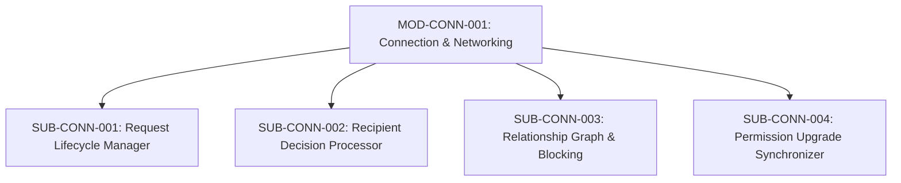

# Document ID: DOC-MOD-003
# Module Specification: Connection & Networking Subsystem

> **Module ID:** `MOD-CONN-001`  
> **Module Name:** Connection & Networking Subsystem  
> **Classification:** Core Platform Capability  
> **Status:** APPROVED  
> **Authoring Lead:** Principal Software Architect & Backend Architect  
> **Review Date:** October 2026  
> **Target System:** AlumniConnect Platform Specification  

---

## 1. Module Identity & Purpose

### 1.1 Purpose & Business Value
The Connection & Networking Subsystem manages bilateral professional relationships between students and alumni. In AlumniConnect, connections are not merely vanity metrics; they are the **cryptographic and authorization gateway** that transitions users from restricted introductory messaging to unlimited real-time chat, file exchange, and WebRTC audio/video calling.

### 1.2 Scope & Exclusions
- **In-Scope:** Connection requests, cancellation/withdrawal, acceptance, rejection, 30-day rejection cooldown, disconnection/unfriending, mutual blocking, permission upgrade synchronization, real-time notification dispatch.
- **Out-of-Scope:** Third-party LinkedIn connection syncing (LinkedIn does not permit syncing external social graph connections via API).

---

## 2. Submodule Decomposition



### 2.1 Submodule 1: Request Lifecycle Manager (`SUB-CONN-001`)
- **Responsibility:** Validate, persist, and manage outgoing connection requests.
- **Inputs:** `requesterId` (from JWT), `targetUserId` (UUID).
- **Outputs:** Created `ConnectionRequest` entity with `status: PENDING`.
- **Business Rules:**
  - Self-connections are strictly rejected (`requesterId !== targetUserId`).
  - Cannot send a request if either party has blocked the other.
  - Cannot send a request if a record is already `PENDING` or `ACCEPTED` (`unique([requesterId, receiverId])`).
  - Requester may withdraw a `PENDING` request at any time prior to recipient action.
- **Error Conditions:** Target does not exist (HTTP 404); blocked relationship (HTTP 403); duplicate pending request (HTTP 409).

---

### 2.2 Submodule 2: Recipient Decision Processor (`SUB-CONN-002`)
- **Responsibility:** Execute recipient decisions (`ACCEPT` or `REJECT`) with strict concurrency safety.
- **Inputs:** `requestId` (UUID), `action` (`ACCEPT` | `REJECT`), `callerId` (from JWT).
- **Outputs:** Updated `ConnectionRequest` record; notification dispatched.
- **Business Rules:**
  - Caller must match `receiverId` on the request.
  - **Accept Action:** Transitions status to `ACCEPTED`, sets `respondedAt = now()`, dispatches `CONNECTION_ACCEPTED` notification, and triggers Submodule 4 (`Permission Upgrade`).
  - **Reject Action:** Transitions status to `REJECTED`, sets `respondedAt = now()`, and initiates a **30-day re-request cooldown**.
- **Race Condition Handling:** Uses database row-level locking (`SELECT ... FOR UPDATE` via Prisma transaction) to prevent concurrent accept/reject race conditions.

---

### 2.3 Submodule 3: Relationship Graph & Blocking (`SUB-CONN-003`)
- **Responsibility:** Manage disconnection and safety blocking between users.
- **Inputs:** `initiatorId` (UUID), `targetId` (UUID), `action` (`DISCONNECT` | `BLOCK` | `UNBLOCK`).
- **Business Rules:**
  - **Disconnect:** Transitions existing connection back to `NONE`. Revokes call permissions; reverts direct messaging to the 2-minute introductory window policy.
  - **Block:** Inserts record into `blocks` table (`unique([blockerId, blockedId])`). Forcibly severs any existing connection, cancels pending requests, and drops active WebRTC calls immediately.
- **Acceptance Criteria:** Blocked user disappears immediately from search and discovery results.

---

### 2.4 Submodule 4: Permission Upgrade Synchronizer (`SUB-CONN-004`)
- **Responsibility:** Upgrade real-time session permissions across both users immediately upon connection acceptance.
- **Mechanisms:**
  - Emits Socket.IO event `connection:status_changed` to rooms `user:${requesterId}` and `user:${receiverId}`.
  - Client state stores (`authStore`, React Query caches) invalidate query keys `['connections']` and `['messages', peerId]`.
  - The 2-minute countdown timer overlay is removed from the active chat view.
  - Video Call and Voice Call action buttons become enabled.

---

## 3. Database Schema Reference

```prisma
model ConnectionRequest {
  id          String           @id @default(uuid())
  requesterId String           @map("requester_id")
  receiverId  String           @map("receiver_id")
  status      ConnectionStatus @default(PENDING)
  respondedAt DateTime?        @map("responded_at")
  createdAt   DateTime         @default(now()) @map("created_at")
  updatedAt   DateTime         @updatedAt @map("updated_at")

  requester User @relation("SentConnectionRequests", fields: [requesterId], references: [id], onDelete: Cascade)
  receiver  User @relation("ReceivedConnectionRequests", fields: [receiverId], references: [id], onDelete: Cascade)

  @@unique([requesterId, receiverId])
  @@index([receiverId, status])
  @@index([requesterId, status])
  @@map("connection_requests")
}
```

---

## 4. Acceptance Criteria & Test Gates

1. Recipient is never connected automatically without explicit click on "Accept" (`TEST-CONN-001`).
2. Rejecting a request enforces 30-day cooldown before requester can re-request (`TEST-CONN-002`).
3. Connection acceptance unlocks unlimited messaging and enables call buttons within <100ms (`TEST-CONN-003`).
