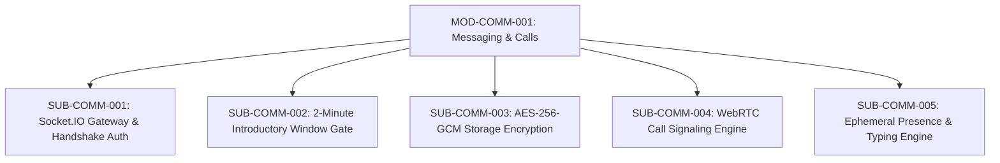

# Document ID: DOC-MOD-004
# Module Specification: Real-Time Messaging & WebRTC Calling Subsystem

> **Module ID:** `MOD-COMM-001`  
> **Module Name:** Real-Time Messaging & WebRTC Communication Subsystem  
> **Classification:** Core Platform Capability  
> **Status:** APPROVED  
> **Authoring Lead:** Backend Architect & Application Security Engineer  
> **Review Date:** October 2026  
> **Target System:** AlumniConnect Platform Specification  

---

## 1. Module Identity & Purpose

### 1.1 Purpose & Business Value
The Real-Time Messaging & Calling Subsystem delivers responsive, direct communication between students and alumni. To solve the dual problems of cold outreach spam and conversational friction, this module provides:
1. Low-latency WebSocket messaging via Socket.IO.
2. A **server-enforced 2-minute introductory window** for unconnected users.
3. Database field-level encryption at rest using AES-256-GCM.
4. Bilateral WebRTC peer-to-peer audio and video calling with STUN/TURN signaling.

### 1.2 Scope & Exclusions
- **In-Scope:** Direct text messaging; Socket.IO JWT authentication; 2-minute introductory window server gate; typing indicators; read receipts; WebRTC 1-on-1 audio/video call signaling (`call:join`, `call:accept`, `call:reject`, `call:end`, `call:signal`).
- **Out-of-Scope:** Client-side End-to-End Encryption (E2EE) with client key generation is deferred (remediates `DEF-04`: current encryption is server-side database AES-256-GCM at rest). Multi-party group video conferencing (>2 participants) is excluded from Milestone 1.0.

---

## 2. Submodule Decomposition

### 2.1 Submodule 1: Socket.IO Gateway & Handshake Auth (`SUB-COMM-001`)
- **Responsibility:** Authenticate incoming WebSocket handshakes, manage user and chat room multiplexing, and guarantee connection hygiene.
- **Handshake Protocol:**
  - Token extraction: Reads `socket.handshake.auth.token` or `Authorization: Bearer <token>`.
  - Signature verification: Verifies token against `JWT_ACCESS_SECRET`.
  - Room joining: Immediately joins `user:${payload.userId}` and `college:${payload.collegeId}`.
- **Heartbeat & Reconnection:** Client ping interval = 25s, ping timeout = 20s. Auto-reconnection enabled with exponential backoff (1s, 2s, 4s, 8s, up to 10s max).
- **Acceptance Criteria:** Unauthenticated socket handshake is rejected with error `Unauthorized` within <5ms.

---

### 2.2 Submodule 2: 2-Minute Introductory Window Gate (`SUB-COMM-002`)
- **Responsibility:** Strictly enforce the 120-second introductory chat window between unconnected users on the backend.
- **Enforcement Logic (`chat.service.js`):**
  1. For incoming message, check if users are mutual connections (`ConnectionRequest.status === 'ACCEPTED'`).
  2. If `isConnected === true`: `canMessage = true`, `trialRemainingSeconds = null`.
  3. If unconnected: Query `firstMessage = Message.findFirst({ where: { chatId }, orderBy: { createdAt: 'asc' } })`.
  4. If no first message exists: `canMessage = true`, `trialRemainingSeconds = 120`.
  5. If first message exists:
     $$\text{elapsed} = \text{Date.now()} - \text{firstMessage.createdAt.getTime()}$$
     $$\text{remainingMs} = 120000 - \text{elapsed}$$
  6. If $\text{remainingMs} \le 0$: Throw `AppError('Free chat window ended. Connect to continue.', 403, { locked: true, trialRemainingSeconds: 0 })`.
- **Acceptance Criteria:** Client attempts to post message via cURL at $t = 121\text{s}$ are rejected with HTTP 403; zero message data is written to the database.

---

### 2.3 Submodule 3: AES-256-GCM Storage Encryption (`SUB-COMM-003`)
- **Responsibility:** Encrypt message bodies before database insertion and decrypt upon retrieval for authorized participants.
- **Algorithm & Key Management:**
  - Algorithm: `aes-256-gcm`.
  - Key: Derived via SHA-256 hash of `MESSAGE_ENCRYPTION_SECRET`.
  - Initialization Vector (IV): Cryptographically random 12-byte buffer (`crypto.randomBytes(12)`).
  - Storage Format: `${encodedIv}:${authTag}:${encryptedCiphertext}` in `messages.content`.
- **Integrity Guarantee:** Authenticated GCM tag verifies that ciphertext has not been tampered with at rest.
- **Acceptance Criteria:** Raw database inspection of the `messages` table reveals zero plaintext content.

---

### 2.4 Submodule 4: WebRTC Call Signaling Engine (`SUB-COMM-004`)
- **Responsibility:** Coordinate bilateral WebRTC media negotiation across peers via Socket.IO rooms.
- **Signaling Event Sequence:**
  1. `POST /api/v1/calls` creates `CallSession` in `RINGING` state. Emits `call:incoming` to recipient room `user:${calleeId}`.
  2. Recipient accepts: Emits `call:accept`. Server updates status to `ACTIVE`, adds both sockets to room `call:${callId}`, emits `call:accepted`.
  3. SDP Offer/Answer: Sockets relay session descriptions via event `call:signal` (`{ callId, signal: { type: 'offer' | 'answer', sdp } }`).
  4. ICE Candidates: Sockets stream network candidate packets via `call:signal` (`{ callId, signal: { candidate } }`).
  5. Teardown: Either peer emits `call:end`. Server sets `status: ENDED`, calculates `durationSeconds`, stops call timer.
- **Acceptance Criteria:** Signaling exchange completes in $\le 1500\text{ms}$; media stream flows P2P via STUN (or relays via TURN if behind symmetric NAT).

---

### 2.5 Submodule 5: Ephemeral Presence & Typing Engine (`SUB-COMM-005`)
- **Responsibility:** Deliver real-time typing indicators and online presence updates without database writes.
- **Typing Lifecycle:**
  - When user types in chat: Client emits `typing` (`{ chatId }`). Gateway relays `typing` to `socket.to(chat:${chatId})`.
  - User stops typing: 1200ms debounce timer triggers `stopTyping` emission. Gateway relays `stopTyping` to room.
  - Fail-safe: Recipient client automatically clears typing indicator if no typing event received within 1800ms.
- **Acceptance Criteria:** Typing events generate zero database queries and consume minimal network bandwidth ($\le 120$ bytes per event).

---

## 3. Error Conditions & Recovery

| Failure Scenario | Recovery & Handling Rule |
| :--- | :--- |
| **WebSocket disconnects mid-call** | Client attempts ICE reconnection for 15s. If unsuccessful, server transitions `CallSession` to `ENDED` and notifies remaining peer. |
| **User tries to message unconnected user after trial** | Returns HTTP `403 Forbidden` (`locked: true`). Client renders connection CTA. |
| **Recipient rejects incoming call** | Emits `call:rejected` (`reason: 'declined'`). Caller UI stops ringing and resets to chat view. |

---

## 4. Acceptance Criteria & Test Gates

1. Unconnected users cannot send messages after 120 seconds have elapsed (`TEST-COMM-001`).
2. Message bodies stored in PostgreSQL are encrypted with AES-256-GCM (`TEST-COMM-002`).
3. Audio/video calls cleanly terminate and stop camera/mic streams upon hanging up (`TEST-COMM-003`).
