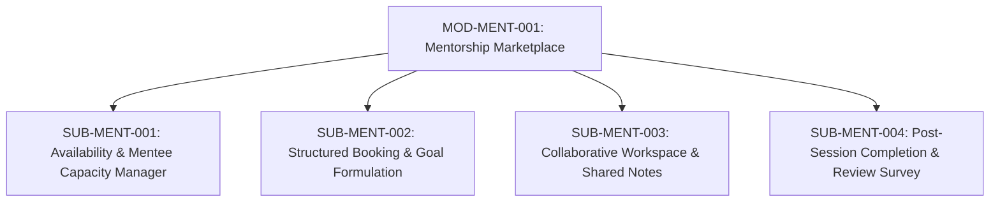

# Document ID: DOC-MOD-005
# Module Specification: Mentorship Marketplace & Senior Mapping

> **Module ID:** `MOD-MENT-001`  
> **Module Name:** Mentorship Marketplace & Senior Mapping Subsystem  
> **Classification:** Core Career Development Capability  
> **Status:** APPROVED  
> **Authoring Lead:** Product Manager & Backend Architect  
> **Review Date:** October 2026  
> **Target System:** AlumniConnect Platform Specification  

---

## 1. Module Identity & Purpose

### 1.1 Purpose & Business Value
The Mentorship Marketplace connects students with experienced alumni from their own institution for structured, 1-on-1 career guidance, resume reviews, and technical interview preparation. 

This module directly remediates two major codebase defects identified during the audit:
- **`DEF-06`:** Implements real service logic replacing the `501 Not Implemented` stubs in `backend/src/routes/mentorship.routes.js`.
- **`DEF-07`:** Integrates the orphaned frontend UI components (`MentorshipCard`, `MentorshipSidebar`, `MentorshipNavbar`, `MentorshipRequestCard`, `MentorshipFooter`) into a fully functional user experience.

### 1.2 Scope & Exclusions
- **In-Scope:** Mentor profile toggling; maximum active mentee caps (`maxMentees`); structured booking requests with goal formulation; mentor acceptance/decline workflow; collaborative session workspace (shared goals and notes); completion review surveys.
- **Out-of-Scope:** Paid or monetized mentorship sessions are excluded (Milestone 1.0/2.0 is non-commercial academic networking).

---

## 2. Submodule Decomposition



### 2.1 Submodule 1: Availability & Capacity Manager (`SUB-MENT-001`)
- **Responsibility:** Allow alumni to declare mentorship availability, specify focus domains, and enforce hard mentee caps to prevent burnout.
- **Inputs:** `openToMentorship` (boolean), `maxMentees` (integer, 1–10, default: 3), `mentorshipTopics` (string array).
- **Outputs:** Updated `Profile` entity; mentor visibility toggled in directory.
- **Business Rules:**
  - Only verified alumni (`role: ALUMNI`) can enable `openToMentorship`.
  - When `activeMenteesCount >= maxMentees`, the mentor is automatically badged as *"At Capacity"* and booking is disabled.
- **Acceptance Criteria:** Mentors cannot be booked once their active mentee count reaches their declared limit.

---

### 2.2 Submodule 2: Structured Booking & Goal Formulation (`SUB-MENT-002`)
- **Responsibility:** Facilitate structured booking requests from students with concrete goals.
- **Inputs:** `mentorId` (UUID), `requestMessage` (string, 20–500 chars), `goals` (string array, 1–5 items).
- **Outputs:** Created `Mentorship` entity (`status: PENDING`), initial `MentorshipGoal` records.
- **Business Rules:**
  - Students cannot submit generic or blank booking requests; must define at least one concrete goal.
  - Mentors have 7 days to review and take action (`ACCEPT` or `DECLINE`).
  - Unanswered requests transition automatically to `EXPIRED` via background cron job.
- **Acceptance Criteria:** Submitting a request dispatches real-time notification to mentor and decrements mentor's available slot counter.

---

### 2.3 Submodule 3: Collaborative Workspace (`SUB-MENT-003`)
- **Responsibility:** Provide an active shared workspace for mentor and mentee during their relationship.
- **Inputs:** `mentorshipId` (UUID), `noteContent` (string), `goalId` (UUID), `goalCompleted` (boolean).
- **Outputs:** Real-time synchronized session state.
- **Business Rules:**
  - Both mentor and mentee can view and toggle checklist goals (`MentorshipGoal.completed`).
  - Either participant can add persistent session notes (`MentorshipNote`).
  - Includes a direct "Start Video Call" action launching a WebRTC session between participants.
- **Acceptance Criteria:** Goal toggle and notes update in real-time across both user screens via Socket.IO.

---

### 2.4 Submodule 4: Completion & Review Survey Engine (`SUB-MENT-004`)
- **Responsibility:** Conclude mentorship relationships, gather bilateral satisfaction feedback, and update alumni leaderboard points.
- **Inputs:** `mentorshipId` (UUID), `rating` (integer, 1–5 stars), `feedback` (string, optional).
- **Outputs:** `Mentorship.status = COMPLETED`, `Mentorship.surveyCompleted = true`.
- **Business Rules:**
  - Either participant can mark a session completed after at least 1 goal is checked or 1 call was completed.
  - Completing a session prompts both participants to complete an anonymous satisfaction review.
  - Each completed mentorship with rating $\ge 4$ stars awards **50 engagement points** to the mentor on the Alumni Leaderboard.
  - Mentor's active mentee slot is immediately released, allowing them to take on a new student.
- **Acceptance Criteria:** Marking a session complete unlocks the mentor's slot immediately.

---

## 3. Database Schema Reference

```prisma
model Mentorship {
  id              String           @id @default(uuid())
  mentorId        String           @map("mentor_id")
  menteeId        String           @map("mentee_id")
  status          MentorshipStatus @default(PENDING)
  requestMessage  String           @db.VarChar(500) @map("request_message")
  startDate       DateTime?        @map("start_date")
  endDate         DateTime?        @map("end_date")
  surveyCompleted Boolean          @default(false) @map("survey_completed")
  createdAt       DateTime         @default(now()) @map("created_at")
  updatedAt       DateTime         @updatedAt @map("updated_at")

  mentor User @relation("MentorRelation", fields: [mentorId], references: [id], onDelete: Cascade)
  mentee User @relation("MenteeRelation", fields: [menteeId], references: [id], onDelete: Cascade)
  notes  MentorshipNote[]
  goals  MentorshipGoal[]

  @@index([mentorId, status])
  @@index([menteeId, status])
  @@map("mentorships")
}

model MentorshipNote {
  id           String   @id @default(uuid())
  mentorshipId String   @map("mentorship_id")
  addedById    String   @map("added_by_id")
  content      String
  createdAt    DateTime @default(now()) @map("created_at")

  mentorship Mentorship @relation(fields: [mentorshipId], references: [id], onDelete: Cascade)
  @@map("mentorship_notes")
}

model MentorshipGoal {
  id           String   @id @default(uuid())
  mentorshipId String   @map("mentorship_id")
  text         String
  completed    Boolean  @default(false)
  createdAt    DateTime @default(now()) @map("created_at")

  mentorship Mentorship @relation(fields: [mentorshipId], references: [id], onDelete: Cascade)
  @@map("mentorship_goals")
}
```

---

## 4. Acceptance Criteria & Test Gates

1. Student cannot book a mentor who has reached `maxMentees` (`TEST-MENT-001`).
2. Mentors can accept, decline, or complete sessions through authenticated endpoints (`TEST-MENT-002`).
3. Completing a session frees the mentee slot and awards leaderboard points (`TEST-MENT-003`).
