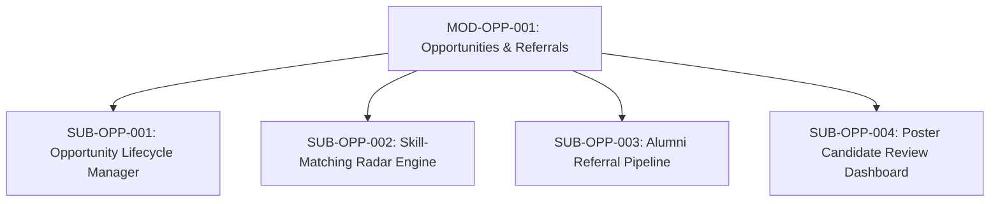

# Document ID: DOC-MOD-006
# Module Specification: Opportunities Radar & Alumni Referrals

> **Module ID:** `MOD-OPP-001`  
> **Module Name:** Opportunities Radar & Alumni Referral Pipeline  
> **Classification:** Core Career Acceleration Capability  
> **Status:** APPROVED  
> **Authoring Lead:** Product Manager & Backend Architect  
> **Review Date:** October 2026  
> **Target System:** AlumniConnect Platform Specification  

---

## 1. Module Identity & Purpose

### 1.1 Purpose & Business Value
The Opportunities Radar & Referral Subsystem connects students with authentic career openings posted by verified alumni from their institution. Unlike open public job boards flooded with thousands of applicants, this module bridges the gap between campus talent and corporate opportunities by:
1. Providing an institutional job and internship board.
2. Calculating candidate-to-job compatibility scores based on verified skills.
3. Facilitating formal **internal employee referrals** from alumni working at hiring companies.

### 1.2 Scope & Exclusions
- **In-Scope:** Opportunity posting (`JOB`, `INTERNSHIP`, `EVENT`); skill-matching algorithm; application submission with cover notes; resume PDF attachment; candidate status progression (`APPLIED`, `SHORTLISTED`, `REFERRED`, `REJECTED`, `HIRED`).
- **Out-of-Scope:** Automated parsing of arbitrary external job portals via scraping is excluded.

---

## 2. Submodule Decomposition



### 2.1 Submodule 1: Opportunity Lifecycle Manager (`SUB-OPP-001`)
- **Responsibility:** Manage creation, listing, updating, and closure of career postings.
- **Inputs:** `title`, `companyName`, `type` (`JOB` | `INTERNSHIP` | `EVENT`), `description`, `location`, `compensation`, `deadline`, `skillsRequired: string[]`, `applicationUrl`, `acceptingReferrals: boolean`.
- **Outputs:** Created `Opportunity` record.
- **Business Rules:**
  - Only verified alumni (`role: ALUMNI`) and institutional admins can create opportunities.
  - Opportunities are scoped to the poster's `collegeId` by default, with optional flag to broadcast cross-college.
  - Opportunities automatically close upon passing `deadline` (`status: CLOSED`).
- **Acceptance Criteria:** Expired opportunities are excluded from active listings.

---

### 2.2 Submodule 2: Skill-Matching Radar Engine (`SUB-OPP-002`)
- **Responsibility:** Calculate personalized compatibility scores between student skill profiles and opportunity requirements.
- **Algorithm:**
  $$\text{MatchScore} = \frac{|\text{ProfileSkills} \cap \text{OpportunitySkills}|}{|\text{OpportunitySkills}|} \times 100\%$$
- **Behavior:**
  - Opportunities on the student's dashboard are ranked by `MatchScore` descending.
  - Visual badges indicate compatibility:
    - $\ge 80\%$: Green badge (*"High Match"*).
    - $50\% - 79\%$: Amber badge (*"Moderate Match"*).
    - $< 50\%$: Grey badge (*"Skill Gap Identified"*).
  - Highlights missing skills, allowing students to identify concrete learning gaps.
- **Acceptance Criteria:** Match scores computed in $\le 5\text{ms}$ per opportunity.

---

### 2.3 Submodule 3: Alumni Referral Pipeline (`SUB-OPP-003`)
- **Responsibility:** Facilitate formal referral requests from students to alumni posters.
- **Inputs:** `opportunityId` (UUID), `coverNote` (string, max 4000 chars), `resumeFileId` (UUID).
- **Outputs:** `OpportunityApplication` record with `status: APPLIED`.
- **Business Rules:**
  - Students can apply only if the opportunity has `acceptingReferrals: true`.
  - A student cannot apply multiple times to the same opportunity (`unique([opportunityId, applicantId])`).
  - Application requires attaching an uploaded PDF resume.
- **Acceptance Criteria:** Poster receives instant notification with candidate summary and resume link.

---

### 2.4 Submodule 4: Candidate Review Dashboard (`SUB-OPP-004`)
- **Responsibility:** Allow alumni posters to triage applicants and advance referral states.
- **Inputs:** `applicationId` (UUID), `status` (`SHORTLISTED` | `REFERRED` | `REJECTED`), `feedbackNote` (string, optional).
- **Outputs:** Updated application record; notification dispatched to applicant.
- **Acceptance Criteria:** State transitions update applicant's tracking view within <1 second.

---

## 3. Database Schema Reference

```prisma
model Opportunity {
  id               String            @id @default(uuid())
  creatorId        String            @map("creator_id")
  collegeId        String            @map("college_id")
  type             OpportunityType   @default(JOB)
  status           OpportunityStatus @default(ACTIVE)
  title            String
  companyName      String            @map("company_name")
  description      String            @db.VarChar(4000)
  location         String?
  compensation     String?
  deadline         DateTime?
  applicationUrl   String?           @map("application_url")
  skillsRequired   String[]          @default([]) @map("skills_required")
  createdAt        DateTime          @default(now()) @map("created_at")
  updatedAt        DateTime          @updatedAt @map("updated_at")

  creator      User                     @relation("OpportunityCreator", fields: [creatorId], references: [id], onDelete: Cascade)
  college      College                  @relation(fields: [collegeId], references: [id], onDelete: Cascade)
  applications OpportunityApplication[]

  @@index([collegeId, status, createdAt])
  @@index([type, status, createdAt])
  @@map("opportunities")
}

model OpportunityApplication {
  id            String            @id @default(uuid())
  opportunityId String            @map("opportunity_id")
  applicantId   String            @map("applicant_id")
  coverNote     String?           @db.VarChar(4000) @map("cover_note")
  status        ApplicationStatus @default(APPLIED)
  createdAt     DateTime          @default(now()) @map("created_at")
  updatedAt     DateTime          @updatedAt @map("updated_at")

  opportunity Opportunity @relation(fields: [opportunityId], references: [id], onDelete: Cascade)
  applicant   User        @relation(fields: [applicantId], references: [id], onDelete: Cascade)

  @@unique([opportunityId, applicantId])
  @@index([applicantId, status])
  @@map("opportunity_applications")
}
```

---

## 4. Acceptance Criteria & Test Gates

1. Students cannot create job opportunities (returns HTTP 403) (`TEST-OPP-001`).
2. Duplicate applications to the same opportunity are prevented with HTTP 409 (`TEST-OPP-002`).
3. Skill match percentage accurately reflects the overlap of user skills and required skills (`TEST-OPP-003`).
