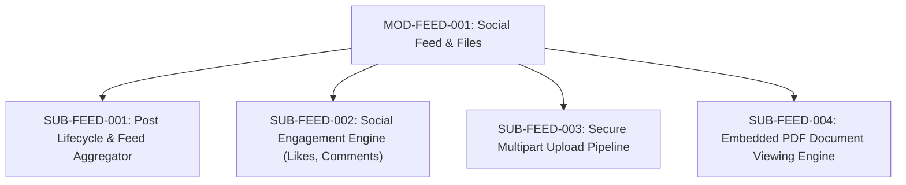

# Document ID: DOC-MOD-007
# Module Specification: Academic Social Feed & Secure File Handling

> **Module ID:** `MOD-FEED-001`  
> **Module Name:** Academic Social Feed & Secure File Subsystem  
> **Classification:** Core Engagement & Media Capability  
> **Status:** APPROVED  
> **Authoring Lead:** Frontend Architect & Application Security Engineer  
> **Review Date:** October 2026  
> **Target System:** AlumniConnect Platform Specification  

---

## 1. Module Identity & Purpose

### 1.1 Purpose & Business Value
The Academic Social Feed enables students, alumni, and faculty to share project milestones, hackathon wins, research papers, and verified certifications. 

This module remediates two critical architectural and security defects identified during audit:
- **`DEF-03` (Public Unauthenticated File Access):** Replaces insecure `express.static()` serving with private, authenticated signed URLs for sensitive documents.
- **`DEF-10` (Insecure Base64 Image Upload):** Replaces memory-heavy Base64 JSON uploads with standardized streaming multipart upload handlers with MIME magic-byte verification.

### 1.2 Scope & Exclusions
- **In-Scope:** Post creation with categorization (`GENERAL`, `CERTIFICATE`, `HACKATHON`, `EVENT`); social interactions (likes, comments, shares); secure multipart upload pipeline for images and PDFs; embedded PDF canvas rendering with `@react-pdf-viewer`.
- **Out-of-Scope:** Video transcoding or long-form video streaming is excluded (supports images and PDF documents).

---

## 2. Submodule Decomposition



### 2.1 Submodule 1: Post Lifecycle & Feed Aggregator (`SUB-FEED-001`)
- **Responsibility:** Manage post creation, updating, deletion, and chronological feed delivery.
- **Inputs:** `title` (string, 3–200 chars), `description` (string, 10–5000 chars), `type` (enum), `fileIds: string[]`.
- **Outputs:** Created `Post` entity returned; feed broadcast emitted via Socket.IO.
- **Business Rules:**
  - Posts are linked to author's `collegeId`.
  - Feed queries return posts from the user's institution, sorted by `createdAt` descending.
  - Authors may delete their own posts (cascades to likes, comments, and post files).
- **Acceptance Criteria:** New posts appear on active peer dashboards within <200ms.

---

### 2.2 Submodule 2: Social Engagement Engine (`SUB-FEED-002`)
- **Responsibility:** Handle atomic like toggles, comment threads, and post sharing.
- **Inputs:** `postId` (UUID), `commentContent` (string, max 2000 chars).
- **Business Rules:**
  - Liking an already-liked post toggles it to unliked and decrements `post.like_count`.
  - Comments must be non-empty and are stored with author identity and timestamp.
  - Post aggregators (`like_count`, `comment_count`, `share_count`) are updated atomically.
- **Acceptance Criteria:** Like toggle is idempotent and immune to race conditions.

---

### 2.3 Submodule 3: Secure Multipart Upload Pipeline (`SUB-FEED-003`)
- **Responsibility:** Ingest, validate, sanitize, and persist uploaded media assets (remediates `DEF-03` and `DEF-10`).
- **Validation Pipeline:**
  1. Stream parsing: Multi-part body streamed via `parseMultipartFiles()` with global byte limit $\le 50\text{MB}$.
  2. File size validation: Images $\le 5\text{MB}$, PDFs $\le 15\text{MB}$.
  3. MIME & Magic-byte sniffing: Verifies binary signature matches declared extension (`%PDF-` for PDFs, `FF D8 FF` for JPEGs, `89 50 4E 47` for PNGs).
  4. UUID storage naming: Stored with non-enumerable names (`${uuid}.pdf`).
  5. Access Authorization: Sensitive documents (resumes, ID cards) require an authenticated download endpoint verifying caller permissions.
- **Acceptance Criteria:** Uploading executable files (`.exe`, `.sh`, `.php`) masked as PDFs is rejected with HTTP 400.

---

### 2.4 Submodule 4: Embedded PDF Document Viewing Engine (`SUB-FEED-004`)
- **Responsibility:** Render certificates and documents directly within feed cards using `@react-pdf-viewer`.
- **Features:**
  - Embedded canvas rendering with pinch-to-zoom and page navigation.
  - Full-screen modal inspection toggle.
  - Responsive canvas scaling preventing layout shifts (CLS $\le 0.05$).
- **Acceptance Criteria:** PDF renders inline on mobile and desktop without triggering browser file download dialog.

---

## 3. Database Schema Reference

```prisma
model Post {
  id           String        @id @default(uuid())
  authorId     String        @map("author_id")
  type         PostType      @default(GENERAL)
  title        String
  description  String
  likeCount    Int           @default(0) @map("like_count")
  commentCount Int           @default(0) @map("comment_count")
  shareCount   Int           @default(0) @map("share_count")
  createdAt    DateTime      @default(now()) @map("created_at")
  updatedAt    DateTime      @updatedAt @map("updated_at")

  author   User          @relation(fields: [authorId], references: [id], onDelete: Cascade)
  likes    PostLike[]
  comments PostComment[]
  shares   PostShare[]
  files    PostFile[]

  @@index([createdAt])
  @@index([authorId, createdAt])
  @@map("posts")
}

model PostFile {
  id        String   @id @default(uuid())
  postId    String   @map("post_id")
  url       String
  fileType  String   @map("file_type")
  fileName  String?  @map("file_name")
  fileSize  Int?     @map("file_size")
  mimeType  String?  @map("mime_type")
  createdAt DateTime @default(now()) @map("created_at")

  post Post @relation(fields: [postId], references: [id], onDelete: Cascade)
  @@index([postId, createdAt])
  @@map("post_files")
}
```

---

## 4. Acceptance Criteria & Test Gates

1. Uploading files $> 15\text{MB}$ is rejected with HTTP 400 (`TEST-FEED-001`).
2. Inline PDF viewer renders valid PDF certificate within <1.5s (`TEST-FEED-002`).
3. Private documents cannot be accessed by unauthenticated actors (`TEST-FEED-003`).
