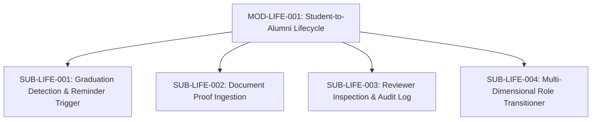

# Document ID: DOC-MOD-008
# Module Specification: Student-to-Alumni Lifecycle & Verification

> **Module ID:** `MOD-LIFE-001`  
> **Module Name:** Student-to-Alumni Lifecycle & Verification Subsystem  
> **Classification:** Core Trust & Identity Subsystem  
> **Status:** APPROVED  
> **Authoring Lead:** Principal Software Architect & Senior Business Analyst  
> **Review Date:** October 2026  
> **Target System:** AlumniConnect Platform Specification  

---

## 1. Module Identity & Purpose

### 1.1 Purpose & Business Value
The Student-to-Alumni Lifecycle Subsystem governs the critical transition of graduating students into verified alumni. 

This module directly eliminates the **critical architectural defect `DEF-02`** identified during the repository audit, where an hourly background cron job (`syncGraduationStatuses`) was silently mutating student roles to `ALUMNI` based purely on chronological date calculation without requiring degree verification or proof.

In this specification:
- Role transitions are decoupled from simple date arithmetic.
- Passing expected graduation date initiates a formal `GRADUATION_REVIEW` workflow.
- Verified Alumni status is granted strictly upon verifiable document proof or institutional placement officer sign-off.
- Every state change is immutably recorded in `verification_logs`.

### 1.2 Scope & Exclusions
- **In-Scope:** Graduation date monitoring; automated transition to `GRADUATION_PENDING_VERIFICATION`; degree document upload (PDF/Image); institutional reviewer review queue; role promotion and badge issuance; verification audit trail.
- **Out-of-Scope:** Automated optical character recognition (OCR) parsing of government seals is an optional heuristic; final authority rests with human reviewer verification.

---

## 2. Submodule Decomposition



### 2.1 Submodule 1: Graduation Detection & Reminders (`SUB-LIFE-001`)
- **Responsibility:** Monitor enrolled students nearing or passing their expected graduation month and initiate review workflows (remediates `DEF-02`).
- **Trigger:** Hourly cron job `syncGraduationStatuses`.
- **Logic:**
  1. Identifies students where `role === 'STUDENT'` AND `graduationDate <= now()`.
  2. Sets `academicStatus = GRADUATION_PENDING_VERIFICATION`. **Does NOT mutate `role = 'ALUMNI'`**.
  3. Dispatches congratulatory email and in-app alert: *"Congratulations on completing your degree! Please upload your degree certificate to unlock Verified Alumni status."*
  4. If user remains unverified after 7 days, dispatches automated reminder email.
- **Acceptance Criteria:** Student role remains `STUDENT` until explicit verification approval.

---

### 2.2 Submodule 2: Document Proof Ingestion (`SUB-LIFE-002`)
- **Responsibility:** Securely ingest, validate, and store student verification documents.
- **Inputs:** `degreeCertificateUrl` (secure private URL), `enrollmentNumber` (string), `graduationYear` (int), `graduationMonth` (int).
- **Outputs:** Created `VerificationRequest` record with status `PENDING_REVIEW`.
- **Validation:** Uploaded document must be PDF or image $\le 15\text{MB}$.
- **Acceptance Criteria:** Document is stored in private storage inaccessible to unauthenticated web crawlers.

---

### 2.3 Submodule 3: Reviewer Inspection & Audit Log (`SUB-LIFE-003`)
- **Responsibility:** Provide institutional administrators with a verification portal to review candidate documents.
- **Inputs:** `requestId` (UUID), `decision` (`APPROVE` | `REJECT`), `reviewerNotes` (string, optional).
- **Outputs:** Immutably signed `VerificationLog` entry.
- **Business Rules:**
  - Reviewer must hold `INSTITUTION_ADMIN` or `SYSTEM_ADMIN` role.
  - Reviewer verifies student enrollment number against institutional records.
  - Rejection requires documenting a reason (e.g., *"Illegible document; please re-upload"*).
- **Acceptance Criteria:** Audit log captures reviewer ID, decision, and timestamp with zero overwrite capability.

---

### 2.4 Submodule 4: Multi-Dimensional Role Transitioner (`SUB-LIFE-004`)
- **Responsibility:** Safely upgrade user permissions upon verification approval.
- **Atomic Transaction:**
  ```prisma
  await prisma.$transaction([
    prisma.user.update({
      where: { id: userId },
      data: {
        role: 'ALUMNI',
        verificationStatus: 'APPROVED',
      },
    }),
    prisma.verificationLog.create({
      data: {
        userId,
        decision: 'APPROVED',
        reviewedBy: reviewerId,
        riskScore: 0,
      },
    }),
  ])
  ```
- **Permission Upgrades:** Unlocks ability to toggle `openToMentorship`, post opportunities (`JOB`, `INTERNSHIP`), offer referrals, and participate on the Alumni Leaderboard.

---

## 3. Database Schema Reference

```prisma
model VerificationLog {
  id         String   @id @default(uuid())
  userId     String   @map("user_id")
  riskScore  Int      @default(0) @map("risk_score")
  ocrName    String?  @map("ocr_name")
  decision   String   // APPROVED | REJECTED | MANUAL_REVIEW
  reviewedBy String?  @map("reviewed_by")
  createdAt  DateTime @default(now()) @map("created_at")

  user User @relation(fields: [userId], references: [id], onDelete: Cascade)
  @@index([userId, createdAt])
  @@map("verification_logs")
}
```

---

## 4. Acceptance Criteria & Test Gates

1. Chronological date expiration never mutates user role to `ALUMNI` automatically (`TEST-LIFE-001`).
2. Verification proof upload creates reviewable ticket in institutional portal (`TEST-LIFE-002`).
3. Administrative approval commits atomic role upgrade and audit log entry (`TEST-LIFE-003`).
