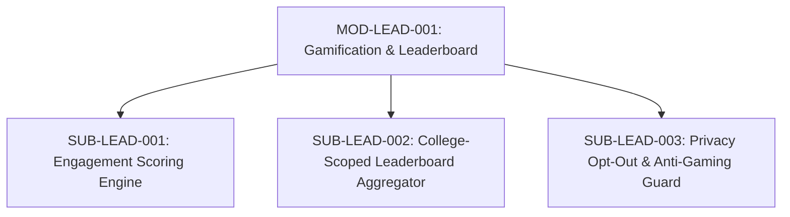

# Document ID: DOC-MOD-009
# Module Specification: Gamification & Alumni Leaderboard

> **Module ID:** `MOD-LEAD-001`  
> **Module Name:** Gamification & Alumni Engagement Leaderboard Subsystem  
> **Classification:** Community Engagement & Recognition Capability  
> **Status:** APPROVED  
> **Authoring Lead:** Product Manager & Backend Architect  
> **Review Date:** October 2026  
> **Target System:** AlumniConnect Platform Specification  

---

## 1. Module Identity & Purpose

### 1.1 Purpose & Business Value
The Alumni Leaderboard recognizes and celebrates alumni who actively contribute to their alma mater through mentorship, student referrals, knowledge sharing, and profile completeness. 

To maintain healthy community dynamics, the leaderboard:
1. Is strictly scoped to the user's institution (fostering institutional pride).
2. Uses an objective, multi-factor scoring formula rather than simple follower counts.
3. Provides an explicit privacy opt-out toggle (`showOnLeaderboard`) for alumni who prefer low visibility.
4. Enforces anti-gaming rate limits to prevent spam-farming points.

### 1.2 Scope & Exclusions
- **In-Scope:** Objective engagement point calculation; college-scoped ranking queries; alumni tier badges (*"Top Mentor"*, *"Career Champion"*, *"Alma Mater Luminary"*); privacy opt-out control; anti-gaming heuristics.
- **Out-of-Scope:** Monetary rewards or cash compensation are excluded.

---

## 2. Submodule Decomposition



### 2.1 Submodule 1: Engagement Scoring Engine (`SUB-LEAD-001`)
- **Responsibility:** Compute and maintain an objective engagement score for each verified alumnus.
- **Scoring Formula:**
  $$\text{Score} = (\text{ProfileCompleteness} \times 20) + (\text{MentorshipsCompleted} \times 50) + (\text{ReferralsActioned} \times 40) + (\text{VerifiedPosts} \times 10) + (\text{ActiveConnections} \times 5)$$
- **Scoring Components:**
  - `ProfileCompleteness`: Float (0.0 to 1.0) based on bio, avatar, skills, experiences, and education filled. Max 20 points.
  - `MentorshipsCompleted`: Integer count of completed sessions with rating $\ge 4$ stars. 50 points per session.
  - `ReferralsActioned`: Count of student referral applications reviewed and submitted. 40 points each.
  - `VerifiedPosts`: Count of academic/career feed posts published (capped at max 10 posts counted per month to prevent spam). 10 points each.
  - `ActiveConnections`: Count of verified connections with same-college students. 5 points each (capped at max 50 points).
- **Acceptance Criteria:** Points calculate deterministically and update upon trigger events.

---

### 2.2 Submodule 2: College-Scoped Leaderboard Aggregator (`SUB-LEAD-002`)
- **Responsibility:** Deliver ranked leaderboard lists strictly within the viewing user's institution.
- **Query Strategy:**
  - Enforces `WHERE college_id = :callerCollegeId AND role = 'ALUMNI' AND show_on_leaderboard = true`.
  - Ordered by `engagement_score` descending, limited to top 50.
  - Cached in Redis for 10 minutes to minimize database compute.
- **Tier Badges:**
  - Tier 1 ($\ge 500$ pts): **"Alma Mater Luminary"** (Gold Badge).
  - Tier 2 ($250 - 499$ pts): **"Career Champion"** (Silver Badge).
  - Tier 3 ($100 - 249$ pts): **"Active Mentor"** (Bronze Badge).
- **Acceptance Criteria:** Leaderboard query latency $\le 50\text{ms}$ with Redis caching.

---

### 2.3 Submodule 3: Privacy Opt-Out & Anti-Gaming Guard (`SUB-LEAD-003`)
- **Responsibility:** Protect alumni privacy and prevent point manipulation.
- **Privacy Controls:**
  - Alumnus can toggle profile setting: `showOnLeaderboard: false`.
  - Immediately removes alumnus from all public rankings while preserving their underlying score.
- **Anti-Gaming Safeguards:**
  - Rapid posting of short or duplicate content is flagged and excluded from score.
  - Mutual connection churning (connecting and disconnecting repeatedly) yields zero additional points.
  - Mentorship ratings from accounts created $< 7$ days ago require moderator validation before awarding points.
- **Acceptance Criteria:** Toggling opt-out invalidates leaderboard cache immediately.

---

## 3. Database Schema Implications

```prisma
// Profile schema extension:
model Profile {
  // Existing fields...
  showOnLeaderboard Boolean  @default(true) @map("show_on_leaderboard")
  engagementScore   Int      @default(0) @map("engagement_score")
  leaderboardTier   String?  @map("leaderboard_tier") // LUMINARY | CHAMPION | MENTOR

  @@index([engagementScore])
}
```

---

## 4. Acceptance Criteria & Test Gates

1. Leaderboard results are strictly filtered to the viewing user's institution (`TEST-LEAD-001`).
2. Toggling `showOnLeaderboard: false` removes the alumnus from rankings within <500ms (`TEST-LEAD-002`).
3. Spamming posts does not yield points beyond the monthly cap (`TEST-LEAD-003`).
