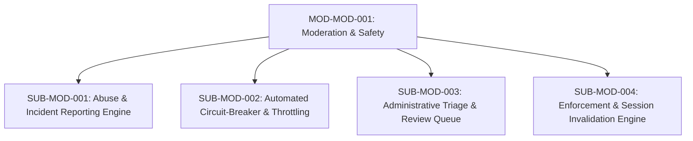

# Document ID: DOC-MOD-010
# Module Specification: Moderation, Trust & Safety Subsystem

> **Module ID:** `MOD-MOD-001`  
> **Module Name:** Moderation, Trust & Safety Subsystem  
> **Classification:** Platform Security & Governance Capability  
> **Status:** APPROVED  
> **Authoring Lead:** Application Security Engineer & Principal Software Architect  
> **Review Date:** October 2026  
> **Target System:** AlumniConnect Platform Specification  

---

## 1. Module Identity & Purpose

### 1.1 Purpose & Business Value
The Moderation, Trust & Safety Subsystem protects students and alumni from harassment, impersonation, unsolicited commercial recruiting, phishing, and predatory behavior. 

This module replaces the unmounted `501 Not Implemented` stubs in `backend/src/routes/admin.routes.js` (remediating `DEF-06`) with an authoritative, automated trust and safety pipeline that provides:
1. Incident reporting across profiles, messages, posts, and calls.
2. An automated circuit-breaker that throttles abusive accounts upon reaching 5 unique reports.
3. An administrative review queue for platform moderators.
4. Immediate, cryptographic session revocation for banned users.

### 1.2 Scope & Exclusions
- **In-Scope:** Reporting engine; automated throttling thresholds; administrative review portal; warning issuance; account suspension; token revocation; audit trail logging.
- **Out-of-Scope:** Automated real-time sentiment analysis or content censorship on encrypted direct messages (preserves privacy and prevents false positives).

---

## 2. Submodule Decomposition



### 2.1 Submodule 1: Abuse & Incident Reporting Engine (`SUB-MOD-001`)
- **Responsibility:** Ingest, categorize, and store violation reports filed by users.
- **Inputs:** `targetId` (UUID), `reason` (`HARASSMENT` | `SPAM` | `IMPERSONATION` | `INAPPROPRIATE_CONTENT`), `notes` (string, max 1000 chars), `includeEvidence` (boolean).
- **Outputs:** Created `Report` record with `status: OPEN`.
- **Business Rules:**
  - Users cannot report themselves.
  - A user cannot submit more than 1 report against the same target within 24 hours (anti-brigading protection).
  - Filing a report immediately offers the reporter a prompt to block the target user.
- **Acceptance Criteria:** Reports committed to database in $\le 50\text{ms}$.

---

### 2.2 Submodule 2: Automated Circuit-Breaker & Throttling (`SUB-MOD-002`)
- **Responsibility:** Automatically engage defensive restrictions when an account exhibits rapid abuse signals.
- **Threshold Rule:**
  - If a user accumulates **5 unique reports within a rolling 14-day window**, the server immediately transitions their account to `RESTRICTED` standing.
- **Restricted Mode Constraints:**
  - User cannot initiate new WebRTC voice or video calls.
  - User cannot initiate new direct message conversations with unconnected users.
  - User cannot publish new feed posts or opportunity listings.
  - High-priority alert dispatched to Platform Administrator queue (`alertLevel: HIGH`).
- **Acceptance Criteria:** Restricted mode activates immediately upon the 5th report transaction commit.

---

### 2.3 Submodule 3: Administrative Triage Queue (`SUB-MOD-003`)
- **Responsibility:** Provide platform moderators with an investigation portal to review reported accounts, inspect message logs (if voluntarily submitted as evidence), and execute decisions.
- **Inputs:** `reportId` (UUID), `decision` (`DISMISS` | `WARN` | `RESTRICT` | `BAN`), `moderatorNotes` (string).
- **Access Control:** Restricted strictly to users holding `SYSTEM_ADMIN` role.
- **Decisions:**
  - `DISMISS`: Clears report ticket; if reports fall below threshold, removes restricted mode.
  - `WARN`: Sends high-priority disciplinary email to the target user.
  - `BAN`: Executes Submodule 4 (`Enforcement & Session Invalidation`).
- **Acceptance Criteria:** Moderator actions are immutably logged with moderator ID and timestamp.

---

### 2.4 Submodule 4: Enforcement & Session Invalidation Engine (`SUB-MOD-004`)
- **Responsibility:** Forcibly terminate access for suspended or banned accounts across all active devices.
- **Atomic Execution:**
  ```prisma
  await prisma.$transaction([
    prisma.user.update({
      where: { id: targetUserId },
      data: {
        isBanned: true,
        tokenVersion: { increment: 1 }, // Invalidates all active JWTs
      },
    }),
    prisma.refreshToken.updateMany({
      where: { userId: targetUserId, revokedAt: null },
      data: { revokedAt: new Date() },
    }),
    prisma.report.updateMany({
      where: { targetId: targetUserId, status: 'OPEN' },
      data: { status: 'RESOLVED', resolvedAt: new Date() },
    }),
  ])
  ```
- **Real-Time Termination:** Server emits Socket.IO event `auth:banned` to room `user:${targetUserId}` and forcibly terminates socket connection.
- **Acceptance Criteria:** Subsequent API calls from banned user fail with HTTP `403 Forbidden` (`code: 'ACCOUNT_BANNED'`).

---

## 3. Database Schema Reference

```prisma
model Report {
  id         String       @id @default(uuid())
  filerId    String       @map("filer_id")
  targetId   String       @map("target_id")
  reason     String
  status     ReportStatus @default(OPEN)
  resolvedAt DateTime?    @map("resolved_at")
  createdAt  DateTime     @default(now()) @map("created_at")

  filer  User @relation("ReportFiler", fields: [filerId], references: [id], onDelete: Cascade)
  target User @relation("ReportTarget", fields: [targetId], references: [id], onDelete: Cascade)

  @@index([targetId, status])
  @@index([createdAt])
  @@map("reports")
}

model Block {
  id        String   @id @default(uuid())
  blockerId String   @map("blocker_id")
  blockedId String   @map("blocked_id")
  createdAt DateTime @default(now()) @map("created_at")

  blocker User @relation("BlockInitiator", fields: [blockerId], references: [id], onDelete: Cascade)
  blocked User @relation("BlockTarget", fields: [blockedId], references: [id], onDelete: Cascade)

  @@unique([blockerId, blockedId])
  @@map("blocks")
}
```

---

## 4. Acceptance Criteria & Test Gates

1. Duplicate reporting within 24 hours is prevented (`TEST-MOD-001`).
2. Accumulating 5 reports engages automated restricted mode (`TEST-MOD-002`).
3. Banning an account invalidates active JWTs and revokes refresh tokens immediately (`TEST-MOD-003`).
