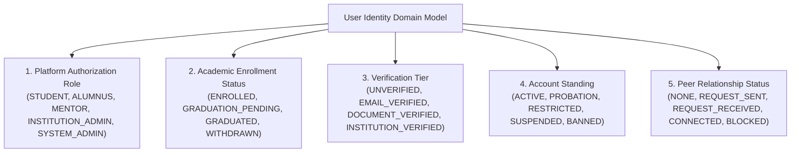
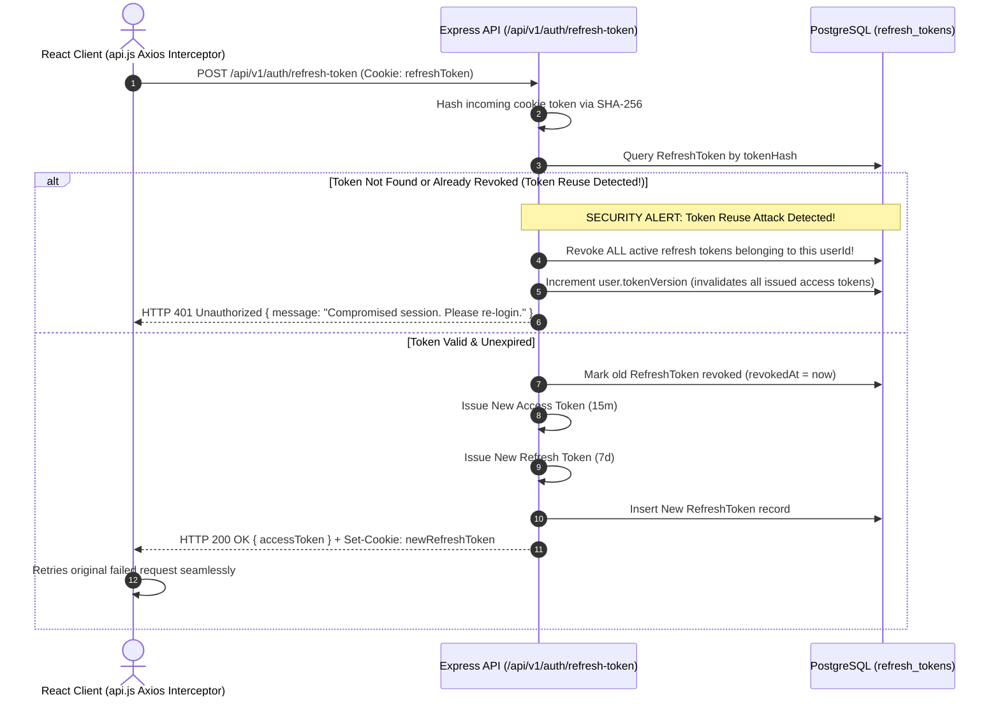

# Document ID: DOC-SEC-001
# Authentication, Authorization & Identity Architecture

> **Document Version:** 1.0.0  
> **Classification:** Security Architecture & Cryptographic Specification  
> **Status:** APPROVED  
> **Authoring Lead:** Authentication & Application Security Engineer  
> **Review Date:** October 2026  
> **Target System:** AlumniConnect Platform Specification  

---

## 1. Multi-Dimensional Identity & Domain Model

In strict conformance with **Master Prompt Section 7**, the platform completely eliminates the architectural defect of overloading a single `role` enum (`DEF-09`). User standing is partitioned into five distinct, orthogonal domain dimensions:



### 1.1 Authorization Dimension Definitions
1. **`PlatformRole`:** Dictates functional capabilities (e.g. posting jobs, viewing administrative moderation queues).
2. **`AcademicStatus`:** Reflects verified institutional reality (enrolled undergraduate vs graduated degree holder).
3. **`VerificationTier`:** Represents the level of identity certainty established through email OTPs, student ID card verification, and registrar sign-off.
4. **`AccountStanding`:** Enforces trust and safety standing (active vs rate-throttled vs permanently banned).
5. **`RelationshipStatus`:** Governs interpersonal communication permissions between pairs of users (unconnected 2-minute trial vs mutual connected calling).

---

## 2. Authentication Sequence Workflows

### 2.1 Standard Login & Token Rotation Sequence

```mermaid
sequenceDiagram
    autonumber
    actor User as Authenticated User
    participant Client as React SPA (AuthCard.jsx)
    participant API as Express API (/api/v1/auth)
    participant DB as PostgreSQL (Prisma)

    User->>Client: Enters Email & Password -> Clicks "Sign In"
    Client->>API: POST /api/v1/auth/login { email, password }
    API->>DB: Query User by email (includes college, profile)
    API->>API: Verify account is not locked (lockedUntil <= now)
    API->>API: bcrypt.compare(password, user.passwordHash)
    alt Password Invalid
        API->>DB: Increment failedLoginAttempts. If >= 5, set lockedUntil = now + 15m
        API-->>Client: HTTP 401 Unauthorized { message: "Invalid credentials. N attempts remaining." }
    else Password Valid
        API->>DB: Reset failedLoginAttempts = 0, update lastLoginAt = now
        API->>API: Generate Access Token (JWT, 15m, signed with JWT_ACCESS_SECRET)
        API->>API: Generate Refresh Token (Opaque 32-byte hex string)
        API->>DB: Insert RefreshToken (Hashed SHA-256, expires in 7 days, userAgent, ipAddress)
        API-->>Client: HTTP 200 OK { accessToken, user } + Set-Cookie: refreshToken (HttpOnly, Secure, SameSite=Strict)
        Client->>User: Stores accessToken in Zustand memory; redirects to /dashboard
    end
```

---

### 2.2 Refresh Token Rotation with Token Family Revocation
To protect against stolen refresh tokens, the platform implements **Refresh Token Rotation (RTR)** with automatic reuse detection:



---

### 2.3 Logout & Global Session Revocation
- **Local Logout (`POST /api/v1/auth/logout`):**
  - Marks current refresh token `revokedAt = now()`.
  - Clears `refreshToken` cookie with expired `Set-Cookie` header (`Max-Age=0`).
  - Clears client-side Zustand store and disconnects active Socket.IO connection.
- **Global Logout (`POST /api/v1/auth/logout-all`):**
  - Increments `user.tokenVersion = tokenVersion + 1`.
  - Revokes all records in `refresh_tokens` where `userId = caller.userId`.
  - Forcibly disconnects all active sockets in room `user:${userId}`.

---

## 3. Comprehensive RBAC & Resource Permission Matrix

Every sensitive resource and operation is governed by server-side authorization middleware enforcing this authoritative matrix:

| Operation / Protected Resource | Anonymous Visitor | Unverified User | Verified Student | Verified Alumnus | Mentor | Institution Admin | System Admin | Suspended / Banned |
| :--- | :---: | :---: | :---: | :---: | :---: | :---: | :---: | :---: |
| **Browse Landing & Public Info** | ALLOW | ALLOW | ALLOW | ALLOW | ALLOW | ALLOW | ALLOW | ALLOW |
| **View Own Dashboard & Profile** | DENY (401) | ALLOW | ALLOW | ALLOW | ALLOW | ALLOW | ALLOW | DENY (403) |
| **View Alma Mater Directory** | DENY (401) | DENY (403) | ALLOW | ALLOW | ALLOW | ALLOW | ALLOW | DENY (403) |
| **View Cross-College Alumni** | DENY (401) | DENY (403) | ALLOW | ALLOW | ALLOW | ALLOW | ALLOW | DENY (403) |
| **Send Connection Request** | DENY (401) | DENY (403) | ALLOW | ALLOW | ALLOW | ALLOW | ALLOW | DENY (403) |
| **Send 2-Min Introductory Chat** | DENY (401) | DENY (403) | ALLOW | ALLOW | ALLOW | ALLOW | ALLOW | DENY (403) |
| **Unlimited Chat with Connections**| DENY (401) | DENY (403) | ALLOW | ALLOW | ALLOW | ALLOW | ALLOW | DENY (403) |
| **Start WebRTC Video/Audio Call**| DENY (401) | DENY (403) | ALLOW | ALLOW | ALLOW | ALLOW | ALLOW | DENY (403) |
| **Book Mentorship Session** | DENY (401) | DENY (403) | ALLOW | ALLOW | DENY | DENY | DENY | DENY (403) |
| **Offer Mentorship & Set Mentees**| DENY (401) | DENY (403) | DENY (403) | ALLOW | ALLOW | DENY (403) | DENY (403) | DENY (403) |
| **Create Opportunity (Job/Intern)**| DENY (401) | DENY (403) | DENY (403) | ALLOW | ALLOW | ALLOW | ALLOW | DENY (403) |
| **Apply for Referral** | DENY (401) | DENY (403) | ALLOW | ALLOW | ALLOW | DENY (403) | DENY (403) | DENY (403) |
| **Publish Academic Feed Post** | DENY (401) | DENY (403) | ALLOW | ALLOW | ALLOW | ALLOW | ALLOW | DENY (403) |
| **Upload PDF Certificates** | DENY (401) | DENY (403) | ALLOW | ALLOW | ALLOW | ALLOW | ALLOW | DENY (403) |
| **Verify Enrolled Students** | DENY (401) | DENY (403) | DENY (403) | DENY (403) | DENY (403) | ALLOW | ALLOW | DENY (403) |
| **Approve College Addition Requests**| DENY (401) | DENY (403) | DENY (403) | DENY (403) | DENY (403) | DENY (403) | ALLOW | DENY (403) |
| **Moderate Reports & Ban Users** | DENY (401) | DENY (403) | DENY (403) | DENY (403) | DENY (403) | DENY (403) | ALLOW | DENY (403) |

---

## 4. Cryptographic Standards & Secret Management

| Security Component | Implementation Standard | Environmental Secret / Configuration |
| :--- | :--- | :--- |
| **Password Storage** | `bcrypt` work factor = **12 rounds**. Never logged or cached. | Handled in-memory during authentication. |
| **JWT Access Tokens** | HMAC-SHA256 (`HS256`). Lifetime = **15 minutes**. | `JWT_ACCESS_SECRET` (minimum 256-bit entropy). |
| **JWT Refresh Tokens** | Opaque 256-bit cryptographically secure random token (`crypto.randomBytes(32)`). Lifetime = **7 days**. Stored as SHA-256 hash in DB. | `JWT_REFRESH_SECRET` |
| **Chat Message Encryption** | `AES-256-GCM` with 12-byte random IV per message. Authenticated GCM tag verification. | `MESSAGE_ENCRYPTION_SECRET` |
| **Password Reset Tokens** | 32-byte hex string. Lifetime = **15 minutes**. Stored as SHA-256 hash in DB. Single-use consumed. | Ephemeral cryptographic generation. |
| **Email Verification OTPs** | 6-digit numeric integer (`100000` to `999999`). Lifetime = **10 minutes**. Stored as SHA-256 hash. Max 5 verification attempts. | Ephemeral cryptographic generation. |

---

## 5. Security Failure & Incident Handling

- **Brute-Force Lockout:** 5 failed password attempts locks the target account for exactly **15 minutes** (`lockedUntil = now + 15m`). Subsequent attempts return HTTP `429 Too Many Requests` without querying password hashes.
- **Token Version Invalidation:** Any privilege escalation, password change, or administrative ban increments `user.tokenVersion`. The `requireAuth` middleware verifies `payload.tokenVersion === user.tokenVersion`; mismatches reject the request with HTTP `401 Unauthorized`.
- **Anti-Enumeration:** Registration, login, and password reset endpoints return standardized non-revealing messages to prevent harvesting active user emails.
