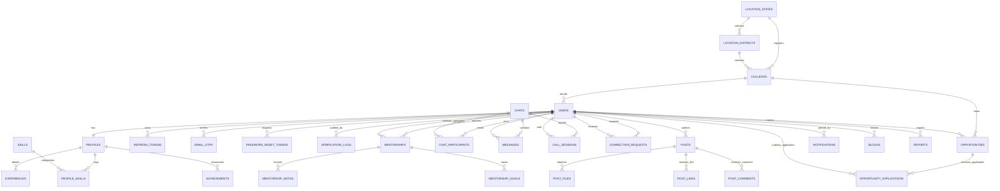

# Document ID: DOC-DAT-001
# Relational Database Schema, ERD & Data Dictionary

> **Document Version:** 1.0.0  
> **Classification:** Data Architecture & Database Engineering  
> **Status:** APPROVED  
> **Authoring Lead:** Database Architect & Principal Software Architect  
> **Review Date:** October 2026  
> **Target Database:** PostgreSQL 16 (Managed via Prisma ORM)  

---

## 1. Database Architecture & Conceptual Data Model

The AlumniConnect database is architected on **PostgreSQL 16** using Prisma ORM. It enforces relational integrity, ACID transaction boundaries, and spatial/institutional multi-tenancy.

### Core Architectural Directives:
1. **Primary Key Standard:** All relational models use canonical **UUIDv4** primary keys (`@id @default(uuid())`) to prevent ID enumeration vulnerabilities.
2. **Column Naming Standard:** PostgreSQL columns utilize snake_case physical naming mapped via Prisma `@map("snake_case")` directives.
3. **Institutional Multi-Tenancy:** The `collegeId` attribute is indexed across core domain entities (`users`, `colleges`, `opportunities`, `posts`) ensuring high-speed row-level multi-tenant isolation.
4. **Data Classification:** Confidential PII (passwords, OTPs, refresh tokens, mobile numbers, ID cards) is separated from public directory profiles.

---

## 2. Logical Entity-Relationship Diagram (ERD)



---

## 3. Comprehensive Data Dictionary

Below is the authoritative dictionary documenting core tables, constraints, sensitivity levels, and retention policies across the database.

### 3.1 Table: `users`
Represents the core identity, credentials, role, and security state of every platform user.

| Column Name | Prisma Field | Type | Nullable | Constraints & Default | Sensitivity | Retention & Description |
| :--- | :--- | :--- | :---: | :--- | :--- | :--- |
| `id` | `id` | UUID | No | Primary Key (`default(uuid())`) | Public ID | Retained until account erasure. |
| `email` | `email` | VARCHAR(255) | No | `UNIQUE` | Confidential PII | User email address; unique login identifier. |
| `mobile_number`| `mobileNumber` | VARCHAR(20) | Yes | `UNIQUE` | Confidential PII | Optional verified phone number. |
| `enrollment_number`| `enrollmentNumber`| VARCHAR(100)| Yes | `UNIQUE` | Restricted PII | Institutional student enrollment/roll number. |
| `password_hash`| `passwordHash` | VARCHAR(255) | Yes | Null for OAuth | Restricted Auth | Bcrypt salted hash (work factor 12). |
| `college_id` | `collegeId` | UUID | No | FK -> `colleges.id` | Internal | Anchor institution ID. Indexed. |
| `role` | `role` | Enum (`Role`)| No | Default `STUDENT` | Public | `STUDENT`, `ALUMNI`, `ADMIN`. |
| `verified` | `verified` | BOOLEAN | No | Default `false` | Internal | Email verification status flag. |
| `verification_status`| `verificationStatus`| Enum | No | Default `PENDING` | Internal | `PENDING`, `APPROVED`, `REJECTED`, `MANUAL_REVIEW`.|
| `token_version`| `tokenVersion` | INT | No | Default `0` | Internal | Incremented to invalidate all active JWTs. |
| `failed_login_attempts`| `failedLoginAttempts`| INT | No | Default `0` | Internal | Brute-force counter; locks account at 5. |
| `locked_until` | `lockedUntil` | TIMESTAMP | Yes | Default `null` | Internal | Lockout expiration timestamp. |
| `is_banned` | `isBanned` | BOOLEAN | No | Default `false` | Internal | Administrative suspension flag. |
| `created_at` | `createdAt` | TIMESTAMP | No | `default(now())` | Public | Account creation timestamp. |
| `updated_at` | `updatedAt` | TIMESTAMP | No | `updatedAt` | Public | Last profile modification timestamp. |

---

### 3.2 Table: `profiles`
Stores professional, educational, and mentorship attributes.

| Column Name | Prisma Field | Type | Nullable | Constraints & Default | Sensitivity | Description |
| :--- | :--- | :--- | :---: | :--- | :--- | :--- |
| `id` | `id` | UUID | No | Primary Key | Public ID | Profile entity identifier. |
| `user_id` | `userId` | UUID | No | `UNIQUE`, FK -> `users.id` | Internal | 1-to-1 relationship with `users`. |
| `first_name` | `firstName` | VARCHAR(100) | No | Required | Public | User given name. |
| `last_name` | `lastName` | VARCHAR(100) | No | Required | Public | User family name. |
| `avatar_url` | `avatarUrl` | VARCHAR(500) | Yes | Nullable | Public | Cloud storage URL to profile picture. |
| `bio` | `bio` | VARCHAR(2000)| Yes | Max 2000 chars | Public | Professional bio and career summary. |
| `domain` | `domain` | VARCHAR(50) | No | Default `'both'` | Public | Career domain: `'tech'`, `'non-tech'`, `'both'`.|
| `batch_year` | `batchYear` | INT | No | Indexed | Public | College entry cohort year (e.g. 2022). |
| `graduation_year`| `graduationYear`| INT | Yes | Indexed | Public | Expected or confirmed graduation year. |
| `graduation_month`| `graduationMonth`| INT | Yes | 1 to 12 | Public | Graduation month. |
| `department` | `department` | VARCHAR(150) | No | Indexed | Public | Academic faculty / branch name. |
| `current_role` | `currentRole` | VARCHAR(150) | Yes | Nullable | Public | Job title (e.g. "Software Engineer II"). |
| `company` | `company` | VARCHAR(150) | Yes | Nullable | Public | Current employer or startup name. |
| `open_to_mentorship`| `openToMentorship`| BOOLEAN | No | Default `false` | Public | Availability toggle for student mentorship. |
| `max_mentees` | `maxMentees` | INT | No | Default `3` (1–10) | Public | Active mentee capacity limit. |
| `skill_tags` | `skillTags` | TEXT[] | No | Default `[]` | Public | Array of user skills (e.g. `["React", "Go"]`).|
| `interest_tags`| `interestTags`| TEXT[] | No | Default `[]` | Public | Career interests (e.g. `["AI", "Finance"]`). |

---

### 3.3 Table: `connection_requests`
Maintains the peer-to-peer relationship graph.

| Column Name | Prisma Field | Type | Nullable | Constraints & Default | Description |
| :--- | :--- | :--- | :---: | :--- | :--- |
| `id` | `id` | UUID | No | Primary Key | Connection request identifier. |
| `requester_id` | `requesterId` | UUID | No | FK -> `users.id` | Outgoing user ID. |
| `receiver_id` | `receiverId` | UUID | No | FK -> `users.id` | Target recipient user ID. |
| `status` | `status` | Enum | No | Default `PENDING` | `PENDING`, `ACCEPTED`, `REJECTED`. |
| `responded_at` | `respondedAt` | TIMESTAMP | Yes | Default `null` | Timestamp of accept/reject decision. |
| `created_at` | `createdAt` | TIMESTAMP | No | `default(now())` | Submission timestamp. |

*Unique Constraint:* `@@unique([requesterId, receiverId])` prevents duplicate requests.

---

### 3.4 Table: `messages`
Stores direct text messages with database field-level encryption.

| Column Name | Prisma Field | Type | Nullable | Constraints & Default | Description |
| :--- | :--- | :--- | :---: | :--- | :--- |
| `id` | `id` | UUID | No | Primary Key | Message identifier. |
| `chat_id` | `chatId` | UUID | No | FK -> `chats.id` | Chat thread identifier. Indexed. |
| `from_id` | `fromId` | UUID | No | FK -> `users.id` | Author user ID. |
| `content` | `content` | TEXT | Yes | Encrypted AES-256-GCM | Encrypted ciphertext (`${iv}:${tag}:${cipher}`). |
| `media_url` | `mediaUrl` | VARCHAR(500) | Yes | Nullable | Secure attachment URL. |
| `type` | `type` | Enum | No | Default `TEXT` | `TEXT`, `IMAGE`, `FILE`. |
| `read` | `read` | BOOLEAN | No | Default `false` | Read receipt status flag. |
| `created_at` | `createdAt` | TIMESTAMP | No | `default(now())` | Delivery timestamp. Indexed. |

---

### 3.5 Table: `call_sessions`
Tracks bilateral WebRTC voice and video calls.

| Column Name | Prisma Field | Type | Nullable | Constraints & Default | Description |
| :--- | :--- | :--- | :---: | :--- | :--- |
| `id` | `id` | UUID | No | Primary Key | Call session identifier. |
| `chat_id` | `chatId` | UUID | No | FK -> `chats.id` | Linked chat conversation ID. |
| `caller_id` | `callerId` | UUID | No | FK -> `users.id` | Call initiator ID. |
| `callee_id` | `calleeId` | UUID | No | FK -> `users.id` | Call recipient ID. Indexed. |
| `mode` | `mode` | Enum | No | Default `VOICE` | `VOICE`, `VIDEO`. |
| `status` | `status` | Enum | No | Default `RINGING` | `RINGING`, `ACTIVE`, `REJECTED`, `ENDED`, `MISSED`.|
| `accepted_at` | `acceptedAt` | TIMESTAMP | Yes | Nullable | Timestamp call was answered. |
| `ended_at` | `endedAt` | TIMESTAMP | Yes | Nullable | Timestamp call ended. |
| `duration_seconds`| `durationSeconds`| INT | Yes | Nullable | Computed call duration in seconds. |

---

## 4. Indexing & Query Optimization Strategy

To ensure sub-100ms response times at scale, the database employs deliberate composite indexing:

```sql
-- Institutional Multi-Tenancy & Discovery Indexes
CREATE INDEX idx_users_college_role ON users(college_id, role);
CREATE INDEX idx_profiles_batch_dept ON profiles(batch_year, department);
CREATE INDEX idx_colleges_state_district ON colleges(state_id, district_id, name);

-- Real-Time Communication Indexes
CREATE INDEX idx_messages_chat_created ON messages(chat_id, created_at DESC);
CREATE INDEX idx_calls_callee_status ON call_sessions(callee_id, status);

-- Opportunities Radar Indexes
CREATE INDEX idx_opps_college_status ON opportunities(college_id, status, created_at DESC);

-- Notification Polling Indexes
CREATE INDEX idx_notifications_user_unread ON notifications(user_id, read, created_at DESC);
```

---

## 5. Migration & Backup Policy

- **Migration Governance:** Managed strictly via `prisma migrate dev` in development and `prisma migrate deploy` in CI/CD. Direct ad-hoc SQL modifications on production are strictly prohibited.
- **Backup Schedule:**
  - Full daily snapshot at 02:00 UTC retained for 30 days.
  - Continuous Write-Ahead Logging (WAL) archiving to S3 enabling Point-In-Time Recovery (PITR) with RPO $\le 1\text{ hour}$.
