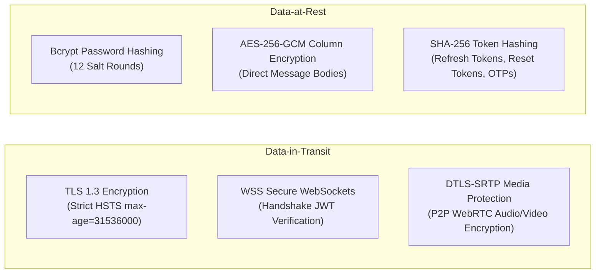

# Document ID: DOC-THR-001
# Threat Modeling & STRIDE Security Analysis

> **Document Version:** 1.0.0  
> **Classification:** Application Security Architecture  
> **Status:** APPROVED  
> **Authoring Lead:** Application Security Engineer & Principal Software Architect  
> **Review Date:** October 2026  
> **Methodology:** Microsoft STRIDE Threat Modeling Framework & OWASP Top 10 (2021)  

---

## 1. Threat Modeling Overview & Trust Boundaries

AlumniConnect processes confidential student educational data, institutional identity affiliations, direct messages, and WebRTC audio/video streams. To identify vulnerabilities and design robust architectural mitigations, this threat model analyzes interactions across six distinct trust boundaries:

```mermaid
graph TD
    subgraph TB1["Trust Boundary 1: Client Browser to Edge Ingress"]
        Browser["Untrusted User Browser"] -->|Public Internet / HTTPS| WAF["Edge Ingress (Nginx / Cloudflare)"]
    end

    subgraph TB2["Trust Boundary 2: Edge Ingress to Application Tier"]
        WAF -->|Internal Network| AppServer["Express API & Socket.IO Gateway"]
    end

    subgraph TB3["Trust Boundary 3: Application to Relational Storage"]
        AppServer -->|Private VPC| DB[("PostgreSQL 16 Database")]
    end

    subgraph TB4["Trust Boundary 4: Application to Media Storage"]
        AppServer -->|Pre-Signed URLs| S3[("Private S3 / R2 Vault")]
    end

    subgraph TB5["Trust Boundary 5: Application to Identity Providers"]
        AppServer -->|OIDC Token Verify| GoogleIdP["Google / LinkedIn OAuth"]
    end

    subgraph TB6["Trust Boundary 6: Peer-to-Peer Media Channel"]
        Browser -->|WebRTC Media (SRTP / DTLS)| PeerBrowser["Remote Peer Browser"]
    end
```

---

## 2. Exhaustive STRIDE Threat Analysis Matrix

| Threat ID | STRIDE Category | Threat Description & Attack Path | Threat Actor & Capabilities | Impact Severity | Likelihood | Risk Rating | Preventive Controls (Architecture) | Detective Controls | Residual Risk |
| :--- | :--- | :--- | :--- | :---: | :---: | :---: | :--- | :--- | :---: |
| **THR-001** | **Spoofing** | **Fake Institution Submission:** Attacker submits fake or spoofed colleges to pollute the directory. | External anonymous attacker with automated script. | High | High | **HIGH** | `POST /api/colleges` restricted; user submissions create `InstitutionAdditionRequest` tickets requiring Admin sign-off (remediates `DEF-01`). | Admin review dashboard with geographic verification checks. | Low |
| **THR-002** | **Spoofing** | **Fake Alumni Impersonation:** Attacker creates an account claiming to be a senior alumnus without having graduated. | Malicious actor seeking to deceive students. | High | High | **HIGH** | Role `ALUMNI` granted strictly upon verifiable document review or official email domain matching; cron auto-mutation eliminated (remediates `DEF-02`). | `VerificationLog` audit trail with reviewer ID stamping. | Low |
| **THR-003** | **Tampering** | **2-Minute Chat Window Bypass:** Attacker manipulates client-side JavaScript or local clock to bypass trial chat expiry. | Tech-savvy student attempting unlimited messaging without connecting. | Medium | High | **HIGH** | Timer calculation is 100% server-authoritative on the backend (`Date.now() - firstMessage.createdAt`). Server strictly throws HTTP 403 on expiry. | Logged as `CHAT_TRIAL_EXPIRED_REJECTION`. | Negligible |
| **THR-004** | **Tampering** | **Ciphertext Tampering at Rest:** Attacker with database access attempts to alter encrypted message content. | Rogue database admin or SQL injection attacker. | High | Low | **MEDIUM** | AES-256-GCM authenticated cipher tags (`authTag`). Any tampering with ciphertext fails GCM authentication check during decryption. | Decryption failures logged to security alert channel. | Low |
| **THR-005** | **Repudiation** | **Untraceable Abusive WebRTC Calls:** Abusive user starts harassing calls and claims they never initiated the session. | Harassing peer attempting to evade suspension. | High | Medium | **HIGH** | `call_sessions` table immutably logs `callerId`, `calleeId`, timestamps, and socket session IDs upon call creation. | End-to-end call audit logging in PostgreSQL. | Low |
| **THR-006** | **Information Disclosure** | **Insecure Direct Object Reference (IDOR) on Uploaded PDFs:** Attacker enumerates URLs under `/uploads` to view private resumes and student IDs. | Malicious student or web crawler. | High | High | **CRITICAL** | `express.static()` public serving eliminated (remediates `DEF-03`). Private vault storage with pre-signed URLs or authenticated streaming proxies. | Failed access attempts return HTTP 401/403. | Low |
| **THR-007** | **Information Disclosure** | **User Email Enumeration:** Attacker sends repeated login or reset password requests to determine which emails are registered. | External credential stuffer / scraper. | Medium | High | **MEDIUM** | Standardized anti-enumeration responses: Login and password reset return identical generic success/failure notices. | IP rate limiting (5 attempts/15 min). | Low |
| **THR-008** | **Denial of Service** | **OTP Email Bombing:** Attacker repeatedly triggers `POST /auth/signup` to exhaust transactional email credits. | Botnet or automated script. | Medium | High | **MEDIUM** | IP-based rate limiting (5 auth attempts/15 min) + 60-second cooldown per email between OTP resends + Cloudflare Turnstile CAPTCHA. | Alerts on Resend email API usage spikes. | Low |
| **THR-009** | **Denial of Service** | **Base64 Payload Memory Exhaustion:** Attacker uploads massive Base64 strings in JSON bodies to exhaust Node.js event loop memory. | Malicious user uploading 100MB JSON strings. | High | Medium | **HIGH** | Standardized streaming multipart uploads with strict 5MB image / 15MB PDF caps; Express body-parser capped at 6MB (remediates `DEF-10`). | Node.js process memory metrics monitoring. | Negligible |
| **THR-010** | **Elevation of Privilege** | **Role Mutation via Profile Update:** Attacker injects `{ role: 'ADMIN' }` into `PUT /user/update` payload. | Authenticated student attempting privilege escalation. | Critical | Medium | **CRITICAL** | Zod validation schema strictly strips `role` from update payloads; database update queries explicitly omit role fields. | Schema validation rejections logged. | Negligible |
| **THR-011** | **Elevation of Privilege** | **Stolen Refresh Token Reuse:** Attacker intercepts a valid refresh token cookie to maintain persistent session. | Man-in-the-middle / compromised device. | High | Medium | **HIGH** | Refresh Token Rotation (RTR) with token family revocation: Attempting to use an already-revoked refresh token revokes ALL tokens for that user. | Token family reuse security alert dispatched. | Low |

---

## 3. Cryptographic & Transport Mitigations



---

## 4. Verification & Security Quality Gates

1. **Gate 1:** Zero public endpoints serve private user files without authorization checks (`TEST-SEC-001`).
2. **Gate 2:** Attempted role escalation via profile updates is rejected and logged (`TEST-SEC-002`).
3. **Gate 3:** Refresh token reuse triggers immediate family revocation across all devices (`TEST-SEC-003`).
