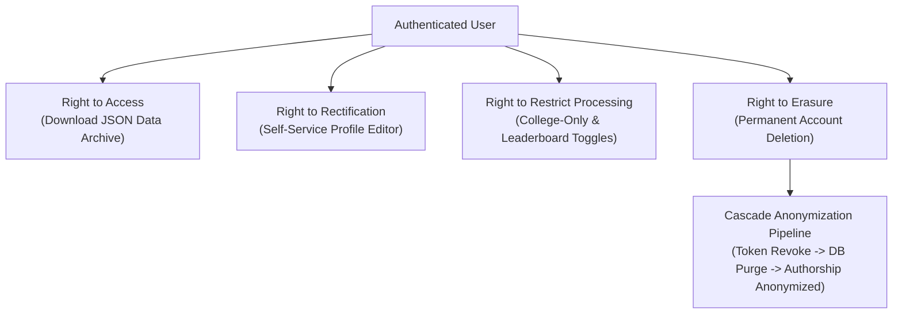

# Document ID: DOC-THR-002
# Data Privacy, PII Governance & Regulatory Compliance

> **Document Version:** 1.0.0  
> **Classification:** Data Privacy & Regulatory Compliance Baseline  
> **Status:** APPROVED  
> **Authoring Lead:** Application Security Engineer & Senior Business Analyst  
> **Review Date:** October 2026  
> **Target Regulations:** Digital Personal Data Protection Act (DPDP 2023), GDPR, FERPA Alignment  

---

## 1. Privacy Architecture & Governance Principles

AlumniConnect processes sensitive academic, personal, and professional data. The platform adheres strictly to five privacy engineering principles:
1. **Data Minimization:** Only data necessary for institutional verification and professional networking is collected.
2. **Purpose Limitation:** Student data is used exclusively for verified networking, mentorship, and career placement; never sold to third-party commercial brokers.
3. **Storage Limitation:** Ephemeral data (OTPs, temporary verification ID card uploads) is automatically purged post-verification.
4. **Transparency & Consent:** Explicit opt-in consent for external account connections (Google, LinkedIn) and public directory visibility.
5. **Right to Erasure:** Complete, irreversible account deletion and anonymization workflows.

---

## 2. Personal Data Inventory & Classification

| Data Category | Specific Attributes | Sensitivity Classification | Storage Location | Access Policy & Protections | Retention Period |
| :--- | :--- | :---: | :--- | :--- | :--- |
| **Public Directory Profile** | First Name, Last Name, College, Department, Batch Year, Headline, Avatar, Bio, Skill Tags. | **Public Profile** | PostgreSQL `profiles` table | Visible to verified same-college users (and cross-college if public). | Retained until user deletes account. |
| **Confidential Contact Info** | Email Address, Mobile Number (optional). | **Confidential PII** | PostgreSQL `users` table | Hidden from public profile views; accessible only by user and system notifications. | Retained until user deletes account. |
| **Educational Identity Proofs** | Student ID card image, Degree Certificate PDF, Enrollment Number. | **Restricted Identity** | Private S3 / R2 Bucket | Accessible strictly by authorized Institutional Admins via expiring signed URLs. | Purged **30 days** post-verification approval. |
| **Direct Communication** | Chat Messages, Call Duration Records. | **Private Comms** | PostgreSQL `messages` table | Encrypted at rest via AES-256-GCM. Accessible strictly by verified chat participants. | Retained until conversation deletion. |
| **Authentication Secrets** | Password hashes (Bcrypt), Token hashes (SHA-256), OTP hashes. | **Restricted Security** | PostgreSQL `users`, `refresh_tokens`, `email_otps` | Accessible strictly by internal auth middleware. | Expired tokens purged daily via cron. |

---

## 3. Data Subject Rights & Implementation Workflows

### 3.1 Right to Erasure / Account Deletion (`DELETE /api/v1/user/me`)
When a user deletes their account, the platform executes a deterministic privacy pipeline:
1. Re-authenticates user via password confirmation or OAuth re-prompt.
2. Forcibly revokes all active refresh tokens in `refresh_tokens`.
3. Deletes private user profile records (`profiles`, `profile_skills`, `experiences`, `achievements`, `email_otps`).
4. Replaces historical authorship on public forum posts with generic *"Deleted User"*, preserving community thread readability without retaining PII.
5. Deletes private uploaded identity documents from the cloud object storage vault.
6. Clears client session cookies and emits a socket termination event.

---

## 4. Automated Data Purging Schedules

To ensure compliance with storage limitation mandates, background cron jobs enforce strict retention schedules:

| Target Entity | Purge Trigger Condition | Cron Job | Operational Action |
| :--- | :--- | :--- | :--- |
| `email_otps` | `expiresAt < now() - 24 hours` OR `consumedAt IS NOT NULL` | `JOB-CRON-002` (Daily at 03:00 UTC) | Permanently deleted from database. |
| `refresh_tokens` | `revokedAt < now() - 30 days` | `JOB-CRON-003` (Daily at 04:00 UTC) | Permanently deleted from database. |
| Verification Proof Documents | `reviewedAt < now() - 30 days` on approved tickets | `JOB-CRON-007` (Weekly) | Binary files permanently purged from S3 vault. |

---

## 5. Security Incident Response & Breach Notification Protocol

In the event of a verified security incident or data breach:
1. **Containment (t $\le 1$ hour):** Automated circuit-breakers isolate compromised services; `tokenVersion` incremented globally to terminate all active sessions.
2. **Forensic Triage (t $\le 6$ hours):** Audit log analysis determines affected user IDs and compromised data categories.
3. **Regulatory Notification (t $\le 72$ hours):** Formal notification dispatched to relevant data protection authorities in accordance with DPDP / GDPR guidelines.
4. **User Notification:** Transparent email notifications dispatched to all affected users detailing incident scope and remediation steps (e.g., mandatory password reset).
