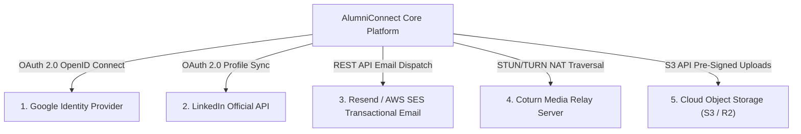

# Document ID: DOC-INT-001
# External Services & Cloud Integrations Architecture

> **Document Version:** 1.0.0  
> **Classification:** Systems Engineering & Third-Party Integration Architecture  
> **Status:** APPROVED  
> **Authoring Lead:** Principal Software Architect & Application Security Engineer  
> **Review Date:** October 2026  
> **Target System:** AlumniConnect Platform Specification  

---

## 1. Integration Landscape & Ecosystem Overview

AlumniConnect interfaces with four external cloud services to deliver authentication, communications, media storage, and profile synchronization:



---

## 2. Google OAuth 2.0 & Account Linking

### 2.1 Protocol & Authentication Flow
- **Standard:** OpenID Connect (OIDC) on top of OAuth 2.0.
- **Client Configuration:** Google Identity Services client SDK (`@react-oauth/google` or standard button).
- **Backend Verification:** Backend receives `idToken` from client, verifies signature using Google Public Keys (`google-auth-library`), and extracts verified email, name, and `googleId`.

### 2.2 Account Linking & Conflict Resolution
1. **Scenario A (New Google User):** User registers via Google; email does not exist. Creates user with `authProvider: GOOGLE`, `googleId`, and auto-sets `verified: true`.
2. **Scenario B (Existing Password User Signs In with Google):** An account already exists with the same email under `authProvider: LOCAL`. The system securely links the `googleId` to the existing account, preserving existing academic affiliation and profile history.
3. **Scenario C (Email Mismatch):** Google account email differs from user's institutional email. Platform prompts user to link secondary email with explicit OTP verification on the institutional address.

---

## 3. LinkedIn Integration & Achievement Reminders

In strict conformance with **Master Prompt Section 4.7**, the platform integrates exclusively with officially supported LinkedIn APIs without scraping.

### 3.1 Authorized Scopes & Data Availability
- **Authorized OAuth Scopes:** `openid`, `profile`, `email`.
- **Accessible Data:** User Full Name, Profile Picture URL, Primary Email Address, Vanity Profile URL.
- **Inaccessible Data (Protected by LinkedIn Enterprise Restrictions):** User feed posts, full work history updates, and real-time certification events cannot be accessed via public developer scopes. Scraping is strictly prohibited by platform policy.

### 3.2 Achievement Reminder & Manual Fallback Workflow
```mermaid
sequenceDiagram
    autonumber
    actor User as Alumnus / Student
    participant Client as React SPA
    participant Server as Express Server
    participant DB as PostgreSQL

    User->>Client: Clicks "Connect LinkedIn" in Profile Settings
    Client->>Server: Initiates OAuth 2.0 Authorization Code Flow
    Server->>User: Redirects to LinkedIn Consent Screen
    User->>Server: Grants Consent -> Server receives Auth Code
    Server->>Server: Exchanges Code for Access Token; stores in DB
    Server-->>Client: Confirms LinkedIn Connected
    Note over Server: Automated Achievement Tracking Heuristics
    Server->>DB: Check if user profile has empty Achievements or Certifications
    alt Profile Missing Key Certifications
        Server->>DB: Generate Notification: "Keep your alma mater profile updated!"
        Server-->>Client: Displays banner: "Add your latest AWS or CFA certification to your college showcase"
    end
    User->>Client: Enters Certificate Name, Issuer, URL, and uploads PDF
    Client->>Server: POST /api/v1/posts { type: 'CERTIFICATE', fileUrl }
    Server->>DB: Commits verified achievement
```

- **Opt-Out & Frequency Capping:** Achievement reminder notifications are rate-limited to at most **once every 30 days** per user; users can toggle *"Disable external sync reminders"* in settings.
- **Disconnection & Token Revocation:** Users can click *"Disconnect LinkedIn"* at any time. Server immediately revokes the OAuth token and deletes external tokens from the database.

---

## 4. Transactional Email Delivery (Resend / AWS SES)

- **Provider:** Resend API (with seamless fallback to AWS SES or standard SMTP).
- **Configuration:** Managed via `env.resendApiKey` and `env.otpFromEmail`.
- **Templates:**
  1. `EMAIL_OTP_VERIFICATION`: 6-digit registration OTP with 10-minute expiry notice.
  2. `PASSWORD_RESET`: Expiring password reset link with 15-minute token.
  3. `GRADUATION_CONGRATULATIONS`: Degree completion notice prompting alumni verification upload.
  4. `GRADUATION_REMINDER`: Engagement reminder dispatched 24 hours post-graduation.
- **Fail-Safe Mechanism:** In local development or during transient email provider downtime, the system logs generated OTPs to the secure server console (`[otp] generated: XXXXXX`) to prevent developer lockout.

---

## 5. WebRTC Media Relay (Coturn STUN/TURN)

### 5.1 NAT Traversal Architecture
To ensure audio and video calls connect reliably across complex university campus firewalls and symmetric mobile NATs, the platform deploys a dedicated Coturn server:
- **STUN (Session Traversal Utilities for NAT):** Discovers public IP and port mappings for direct P2P connections (handles ~85% of domestic calls).
- **TURN (Traversal Using Relays around NAT):** Encrypted media relay (TURNS over TLS port 443) for callers behind restrictive campus proxies or enterprise firewalls (handles ~15% of symmetric NAT calls).

### 5.2 Dynamic ICE Server Token Minting
The backend mints ephemeral, time-limited TURN credentials via HMAC-SHA1:
```javascript
export const getIceServers = (userId) => {
  const username = `${Math.floor(Date.now() / 1000) + 3600}:${userId}`;
  const hmac = crypto.createHmac('sha1', env.turnSecret);
  hmac.update(username);
  const credential = hmac.digest('base64');

  return [
    { urls: 'stun:stun.alumniconnect.edu:3478' },
    {
      urls: 'turn:turn.alumniconnect.edu:3478?transport=udp',
      username,
      credential,
    },
    {
      urls: 'turns:turn.alumniconnect.edu:443?transport=tcp',
      username,
      credential,
    },
  ];
};
```

---

## 6. Cloud Object Storage (S3 / Cloudflare R2)

- **Provider:** AWS S3 or Cloudflare R2 (S3-compatible API).
- **Storage Buckets:**
  - `alumniconnect-public-assets`: Cached public avatars and college logos.
  - `alumniconnect-private-vault`: Resumes, degree certificates, and identity cards.
- **Security Control:** Sensitive assets in the private vault require **Pre-Signed Expiring URLs** (TTL = 15 minutes) generated by the backend API upon verifying the caller's authorization.

---

## 7. Acceptance Criteria & Test Gates

1. LinkedIn connection requires explicit user consent and supports 1-click disconnection (`TEST-INT-001`).
2. WebRTC calls establish P2P media streaming across symmetric NAT via TURN relay (`TEST-INT-002`).
3. Private PDF documents cannot be accessed without an active signed URL (`TEST-INT-003`).
