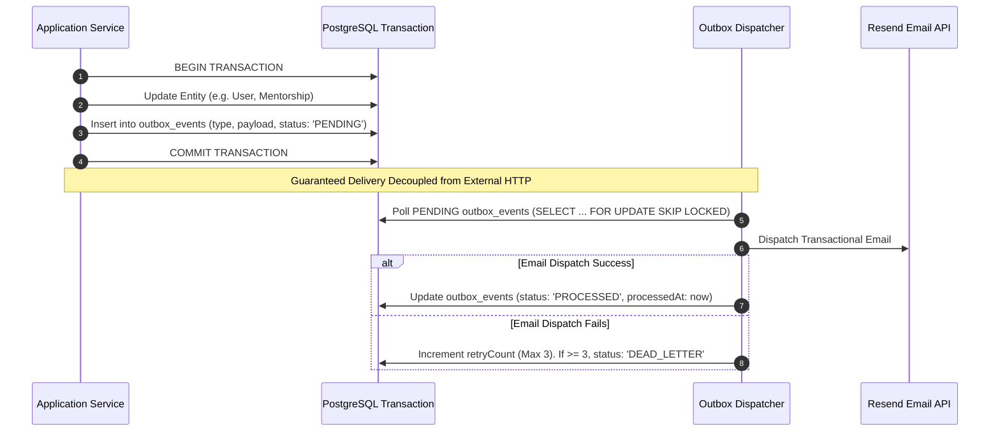

# Document ID: DOC-JOB-001
# Background Jobs, Cron Tasks & Event Processing Architecture

> **Document Version:** 1.0.0  
> **Classification:** Backend Systems & Asynchronous Processing Specification  
> **Status:** APPROVED  
> **Authoring Lead:** Backend Architect  
> **Review Date:** October 2026  
> **Target System:** AlumniConnect Background Engine (`engagement.service.js`)  

---

## 1. Asynchronous Architecture & Processing Strategy

AlumniConnect employs an asynchronous processing tier to decouple resource-intensive or scheduled workflows from the synchronous HTTP request/response loop:
1. **Scheduled Recurring Cron Workers:** Managed via `node-cron` executing defined time-interval tasks.
2. **Transactional Outbox Pattern:** Ensures that event notifications and external email dispatches are guaranteed even if external providers experience transient network faults.
3. **Idempotent Job Consumers:** All background tasks are designed with idempotency keys to ensure that duplicated triggers do not create redundant database records or spam user inboxes.

```mermaid
graph TD
    Cron["Node-Cron Scheduler (server.js)"]
    Cron -->|Hourly (0 * * * *)| J1["JOB-CRON-001: syncGraduationStatuses"]
    Cron -->|Daily (0 3 * * *)| J2["JOB-CRON-002: cleanupExpiredOtps"]
    Cron -->|Daily (0 4 * * *)| J3["JOB-CRON-003: cleanupRevokedTokens"]
    Cron -->|Every 6h (0 */6 * * *)| J4["JOB-CRON-004: aggregateLeaderboardScores"]
    Cron -->|Daily (0 2 * * *)| J5["JOB-CRON-005: expireInactiveMentorshipRequests"]
    Cron -->|Daily (0 1 * * *)| J6["JOB-CRON-006: closeExpiredOpportunities"]

    J1 --> DB[("PostgreSQL 16")]
    J1 --> Email["Resend Transactional Email"]
    J1 --> Sockets["Socket.IO Broadcast Gateway"]
```

---

## 2. Scheduled Cron Jobs Catalog

| Job ID | Job Name | Cron Expression | Schedule Frequency | Purpose & Execution Logic | Failure Handling & Retries |
| :--- | :--- | :--- | :--- | :--- | :--- |
| **JOB-CRON-001** | `syncGraduationStatuses` | `0 * * * *` | Hourly at minute 0 | Scans students where `graduationDate <= now()`. Updates `academicStatus = GRADUATION_PENDING_VERIFICATION` (does NOT auto-promote to Alumni, remediating `DEF-02`). Dispatches congratulations email and notification. | Logs error to Winston; retries next hour. Idempotent based on `graduationMailSentAt` timestamp check. |
| **JOB-CRON-002** | `cleanupExpiredOtps` | `0 3 * * *` | Daily at 03:00 UTC | Deletes records from `email_otps` where `expiresAt < now() - 24 hours` or `consumedAt IS NOT NULL`. | DB transaction; logs count of purged records. |
| **JOB-CRON-003** | `cleanupRevokedTokens` | `0 4 * * *` | Daily at 04:00 UTC | Purges records from `refresh_tokens` where `revokedAt < now() - 30 days` to prevent unbounded table growth. | DB transaction; logs count of purged records. |
| **JOB-CRON-004** | `aggregateLeaderboardScores` | `0 */6 * * *` | Every 6 hours | Recalculates engagement scores across all verified alumni using the 5-factor formula and populates the Redis leaderboard cache. | Atomic Redis pipeline swap (`RENAME` temp key) prevents read interruptions. |
| **JOB-CRON-005** | `expireInactiveMentorshipRequests` | `0 2 * * *` | Daily at 02:00 UTC | Scans `mentorships` where `status = 'PENDING'` and `createdAt < now() - 7 days`. Sets status to `EXPIRED` and notifies mentee. | Updates DB status; emits real-time socket alert. |
| **JOB-CRON-006** | `closeExpiredOpportunities` | `0 1 * * *` | Daily at 01:00 UTC | Scans `opportunities` where `status = 'ACTIVE'` and `deadline < now()`. Sets `status = 'CLOSED'`. | Updates DB status; removes from active job radar. |

---

## 3. Transactional Outbox Pattern for Email & Real-Time Alerts

To prevent dual-write vulnerabilities (e.g. database commits but email service crashes, or email sends but database rolls back), the system implements a lightweight transactional outbox:



---

## 4. Idempotency & Concurrency Safeguards

1. **Duplicate Execution Prevention:** In multi-container production environments, cron tasks use PostgreSQL advisory locks (`pg_try_advisory_lock(job_id)`) to ensure only **one container instance** executes the scheduled job.
2. **Dead-Letter Queue (DLQ):** Outbox events failing 3 consecutive attempts are flagged as `DEAD_LETTER` and trigger an automated Slack/email alert to platform DevOps engineers.
3. **Job Observability:** Every job execution logs: `jobId`, `startTime`, `recordsProcessed`, `durationMs`, `errorsCount` to Prometheus metrics.

---

## 5. Acceptance Criteria & Test Gates

1. Scheduled graduation sync never promotes students to alumni without verified proof (`TEST-JOB-001`).
2. Expired OTPs and revoked tokens are cleaned up without impacting active sessions (`TEST-JOB-002`).
3. Outbox events retry with exponential backoff upon transient email failure (`TEST-JOB-003`).
