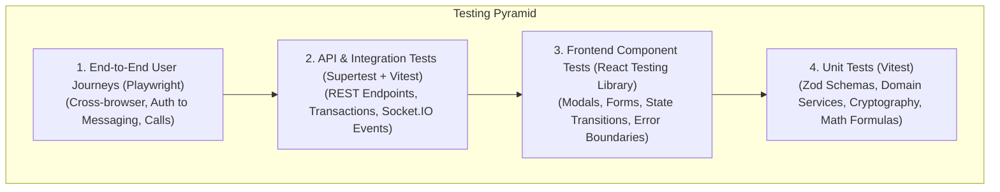

# Document ID: DOC-TST-001
# Quality Assurance Architecture & Test Automation Strategy

> **Document Version:** 1.0.0  
> **Classification:** Engineering Quality Assurance & Test Architecture  
> **Status:** APPROVED  
> **Authoring Lead:** QA & Test Automation Architect & Principal Software Architect  
> **Review Date:** October 2026  
> **Remediates Defect:** `DEF-08` (Complete Absence of Automated Testing)  

---

## 1. Quality Strategy & The Test Pyramid

To remediate the critical vulnerability of having zero automated test suites (`DEF-08`), AlumniConnect establishes an enterprise-grade automated testing pyramid. Every requirement specified in `DOC-REQ-001` maps to concrete, automated verification suites.



---

## 2. Test Suites Decomposition & Framework Selection

| Test Tier | Technology Stack | Scope of Coverage | Minimum Code Coverage Target |
| :--- | :--- | :--- | :---: |
| **Unit Testing** | Vitest | Domain services (`chat.service`, `token.service`, `message-crypto.service`), Zod schemas, utility functions. | $\ge 90\%$ branch coverage |
| **Component Testing** | Vitest + React Testing Library | Frontend UI components (`AuthCard`, `CollegeSelector`, `Messages`, `PostFilePreview`, `AppShell`). | $\ge 80\%$ line coverage |
| **API Integration Testing** | Vitest + Supertest | Express REST endpoints, middleware stacks, rate limiters, Prisma database transactions. | $\ge 85\%$ endpoint coverage |
| **Real-Time WebSocket Testing** | `socket.io-client` in Node.js test harness | Handshake authentication, room isolation, call signaling, message broadcasting. | 100% of socket events |
| **End-to-End (E2E) Testing** | Playwright (Headless Chrome, Firefox, WebKit) | Critical user journeys (`JRN-AUTH-001`, `JRN-CONN-001`, `JRN-CHAT-001`, `JRN-CALL-001`). | Top 12 critical flows |
| **Performance & Load Testing** | k6 (Grafana k6) | High-concurrency throughput (1,000 VUs), p95 latency benchmarks ($\le 150\text{ms}$). | Core read/write paths |
| **Security Penetration Testing** | OWASP ZAP + Custom security test harness | SQL injection, XSS, CSRF, IDOR, token manipulation, brute-force throttling. | 100% of OWASP Top 10 |

---

## 3. Dedicated Test Suites & Verification Rules

### 3.1 Authentication & Security Verification Suite
- **Negative Authorization Matrix:** Tests every protected endpoint with: (1) No token; (2) Expired token; (3) Tampered signature; (4) Invalid role. Verifies server strictly returns HTTP 401 or 403.
- **Token Family Revocation Test:** Simulates stolen refresh token replay. Verifies that attempting to use a revoked token immediately revokes all tokens in the family and increments `tokenVersion`.
- **Brute-Force Lockout Test:** Sends 5 consecutive invalid passwords. Verifies the 6th attempt returns HTTP 429 without querying database password hashes.

### 3.2 2-Minute Introductory Chat Timer Verification Suite
- **Timer Boundary Test:**
  - Test client sends message at $t = 0\text{s}$: Verifies HTTP 201 Created.
  - Test client sends message at $t = 60\text{s}$: Verifies HTTP 201 Created.
  - Test client manipulates local clock to $t = 0\text{s}$ and sends message at real $t = 121\text{s}$: Verifies server rejects write with HTTP `403 Forbidden` (`{ locked: true, trialRemainingSeconds: 0 }`).
  - Verifies zero message records are created after the 120-second threshold.

### 3.3 Discovery Isolation Verification Suite
- **Cross-Institution Isolation Test:**
  - Seeds users across College A (MIT) and College B (Stanford).
  - Authenticated user from College A queries `/api/v1/users/same-college`.
  - Verifies 100% of returned records have `collegeId === College A`. Verifies 0 records from College B are present.

### 3.4 WebRTC Calling & Media State Suite
- **Call Session State Test:**
  - User A starts call to User B (`POST /api/v1/calls`). Verifies state is `RINGING`.
  - User B emits `call:accept`. Verifies state is `ACTIVE`.
  - Simulates peer exchange of SDP offer/answer and ICE candidates via `call:signal`.
  - User A hangs up (`POST /api/v1/calls/:id/end`). Verifies status is `ENDED`, `durationSeconds` calculated correctly.

---

## 4. CI/CD Quality Gates & Release Enforcement

In the GitHub Actions CI pipeline, no pull request can be merged into `develop` or `main` unless it satisfies all automated gates:

```yaml
# CI Quality Gate Criteria:
- Name: "Lint & Format Gate"
  Command: "npm run lint"
  Status: "Must pass with 0 errors and 0 warnings"

- Name: "Unit & Integration Test Gate"
  Command: "npm run test:coverage"
  Status: "All tests must pass; minimum 85% coverage required"

- Name: "Security Audit Gate"
  Command: "npm audit --audit-level=high"
  Status: "0 high or critical vulnerabilities allowed"

- Name: "E2E Playwright Smoke Gate"
  Command: "npx playwright test"
  Status: "100% of smoke user journeys must pass"
```
