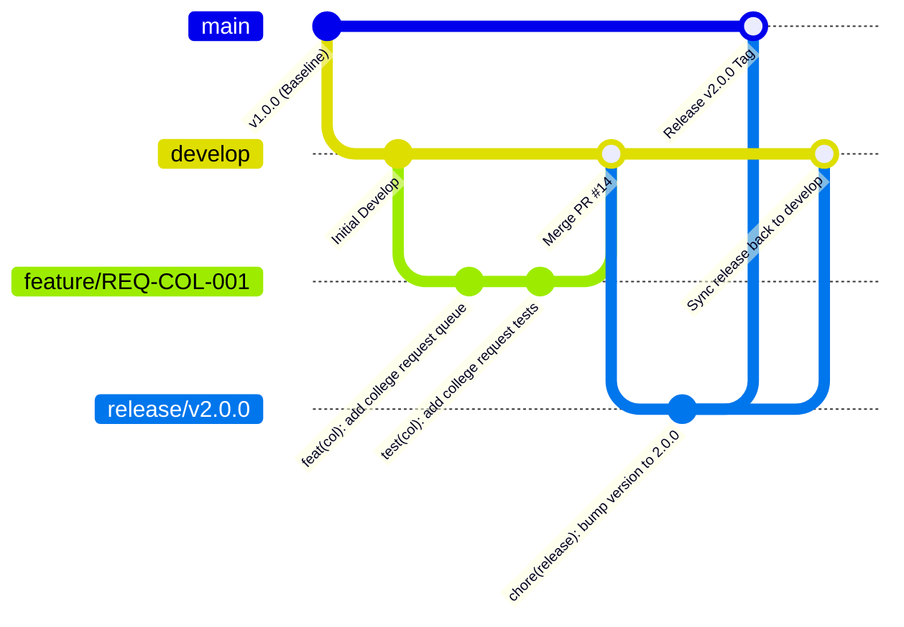

# Document ID: DOC-REL-001
# Branching Strategy, Conventional Commits & Release Engineering

> **Document Version:** 1.0.0  
> **Classification:** Engineering Governance & Release Architecture  
> **Status:** APPROVED  
> **Authoring Lead:** DevOps & Release Engineer & Principal Software Architect  
> **Review Date:** October 2026  
> **Target Standard:** Git Flow & Conventional Commits v1.0.0  

---

## 1. Git Repository & Branching Model

The project follows a disciplined **Git Flow** branching model designed for team development, automated CI verification, and safe production rollouts:



### 1.1 Branch Taxonomy & Lifecycles
1. **`main`:**
   - Production branch. Represents verified, deployed code running in production.
   - Protected: Direct commits and force pushes are strictly disabled. Changes enter solely via squashed Pull Requests from `release/*` or `hotfix/*`.
2. **`develop`:**
   - Active integration branch for sprint deliverables.
   - Protected: All feature branches merge into `develop` via reviewed PRs passing CI gates.
3. **`feature/<REQ-ID>-<short-description>`:**
   - Ephemeral branch created from `develop`.
   - Examples: `feature/REQ-COL-001-college-requests`, `feature/REQ-CHAT-001-trial-timer`.
4. **`fix/<DEF-ID>-<short-description>`:**
   - Bugfix branch created from `develop` targeting non-emergency defect resolutions.
   - Example: `fix/DEF-005-discovery-scoping`.
5. **`hotfix/<vX.Y.Z>-<short-description>`:**
   - Critical production patch branch branched directly from `main`.
   - Merged back to both `main` and `develop` upon verification.

---

## 2. Conventional Commit Standards

Every commit message must adhere to the Conventional Commits specification:

```
<type>(<scope>): <short description in imperative mood>

[optional body referencing REQ-ID or defect resolution]

[optional footer referencing BREAKING CHANGE or issue numbers]
```

### 2.1 Commit Types & Scopes
- `feat`: A new user-facing capability or API endpoint (e.g. `feat(chat): enforce 2-minute introductory window`).
- `fix`: A bug fix or defect resolution (e.g. `fix(discovery): isolate same-college recommendations`).
- `docs`: Documentation-only updates (e.g. `docs(api): update OpenAPI specifications for mentorship`).
- `test`: Adding missing tests or correcting existing tests (e.g. `test(auth): add token family reuse tests`).
- `refactor`: Code change that neither fixes a bug nor adds a feature (e.g. `refactor(crypto): streamline AES-GCM IV generation`).
- `chore`: Maintenance tasks, dependency bumps, build tool configurations (e.g. `chore(deps): update prisma to 5.22.0`).

---

## 3. Pull Request (PR) Requirements & Quality Gates

Every Pull Request must satisfy the following checklist before merge authorization:

- [ ] **Traceability Stamped:** PR title and description cite specific Requirement IDs (`REQ-xxx`) and Document IDs (`DOC-xxx`).
- [ ] **Automated CI Passed:** GitHub Actions CI checks green:
  - Linting (`eslint`) passes with 0 errors.
  - Test suites (`vitest`, `supertest`) pass with $\ge 85\%$ coverage on modified services.
  - Security audit (`npm audit`) reports 0 high/critical vulnerabilities.
- [ ] **Peer Code Review:** Minimum of **2 approving code reviews** from senior engineering leads.
- [ ] **Database Migration Review:** If migrations are included, verified to be backward-compatible (non-blocking).

---

## 4. Database Migration Safety & Rollback Protocols

1. **Forward-Only Additive Migrations:** Database migrations must never execute destructive column drops (`DROP COLUMN`) in the same release as application code changes. Migrations follow the **Expand and Contract pattern**:
   - *Phase 1 (Expand):* Add new column (nullable or with default); update backend code to write to both old and new columns.
   - *Phase 2 (Migrate):* Backfill historical data via asynchronous worker.
   - *Phase 3 (Contract):* Remove old column in a subsequent release after all services run on the new column.
2. **Rollback Strategy:** Every release package maintains a companion rollback script restoring the prior container image and verifying schema compatibility.
