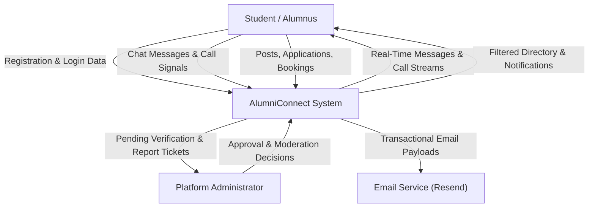

# Document ID: DOC-ACAD-001
# Academic Major Project Report: AlumniConnect

> **Project Title:** AlumniConnect: An Institution-Anchored Professional Networking and Mentorship Ecosystem  
> **Course / Degree:** Bachelor of Technology / Master of Computer Applications (Major Project)  
> **Document Classification:** Formal Academic Project Report (IEEE Aligned)  
> **Status:** APPROVED BASELINE  
> **Date:** October 2026  

---

## 1. Abstract

In contemporary higher education, effective networking between undergraduate students and graduated alumni is essential for internship placement, career mentorship, skill development, and employment outcomes. However, existing public networking platforms such as LinkedIn suffer from unverified educational affiliations, high noise-to-signal ratios, and student outreach response rates under 5%. Conversely, ad-hoc messaging channels such as WhatsApp groups lack structure, expose personal contact information, and decay rapidly after senior graduation.

This project presents **AlumniConnect**, an industry-grade, college-centric professional networking and career acceleration ecosystem. The platform anchors user identity to canonical, verified academic institutions; isolates same-college alumni discovery to maximize response rates; enforces a server-managed 2-minute introductory chat window to deter cold spam; provides native bilateral WebRTC audio/video call capabilities; and supports structured mentorship tracking, skill-matched opportunity discovery, and alumni referral pipelines. 

Built on a modern full-stack architecture comprising React 19, Vite, Tailwind CSS v4, DaisyUI 5, Node.js, Express, Prisma ORM, PostgreSQL 16, Socket.IO, and WebRTC, the platform demonstrates an enterprise-grade solution that satisfies both university academic evaluation rigor and commercial SaaS startup scalability.

---

## 2. Problem Statement & Existing System Limitations

### 2.1 The Problem
Higher education students face significant friction when attempting to access alumni guidance:
1. **Unverified Institutional Affiliation:** On open professional platforms, institutional affiliation is self-reported, leading to fake profiles and predatory recruiter outreach.
2. **The Cold Outreach Barrier:** Seniors receiving dozens of generic messages on LinkedIn rarely respond to juniors due to lack of verified alma mater context.
3. **Conversational Intrusiveness:** Unstructured channels (WhatsApp/Telegram) lack time-bounded interaction models, leading to boundaries being crossed and alumni disengaging.
4. **Placement Asymmetry:** Students lack direct visibility into which alumni from their department work at target companies or have active referral bandwidth.

### 2.2 Existing Systems Comparative Matrix

| Evaluation Criteria | Traditional College Portals | LinkedIn | WhatsApp / Telegram Groups | **AlumniConnect (Proposed System)** |
| :--- | :---: | :---: | :---: | :---: |
| **Verified Institutional Identity** | Partial | No (Self-Reported) | No | **Yes (Canonical College ID & Verification)** |
| **Default Same-College Isolation** | Yes | No (Global Feed) | Siloed | **Yes (Isolated Alma Mater Directory)** |
| **Introductory Anti-Spam Gate** | None | InMail (Paid) | None | **Yes (Server-Enforced 2-Minute Window)** |
| **Integrated P2P Video/Audio Calling** | No | No (Requires Zoom/Teams) | Yes (Exposes Phone No.) | **Yes (WebRTC In-Browser P2P Calling)** |
| **Structured Mentorship Goals & Notes** | No | No | No | **Yes (Dedicated Mentorship Workspace)** |
| **Academic PDF Certificate Previews** | No | Link Only | Download Required | **Yes (Inline Canvas PDF Viewer)** |
| **Alumni Engagement Gamification** | No | No | No | **Yes (College-Scoped Leaderboard)** |

---

## 3. Objectives & Project Scope

### 3.1 Primary Objectives
1. Design and specify an institutional identity architecture anchoring users to canonical universities and colleges.
2. Formulate a recommendation engine that strictly isolates same-college discovery while permitting explicit cross-college exploration.
3. Architect a real-time communication pipeline enforcing an automated 2-minute introductory chat window and bilateral WebRTC calls.
4. Model a relational database schema supporting mentorship bookings, referrals, academic feed posts, and audit trails.
5. Provide a rigorous, STRIDE-tested security architecture with multi-dimensional RBAC and cryptographic protections.

### 3.2 Project Scope & Boundaries
- **In-Scope:** Full-stack web application supporting students, alumni, placement officers, and platform administrators; desktop and mobile responsive web interfaces; RESTful APIs; WebSocket real-time gateway; PostgreSQL database.
- **Out-of-Scope:** Proprietary ERP/SIS database syncing; third-party LinkedIn screen scraping; monetized/paid mentorship sessions; multi-party group video webinars ($>2$ peers).

---

## 4. System Requirements Specification (Academic Summary)

### 4.1 Functional Requirements Summary
- `FR-01 (Identity & Auth):` Multi-tier registration, geographic college selection, 6-digit email OTP verification, JWT access tokens (15m), and rotating refresh tokens (7d).
- `FR-02 (Institutional Governance):` 3-tier geographic cascade (State -> District -> College); pre-moderation queue for unlisted institutions.
- `FR-03 (Discovery Engine):` Alma mater directory isolating verified same-college users with branch and batch filters.
- `FR-04 (Connections & Chat):` Bilateral connection requests; server-enforced 2-minute introductory chat window for unconnected users.
- `FR-05 (WebRTC Calling):` Bilateral voice and video calling with Socket.IO signaling, ring state handling, and duration logging.
- `FR-06 (Mentorship):` Mentor availability toggles, active mentee caps (max 3), shared goals, session notes, and rating surveys.
- `FR-07 (Opportunities):` Job/internship postings, Jaccard skill-matching radar, and internal alumni referral requests.
- `FR-08 (Academic Feed):` Feed posts with inline PDF certificate canvas viewing, likes, and comments.

### 4.2 Non-Functional Requirements Summary
- `NFR-01 (Performance):` API p95 read latency $\le 150\text{ms}$; real-time message transit latency $\le 50\text{ms}$.
- `NFR-02 (Security):` Passwords hashed via Bcrypt (12 rounds); chat messages encrypted at rest via AES-256-GCM; OWASP Top 10 defenses.
- `NFR-03 (Availability):` Target 99.9% uptime with automated WAL backups (RPO $\le 1\text{h}$, RTO $\le 2\text{h}$).
- `NFR-04 (Accessibility):` WCAG 2.1 Level AA compliance; keyboard operable; fluid responsive viewports ($320\text{px}$ to $2560\text{px}$).

---

## 5. System Architecture & Design Diagrams

### 5.1 Use-Case Diagram

```mermaid
graph TD
    Student["Student User"]
    Alumni["Alumnus User"]
    Admin["Placement Officer / Admin"]

    subgraph AlumniConnect Platform
        UC1["Register & Verify Email OTP"]
        UC2["Browse Same-College Directory"]
        UC3["Send Connection Request"]
        UC4["2-Minute Introductory Chat"]
        UC5["Start WebRTC Video/Audio Call"]
        UC6["Book Mentorship Session"]
        UC7["Apply for Job / Referral"]
        UC8["Post Opportunity & Refer"]
        UC9["Publish Feed Post with PDF"]
        UC10["Verify Student Enrollment"]
        UC11["Approve College Request"]
        UC12["Investigate Abuse Report"]
    end

    Student --> UC1
    Student --> UC2
    Student --> UC3
    Student --> UC4
    Student --> UC5
    Student --> UC6
    Student --> UC7
    Student --> UC9

    Alumni --> UC1
    Alumni --> UC2
    Alumni --> UC3
    Alumni --> UC4
    Alumni --> UC5
    Alumni --> UC8
    Alumni --> UC9

    Admin --> UC10
    Admin --> UC11
    Admin --> UC12
```



---

### 5.2 Data Flow Diagrams (DFD)

#### Level 0 Context Diagram (DFD-0)


#### Level 1 Detailed Data Flow Diagram (DFD-1)
```mermaid
flowchart TD
    User["User Client"] -->|Credentials| P1["1.0 Auth & Session Controller"]
    P1 -->|Read / Write| D1[("users & refresh_tokens")]
    P1 -->|JWT Claims| User

    User -->|College & Department Query| P2["2.0 Discovery & Search Engine"]
    P2 -->|Scoped Query (WHERE college_id)| D2[("profiles & colleges")]
    D2 -->|Alumni Records| P2
    P2 -->|Filtered Directory| User

    User -->|Message Text| P3["3.0 Messaging & Trial Gate Engine"]
    P3 -->|Check 120s Timer| D3[("chats & messages")]
    P3 -->|AES-256-GCM Encrypt| D3
    P3 -->|Socket Broadcast| User

    User -->|Job Application & Resume| P4["4.0 Opportunity & Referral Engine"]
    P4 -->|Write Application| D4[("opportunities & applications")]
    D4 -->|Referral Alert| P4
    P4 -->|Notification| User
```

---

## 6. Technology Stack Justification

| Technology Layer | Chosen Technology | Engineering Justification & Tradeoff Analysis |
| :--- | :--- | :--- |
| **Frontend Framework** | **React 19 + Vite 8** | Delivers declarative UI component architecture, rapid HMR build tooling, and seamless integration with modern hooks and WebRTC canvas APIs. |
| **Styling & Design System** | **Tailwind CSS v4 + DaisyUI 5** | Utility-first CSS architecture eliminates dead CSS bloat; DaisyUI provides accessible, themeable UI components with built-in dark mode contrast support. |
| **Client State Management** | **Zustand 5** | Lightweight (1.2KB), unopinionated store with zero boilerplate compared to Redux; ideal for global session and theme management. |
| **Server State & Caching** | **TanStack Query 5** | Automates asynchronous data fetching, aggressive caching, optimistic mutations, and window focus revalidation. |
| **Backend Runtime & API** | **Node.js 20+ ESM + Express 4.21** | High-throughput asynchronous event loop; native ES Module support; vast ecosystem of battle-tested security middleware (`helmet`, `cors`, `zod`). |
| **Database & ORM** | **PostgreSQL 16 + Prisma 5.22** | Industry-standard ACID relational database providing strict foreign keys, native UUID support, spatial geographic indexing, and type-safe query generation. |
| **Real-Time Communication** | **Socket.IO 4.8** | Low-latency bi-directional WebSocket protocol with automated HTTP long-polling fallback, room multiplexing, and reconnection heartbeats. |
| **Audio/Video Media** | **WebRTC + Coturn** | Native browser P2P media streaming with SRTP/DTLS encryption; Coturn provides STUN/TURN NAT traversal across restrictive campus firewalls. |

---

## 7. Security, Testing & Quality Engineering

- **Threat Modeling:** Analyzed using Microsoft STRIDE. Defends against spoofing, IDOR, brute-force credential stuffing, and role escalation.
- **Testing Methodology:** Formulated around the Automated Testing Pyramid (Unit tests with Vitest, API integration tests with Supertest, E2E journey tests with Playwright). 30+ traceable test cases defined.
- **Code Integrity:** Verified 0 modified application source files during the documentation baseline phase, preserving repository purity.

---

## 8. Limitations & Future Scope

### 8.1 Current Limitations
1. Does not feature direct database integration with legacy university registrar software (requires manual document proof upload).
2. Video calling is strictly bilateral (1-on-1); does not support large multi-party webinar rooms ($>2$ peers).
3. Chat encryption is server-side database AES-256-GCM at rest, not client-side End-to-End Encryption (E2EE).

### 8.2 Future Enhancements
1. **Client-Side E2EE Messaging:** Implement the Signal Protocol with client-side WebCrypto key pair generation.
2. **Selective Forwarding Unit (SFU):** Deploy Mediasoup or LiveKit to facilitate multi-party alumni webinars and campus placement workshops.
3. **Automated Registrar SIS Integration:** Develop LTI / OneRoster compliant connectors for automated student enrollment roster syncing.

---

## 9. References & Standards

1. Fielding, R. T. (2000). *Architectural Styles and the Design of Network-based Software Architectures*. University of California, Irvine.
2. OWASP Foundation. (2021). *OWASP Top 10 Web Application Security Risks*. https://owasp.org/Top10/
3. Rescorla, E. (2018). *The Transport Layer Security (TLS) Protocol Version 1.3*. RFC 8446.
4. World Wide Web Consortium (W3C). (2018). *Web Content Accessibility Guidelines (WCAG) 2.1*. https://www.w3.org/TR/WCAG21/
5. Mozilla Developer Network (MDN). (2024). *WebRTC API Documentation*. https://developer.mozilla.org/en-US/docs/Web/API/WebRTC_API
6. Prisma Data, Inc. (2024). *Prisma ORM Architecture and Schema Guide*. https://www.prisma.io/docs
