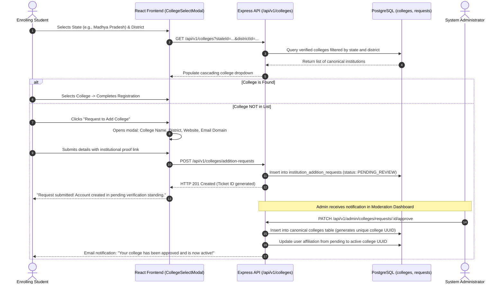
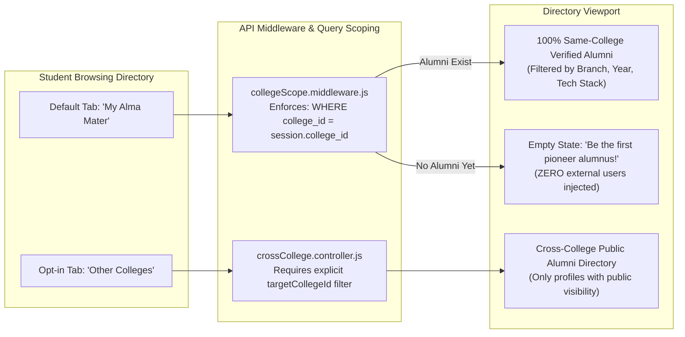
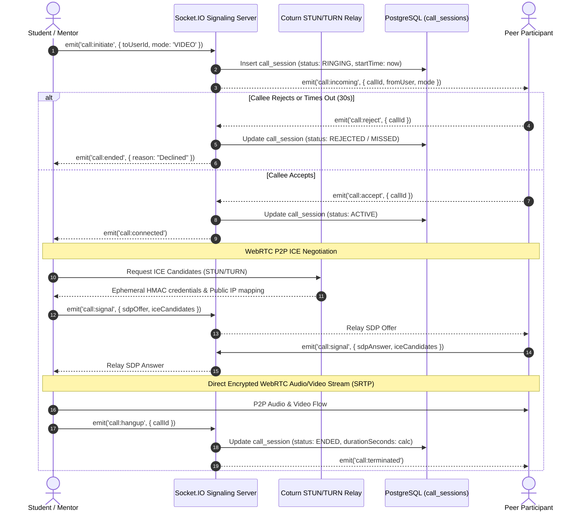
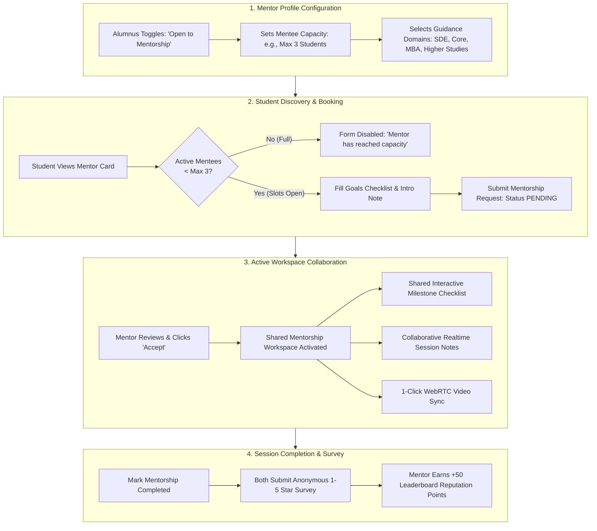
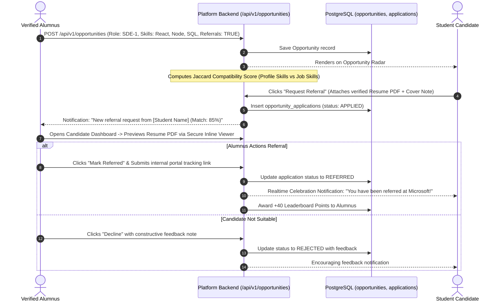
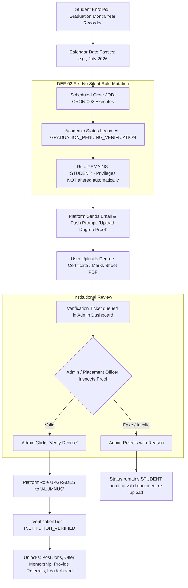
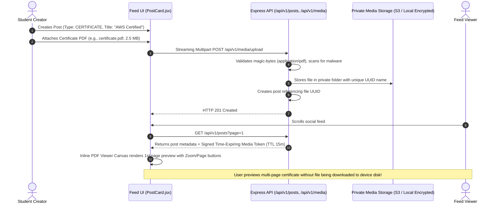
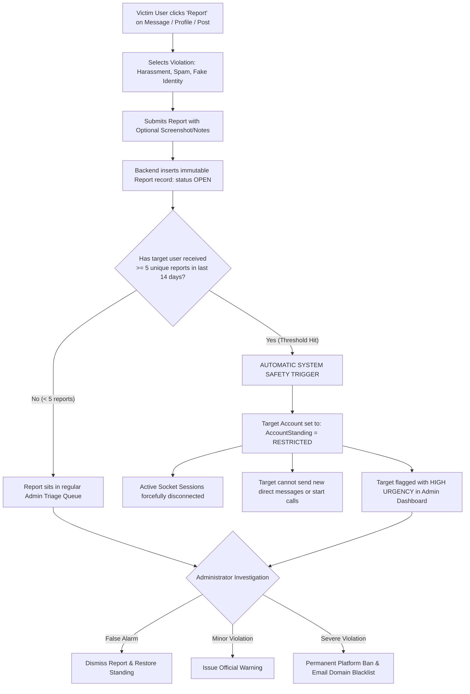

# Complete End-to-End System Workflow & Feature Interaction Diagrams

> **Document ID:** DOC-ACAD-003  
> **Course / Purpose:** Minor Project-I (CS-508) & Major Project Architecture Defense  
> **Status:** APPROVED BASELINE  
> **Target Audience:** Project Guide, Evaluators, Technical Viva Committee, and Engineering Team  

---

## 1. Master High-Level System Workflow Diagram

This master flowchart demonstrates how an undergraduate student and a graduated alumnus interact across every subsystem of the **AlumniConnect Platform**:

```mermaid
flowchart TD
    %% Styling
    classDef auth fill:#1e3a8a,stroke:#3b82f6,stroke-width:2px,color:#ffffff;
    classDef college fill:#78350f,stroke:#f59e0b,stroke-width:2px,color:#ffffff;
    classDef discover fill:#064e3b,stroke:#10b981,stroke-width:2px,color:#ffffff;
    classDef comms fill:#581c87,stroke:#a855f7,stroke-width:2px,color:#ffffff;
    classDef career fill:#7c2d12,stroke:#f97316,stroke-width:2px,color:#ffffff;
    classDef admin fill:#881337,stroke:#f43f5e,stroke-width:2px,color:#ffffff;
    classDef decision fill:#0f172a,stroke:#38bdf8,stroke-width:2px,color:#38bdf8;

    %% STAGE 1: ONBOARDING & INSTITUTIONAL BOUNDARY
    Start(["1. User Visits AlumniConnect Platform"]) --> RegChoice{"Auth Method?"}:::decision
    RegChoice -->|Google OAuth 2.0| OAuthFlow["Google Sign-In: Verified Email"]:::auth
    RegChoice -->|Email and Password| CredFlow["Bcrypt 12 Rounds + Email OTP"]:::auth
    
    OAuthFlow --> StateSelect["2. Geographic Cascading: Select State"]:::college
    CredFlow --> StateSelect
    StateSelect --> DistSelect["Select District"]:::college
    DistSelect --> ColCheck{"College Exists in Database?"}:::decision

    ColCheck -->|YES| BindCollege["Bind Canonical College UUID to User"]:::college
    ColCheck -->|NO| AddReq["Submit College Addition Request"]:::college
    AddReq --> AdminReview{"Admin Verifies College Proof"}:::decision
    AdminReview -->|Rejected| NotifFail["Notify Submitter: Invalid Proof"]:::admin
    AdminReview -->|Approved| CreateCol["Insert into Canonical Colleges Table"]:::admin
    CreateCol --> BindCollege

    %% STAGE 2: MULTI-DIMENSIONAL IDENTITY & DISCOVERY
    BindCollege --> IssueTokens["Issue 15m JWT + 7d Rotating Refresh Token"]:::auth
    IssueTokens --> RoleBranch{"User Role?"}:::decision

    %% STUDENT PATH
    RoleBranch -->|Enrolled Student| StuHome["Student Dashboard"]:::discover
    StuHome --> DiscChoice{"Discovery View?"}:::decision

    DiscChoice -->|Default View| SameColFeed["Strict Same-College Discovery: 100% Alma Mater Alumni"]:::discover
    DiscChoice -->|Explicit Tab| CrossColFeed["Explore Other Colleges: Targeted State/College Filter"]:::discover

    SameColFeed --> FilterAlumni["Filter by Branch, Year, Skills, Company"]:::discover
    CrossColFeed --> FilterAlumni
    FilterAlumni --> SelectAlum["Select Verified Alumnus Profile"]:::discover

    %% STAGE 3: INTERACTION FORK
    SelectAlum --> ActionFork{"Choose Action"}:::decision

    %% FEATURE 3.1: 2-MINUTE INTRO CHAT
    ActionFork -->|1. Introductory Direct Message| CheckConn{"Connected?"}:::decision
    CheckConn -->|YES| FullChat["Unlimited Realtime Socket.IO Chat: AES-256-GCM at Rest"]:::comms
    CheckConn -->|NO| Start2Min["Engage 2-Minute Introductory Window"]:::comms
    Start2Min --> RedisTimer["Server Starts Redis TTL Key: 120s Countdown"]:::comms
    RedisTimer --> TimerCheck{"120 Seconds Elapsed?"}:::decision
    TimerCheck -->|Under 120s| DeliverMsg["Deliver Message with Trial Indicator"]:::comms
    TimerCheck -->|120s Expired| LockChat["Socket Input Locked: Connect to continue"]:::comms

    %% FEATURE 3.2: CONNECTION REQUEST
    ActionFork -->|2. Send Connection Request| SendReq["ConnectionRequest: Status PENDING"]:::comms
    LockChat --> SendReq
    SendReq --> AlumDecision{"Alumnus Decision"}:::decision
    AlumDecision -->|Reject| Cooldown["Request Rejected: 30-Day Anti-Spam Cooldown"]:::comms
    AlumDecision -->|Accept| ConnectedState["Status: CONNECTED"]:::comms
    ConnectedState --> FullChat
    ConnectedState --> VoiceVideoCall["WebRTC 1-on-1 Audio/Video Call via Coturn Relay"]:::comms

    %% FEATURE 3.3: MENTORSHIP MARKETPLACE
    ActionFork -->|3. Book Mentorship| CheckCap{"Active Mentees < MaxCap?"}:::decision
    CheckCap -->|Full: e.g. 3 of 3| BookDisabled["Form Disabled: Mentor has reached capacity"]:::career
    CheckCap -->|Slot Available| SubmitMentReq["Submit Goals Checklist & Note"]:::career
    SubmitMentReq --> MentorAcc{"Mentor Accepts?"}:::decision
    MentorAcc -->|Accept| MentWorkspace["Shared Mentorship Workspace: Realtime Notes & Checklist"]:::career
    MentorAcc -->|Decline| MentDecline["Feedback provided to student"]:::career
    MentWorkspace --> CompleteMent["Mark Mentorship Completed"]:::career
    CompleteMent --> MentSurvey["Both Submit 1-5 Star Anonymous Review"]:::career
    MentSurvey --> AwardRep["+50 Points to Alumnus Leaderboard Score"]:::career

    %% STAGE 4: OPPORTUNITIES & REFERRALS
    RoleBranch -->|Verified Alumnus| AlumHome["Alumnus Dashboard"]:::career
    AlumHome --> PostOpp["Post Opportunity: Job / Internship / Hackathon"]:::career
    PostOpp --> OppRadar["Opportunity Radar: Jaccard Skill Compatibility Matcher"]:::career
    StuHome --> OppRadar
    OppRadar --> ViewJob["Student Views Compatible Opportunity"]:::career
    ViewJob --> ClickReferral["Click Request Referral + Attach Verified Resume PDF"]:::career
    ClickReferral --> AlumTriage["Alumnus Opens Candidate Dashboard"]:::career
    AlumTriage --> InlinePDF["Preview Resume via Secure Inline PDF Viewer"]:::career
    InlinePDF --> RefDecision{"Referral Decision?"}:::decision
    RefDecision -->|Shortlist or Refer| MarkReferred["Mark REFERRED + Add Portal Tracking ID"]:::career
    MarkReferred --> NotifyStudent["Realtime Push Notification to Student"]:::career
    MarkReferred --> AwardRefPoints["+40 Points to Alumnus Leaderboard Score"]:::career
    RefDecision -->|Reject| FeedbackReject["Constructive Feedback Sent to Student"]:::career

    %% STAGE 5: SOCIAL FEED & CERTIFICATE PREVIEW
    StuHome --> SocialFeed["Academic Social Feed"]:::discover
    AlumHome --> SocialFeed
    SocialFeed --> CreatePost["Publish Post: Achievements / Event / Certificate"]:::discover
    CreatePost --> UploadPDF["Upload PDF Certificate via Multipart Stream"]:::discover
    UploadPDF --> PrivateStorage["Stored in Private Storage with Magic-Byte Scan"]:::discover
    PrivateStorage --> FeedRender["Render Feed Card with Inline PDF Canvas Zoom/Page Viewer"]:::discover
    FeedRender --> SocialReact["Atomic Likes, Comments, and Sharing"]:::discover

    %% STAGE 6: GAMIFICATION & LEADERBOARD
    AwardRep --> LeadEngine["Leaderboard Heuristics Engine"]:::career
    AwardRefPoints --> LeadEngine
    LeadEngine --> DailyCapCheck{"Points > 200 per day?"}:::decision
    DailyCapCheck -->|Yes: Over 200| CapPoints["Cap Daily Score at 200 pts"]:::career
    DailyCapCheck -->|No: Within Limit| AcceptPoints["Record Score in Ledger"]:::career
    AcceptPoints --> CheckOptOut{"showOnLeaderboard is True?"}:::decision
    CheckOptOut -->|True| ShowRank["Display on Alma Mater Top 50 Leaderboard"]:::career
    CheckOptOut -->|False: Opt-Out| HideRank["Hide from Public Rankings: Privacy Preserved"]:::career

    %% STAGE 7: STUDENT-TO-ALUMNI LIFECYCLE
    StuHome --> GradDatePasses["Graduation Calendar Date Passes"]:::auth
    GradDatePasses --> CronTrigger["Automated Cron: Transition to GRADUATION_PENDING_VERIFICATION"]:::auth
    CronTrigger --> PromptUpload["Send Prompt: Upload Degree Proof for Alumni Status"]:::auth
    PromptUpload --> UploadDegree["Upload Degree Certificate / College Email OTP"]:::auth
    UploadDegree --> InstReview{"College Admin Reviews Degree"}:::decision
    InstReview -->|Approved| UpgradeAlum["PlatformRole = ALUMNUS, Tier = INSTITUTION_VERIFIED"]:::auth
    UpgradeAlum --> AlumHome
    InstReview -->|Rejected| KeepStu["Role remains STUDENT pending re-upload"]:::auth

    %% STAGE 8: PLATFORM SAFETY & MODERATION
    FullChat -.->|Report Abuse| FileReport["User Reports Profile / Message / Post"]:::admin
    SocialReact -.->|Report Spam| FileReport
    FileReport --> InsertReport["Create Immutable Report: status OPEN"]:::admin
    InsertReport --> CheckThreshold{"5 or more Reports in 14 Days?"}:::decision
    CheckThreshold -->|Threshold Hit: 5 Reports| AutoThrottle["AUTOMATIC SYSTEM TRIGGER: Account RESTRICTED"]:::admin
    AutoThrottle --> RevokeSessions["Kill Active Sockets & Prevent New Chats/Calls"]:::admin
    AutoThrottle --> AdminDesk["Escalate with High Urgency to Admin Moderation Dashboard"]:::admin
    CheckThreshold -->|Under 5 Reports| RoutineQueue["Routine Admin Triage Queue"]:::admin
    RoutineQueue --> AdminDesk
    AdminDesk --> FinalModDecision{"Admin Investigation"}:::decision
    FinalModDecision -->|False Alarm| RestoreAccount["Restore Normal Standing"]:::admin
    FinalModDecision -->|Violation Found| PermBan["Permanent Ban + Email Domain Blacklist"]:::admin
```



---

## 2. Feature-by-Feature Detailed Workflows

### 2.1 Feature 1: College Selection & Moderated Addition Request Workflow
*How institutional identity and verified college boundaries are protected.*



---

### 2.2 Feature 2: Strict Same-College Discovery vs. Cross-College Exploration
*How student discovery guarantees 100% verified alma-mater results.*



---

### 2.3 Feature 3: Connection Lifecycle & 2-Minute Introductory Chat
*How spam-free networking is enforced with a server-side timer.*

```mermaid
sequenceDiagram
    autonumber
    actor Student as Student (Unconnected)
    participant UI as Chat Window (Client)
    participant Redis as Redis Server (TTL Key)
    participant Socket as Socket.IO Gateway
    participant DB as PostgreSQL (messages, connections)
    actor Alumni as Alumnus Recipient

    Student->>UI: Opens chat with alumnus -> Types introductory message
    UI->>Socket: emit('message:send', { toUserId, content })
    Socket->>DB: Check connection standing between users
    
    alt Users are Connected
        Socket->>DB: Save message (AES-256-GCM encrypted)
        Socket-->>Alumni: Deliver message immediately (Unlimited Chat)
    else Users are NOT Connected (2-Min Trial Engaged)
        Socket->>Redis: Check existence of trial key: room:intro:<id>:timer
        alt First Message
            Socket->>Redis: SETEX room:intro:<id>:timer 120 "active" (Starts 120s TTL)
            Socket-->>UI: emit('chat:timer:start', { remainingSeconds: 120 })
            Socket-->>Alumni: emit('message:incoming', { isTrial: true })
        else Within 120 Seconds
            Socket->>DB: Save trial message
            Socket-->>Alumni: Deliver trial message
        else Timer Expired (TTL == 0)
            Socket-->>UI: emit('chat:locked', { reason: "Trial window ended. Connect to continue." })
            UI->>UI: Disable message input box; show "Send Connection Request" CTA
        end
    end

    alt Either user clicks "Connect"
        Student->>DB: Create ConnectionRequest (status: PENDING)
        Alumni->>DB: Clicks "Accept" (status: CONNECTED)
        Socket->>Redis: DEL room:intro:<id>:timer (Lock removed forever)
        Socket-->>UI: emit('chat:unlocked') -> Full messaging enabled!
    end
```

---

### 2.4 Feature 4: WebRTC 1-on-1 Audio/Video Calling
*How browser-to-browser encrypted calling works through Coturn relay.*



---

### 2.5 Feature 5: Mentorship Marketplace & Goal Tracking
*How structured, pro-bono senior mentorship functions.*



---

### 2.6 Feature 6: Opportunity Radar & 1-Click Alumni Referral Pipeline
*How verified job postings and internal company referrals work.*



---

### 2.7 Feature 7: Student-to-Alumni Graduation Verification Workflow
*How academic transitions prevent fraud and ensure verified alumni integrity.*



---

### 2.8 Feature 8: Academic Social Feed & Secure PDF Certificate Viewer
*How students share achievements with inline previews without insecure downloads.*



---

### 2.9 Feature 9: Alumni Leaderboard & Gamification Engine
*How active alumni are fairly recognized without recruiter spam.*

```mermaid
flowchart LR
    subgraph Activities["Verifiable Helpful Activities"]
        A1["Complete Mentorship: +50 pts"]
        A2["Submit Job Referral: +40 pts"]
        A3["Answer Community Question: +15 pts"]
        A4["100% Profile Completion: +20 pts"]
    end

    subgraph HeuristicsEngine["Anti-Spam & Fair Heuristics"]
        H1["Daily Cap: Max 200 points/day"]
        H2["Institutional Scope: Only same-college alumni compete"]
        H3["Privacy Toggle: showOnLeaderboard = false (Opt-Out)"]
    end

    subgraph Presentation["Alumni Leaderboard Viewport"]
        P1["Top 50 Alma-Mater Champions"]
        P2["Badges: 'Gold Mentor', 'Career Pillar'"]
        P3["Respectful Recognition for College Convocation"]
    end

    Activities --> HeuristicsEngine --> Presentation
```



---

### 2.10 Feature 10: Abuse Reporting & Safety Auto-Throttle
*How students and alumni are protected against harassment and spam.*



---

## 3. How to Present This in Your Viva / Guide Evaluation

When presenting this workflow to your **Project Guide (Professor / HOD)** or during your **Minor Project Viva**, use this 3-minute explanation structure:

1. **Step 1: The Core Foundation (Institutions):**
   > *"Sir/Ma'am, our platform starts with Institutional Boundary Governance. A student doesn't just sign up freely; they select their State $\rightarrow$ District $\rightarrow$ College. If their college isn't there, an addition request is submitted for admin review, ensuring no fake colleges ever enter the database."*

2. **Step 2: The Core Problem We Solve (Same-College Discovery):**
   > *"Unlike LinkedIn where recommendations are polluted by strangers, our default discovery is strictly 100% same-college alumni. Students can filter their seniors by branch, graduation year, and tech domain."*

3. **Step 3: Spam Prevention Innovation (2-Minute Introductory Chat):**
   > *"To prevent alumni from being spammed by cold messages, un-connected students get a server-enforced 120-second introductory window backed by Redis TTL. After 2 minutes, the chat locks unless the senior accepts a connection request."*

4. **Step 4: Real-World Career Value (Mentorship & Referrals):**
   > *"Once connected, seniors can provide pro-bono mentorship (capped at 3 mentees to avoid fatigue) and post job referrals with an inline resume PDF viewer."*

5. **Step 5: Trust & Graduation Lifecycle:**
   > *"When a student graduates, the system doesn't blindly upgrade them to an alumnus. They enter a verification review workflow where they upload their degree certificate, verified by the college admin."*

---

*This document is saved at: [`docs/19-college-submission/03-complete-system-workflow-diagrams.md`](file:///d:/Projects/alumini-platform-for-students-1/docs/19-college-submission/03-complete-system-workflow-diagrams.md)*
