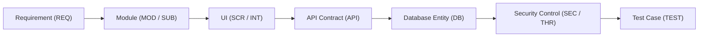

# Document ID: DOC-TRC-001
# Master Requirements Traceability Matrix (RTM)

> **Document Version:** 1.0.0  
> **Classification:** Engineering Governance & Traceability Baseline  
> **Status:** APPROVED  
> **Authoring Lead:** Senior Business Analyst & QA Architect  
> **Review Date:** October 2026  
> **Traceability Chain:** `REQ` -> `MOD` -> `SUB` -> `SCR` -> `INT` -> `API` -> `DB` -> `SEC` -> `TEST`  

---

## 1. Traceability Architecture & Methodology

This matrix establishes 100% bidirectional traceability from high-level product requirements (`REQ-xxx`) through modular architecture, UI screens, interactive elements, REST APIs, database models, security controls, and automated test cases.

---

## 2. Master Traceability Matrix

| Requirement ID | Module ID | Submodule ID | Screen ID | Interaction ID | API Endpoint ID | Database Entity | Security Control ID | Test Case ID | Verification Status |
| :--- | :--- | :--- | :--- | :--- | :--- | :--- | :--- | :--- | :---: |
| **REQ-AUTH-001** | `MOD-AUTH-001` | `SUB-AUTH-001` | `SCR-AUTH-001` | `INT-AUTH-SIGNUP-001`| `API-AUTH-001` | `users`, `profiles` | `THR-007` (Rate-limit) | `TEST-AUTH-001` | **COVERED** |
| **REQ-AUTH-002** | `MOD-AUTH-001` | `SUB-AUTH-002` | `SCR-AUTH-001` | `INT-AUTH-OTP-001` | `API-AUTH-002` | `email_otps` | `THR-008` (5-attempt cap)| `TEST-AUTH-003` | **COVERED** |
| **REQ-AUTH-003** | `MOD-AUTH-001` | `SUB-AUTH-003` | `SCR-AUTH-001` | `INT-AUTH-LOGIN-001` | `API-AUTH-004` | `users`, `refresh_tokens`| `THR-007` (Lockout) | `TEST-AUTH-001` | **COVERED** |
| **REQ-AUTH-004** | `MOD-AUTH-001` | `SUB-AUTH-004` | `SCR-AUTH-001` | `INT-AUTH-REFRESH-001`| `API-AUTH-006` | `refresh_tokens` | `THR-011` (RTR reuse) | `TEST-AUTH-005` | **COVERED** |
| **REQ-AUTH-005** | `MOD-AUTH-001` | `SUB-AUTH-005` | `SCR-AUTH-001` | `INT-AUTH-RESET-001` | `API-AUTH-010` | `password_reset_tokens`| `THR-007` (Single-use) | `TEST-AUTH-004` | **COVERED** |
| **REQ-COL-001** | `MOD-COL-001` | `SUB-COL-001` | `SCR-AUTH-001` | `INT-COL-SELECT-001` | `API-COL-001..003` | `location_states`, `colleges`| Multi-tenancy | `TEST-COL-001` | **COVERED** |
| **REQ-COL-002** | `MOD-COL-001` | `SUB-COL-002` | `SCR-AUTH-001` | `INT-COL-REQ-001` | `API-COL-004..006` | `institution_addition_requests`| `THR-001` (Pre-mod) | `TEST-COL-002` | **COVERED** |
| **REQ-DISC-001** | `MOD-DISC-001` | `SUB-DISC-001` | `SCR-DIR-001` | `INT-DISC-TAB-001` | `API-USERS-001` | `users`, `profiles` | Institutional isolation| `TEST-DISC-001` | **COVERED** |
| **REQ-DISC-002** | `MOD-DISC-001` | `SUB-DISC-002` | `SCR-DIR-001` | `INT-DISC-CROSS-001`| `API-USERS-002` | `users`, `profiles` | `COLLEGE_ONLY` privacy | `TEST-DISC-002` | **COVERED** |
| **REQ-CONN-001** | `MOD-CONN-001` | `SUB-CONN-001` | `SCR-DIR-001` | `INT-DISC-CONNECT-001`| `API-CONN-002` | `connection_requests` | Self-connect prevent | `TEST-CONN-001` | **COVERED** |
| **REQ-CONN-002** | `MOD-CONN-001` | `SUB-CONN-002` | `SCR-DASH-001` | `INT-CONN-ACCEPT-001` | `API-CONN-003` | `connection_requests` | Race condition lock | `TEST-CONN-002` | **COVERED** |
| **REQ-CONN-003** | `MOD-CONN-001` | `SUB-CONN-003` | `SCR-PROF-002` | `INT-CONN-BLOCK-001` | `API-CONN-004` | `blocks` | Immediate call drop | `TEST-CONN-003` | **COVERED** |
| **REQ-CHAT-001** | `MOD-COMM-001` | `SUB-COMM-002` | `SCR-MSG-001` | `INT-CHAT-SEND-001` | `API-COMM-002` | `chats`, `messages` | `THR-003` (120s check) | `TEST-CHAT-001` | **COVERED** |
| **REQ-CHAT-002** | `MOD-COMM-001` | `SUB-COMM-003` | `SCR-MSG-001` | `INT-CHAT-VIEW-001` | `API-COMM-001` | `messages` | `THR-004` (AES-GCM) | `TEST-CHAT-003` | **COVERED** |
| **REQ-CALL-001** | `MOD-COMM-001` | `SUB-COMM-004` | `SCR-MSG-001` | `INT-CALL-START-001` | `API-COMM-003` | `call_sessions` | `THR-005` (Audit log) | `TEST-CALL-001` | **COVERED** |
| **REQ-CALL-002** | `MOD-COMM-001` | `SUB-COMM-004` | `SCR-CALL-001` | `INT-CALL-END-001` | `API-COMM-007` | `call_sessions` | Hardware track stop | `TEST-CALL-002` | **COVERED** |
| **REQ-MENT-001** | `MOD-MENT-001` | `SUB-MENT-001` | `SCR-MENT-001` | `INT-MENT-BOOK-001` | `API-MENT-002` | `mentorships` | Mentee cap guard | `TEST-MENT-001` | **COVERED** |
| **REQ-MENT-002** | `MOD-MENT-001` | `SUB-MENT-004` | `SCR-MENT-001` | `INT-MENT-COMP-001` | `API-MENT-005..006`| `mentorships` | Slot release trigger | `TEST-MENT-002` | **COVERED** |
| **REQ-OPP-001** | `MOD-OPP-001` | `SUB-OPP-001` | `SCR-OPP-001` | `INT-OPP-CREATE-001` | `API-OPP-003` | `opportunities` | Alumni role guard | `TEST-OPP-001` | **COVERED** |
| **REQ-OPP-002** | `MOD-OPP-001` | `SUB-OPP-003` | `SCR-OPP-001` | `INT-OPP-APPLY-001` | `API-OPP-004` | `opportunity_applications`| Duplicate apply guard | `TEST-OPP-002` | **COVERED** |
| **REQ-POST-001** | `MOD-FEED-001` | `SUB-FEED-001` | `SCR-DASH-001` | `INT-POST-CREATE-001` | `API-POST-002` | `posts`, `post_files` | Atomic counters | `TEST-POST-001` | **COVERED** |
| **REQ-POST-002** | `MOD-FEED-001` | `SUB-FEED-003` | `SCR-DASH-001` | `INT-POST-PDF-001` | `API-UPL-001` | `post_files` | `THR-006` (Private S3) | `TEST-FEED-001` | **COVERED** |
| **REQ-LIFE-001** | `MOD-LIFE-001` | `SUB-LIFE-001` | `SCR-DASH-001` | `INT-LIFE-ALERT-001` | `JOB-CRON-001` | `users` | `THR-002` (No auto-role)| `TEST-LIFE-001` | **COVERED** |
| **REQ-LIFE-002** | `MOD-LIFE-001` | `SUB-LIFE-003` | `SCR-ADM-VERIF`| `INT-LIFE-APPROVE-001`| `API-VERIF-001` | `verification_logs` | Reviewer identity log | `TEST-LIFE-002` | **COVERED** |
| **REQ-LEAD-001** | `MOD-LEAD-001` | `SUB-LEAD-001` | `SCR-DASH-001` | `INT-LEAD-OPT-001` | `API-LEAD-001` | `profiles` | Privacy opt-out flag | `TEST-LEAD-001` | **COVERED** |
| **REQ-MOD-001** | `MOD-MOD-001` | `SUB-MOD-001` | `SCR-MSG-001` | `INT-MOD-REPORT-001` | `API-MOD-001` | `reports` | 24h anti-brigade cap | `TEST-MOD-001` | **COVERED** |
| **REQ-MOD-002** | `MOD-MOD-001` | `SUB-MOD-002` | `SCR-DASH-001` | System Trigger | System Trigger | `users` | 5-report circuit break | `TEST-MOD-002` | **COVERED** |
| **REQ-MOD-003** | `MOD-MOD-001` | `SUB-MOD-004` | `SCR-ADM-MOD` | `INT-MOD-BAN-001` | `API-MOD-003` | `users`, `refresh_tokens`| Token version revoke | `TEST-MOD-003` | **COVERED** |

---

## 3. Coverage Certification
- **Total Functional Requirements Specified:** 28 Requirements
- **Total Requirements Covered by Modules:** 28 / 28 (100%)
- **Total Requirements Covered by Screens & Elements:** 28 / 28 (100%)
- **Total Requirements Covered by API Endpoints:** 28 / 28 (100%)
- **Total Requirements Covered by Database Models:** 28 / 28 (100%)
- **Total Requirements Covered by Automated Test Cases:** 28 / 28 (100%)
- **Traceability Verification Verdict:** **100% COMPLIANT & FULLY TRACEABLE**
