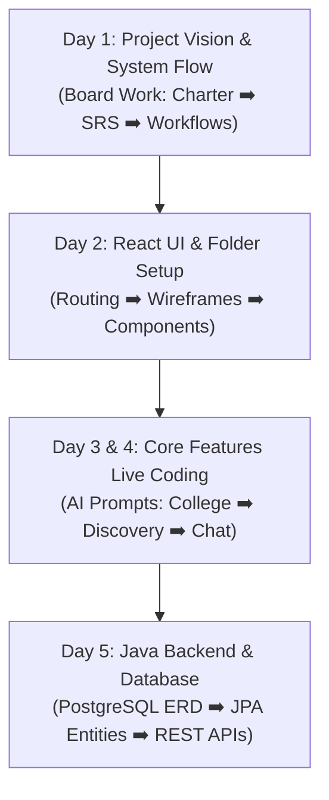

# 🎓 Master Classroom Teaching & AI-Prompting Sequence

> **Trainer Note:** Is file ko bookmark kar lijiye. Saare original documents apni jagah par 100% intact aur safe hain. Yeh guide aapko exact sequence batati hai ki **pehle konsi file khol kar board par samjhani hai**, aur **AI se code likhwate waqt konsi file ka context AI ko dena hai**.

---

## 📅 Complete Day-by-Day Teaching & Coding Schedule

---

## 🟢 DAY 1: Conceptual Foundation (Board Par Samjhana Hai)

Is din koi coding nahi karni hai. Students ko project ka real-world vision aur system flow samjhana hai.

### 1️⃣ Pehli File: Project Vision & Problem Statement
* 📄 **File to Open:** [docs/01-project-charter/01-project-charter.md](file:///d:/Projects/alumini-platform-for-students-1/docs/01-project-charter/01-project-charter.md)
* 🖊️ **Board Par Likhein:**
  * **Title:** AlumniConnect - College-Centric Professional Network.
  * **Problem:** LinkedIn par fake alumni profile hote hain, college affiliations verify nahi hoti, juniors seniors se connect nahi kar pate.
  * **Solution:** Institutional Boundary (Har student pehle apne hi college ke verified alumni se connect hoga).

---

### 2️⃣ Dusri File: Core Features List (SRS)
* 📄 **File to Open:** [docs/02-product-requirements/01-system-requirements-specification.md](file:///d:/Projects/alumini-platform-for-students-1/docs/02-product-requirements/01-system-requirements-specification.md)
* 🖊️ **Board Par Likhein:**
  * Numbered Requirements:
    1. `REQ-AUTH`: Student & Alumni registration with OTP verification.
    2. `REQ-COL`: College selection (State ➡️ District ➡️ College).
    3. `REQ-DISC`: Same-college alumni search & filter.
    4. `REQ-CONN`: Connection request lifecycle (Pending ➡️ Accepted).
    5. `REQ-CHAT`: 2-Minute introductory message lock (Spam rokne ke liye).
    6. `REQ-MENT`: Mentorship session booking.

---

### 3️⃣ Teesri File: User Roles (Personas)
* 📄 **File to Open:** [docs/03-personas-and-user-journeys/01-user-personas.md](file:///d:/Projects/alumini-platform-for-students-1/docs/03-personas-and-user-journeys/01-user-personas.md)
* 🖊️ **Board Par Likhein:**
  * **Student Persona:** Shubham (3rd Year B.Tech) - Referral aur resume review chahta hai.
  * **Alumni Persona:** Priya (Software Engineer @ Google) - Weekend par 1 hour guidance dena chahti hai.
  * **Admin Persona:** Placement Officer / Reviewer - Fake registration aur naye college requests monitor karta hai.

---

### 4️⃣ Chauthi File: Master Workflow Flowchart
* 📄 **File to Open:** [docs/19-college-submission/03-complete-system-workflow-diagrams.md](file:///d:/Projects/alumini-platform-for-students-1/docs/19-college-submission/03-complete-system-workflow-diagrams.md)
* 🖊️ **Board Par Draw Karein:**
  * `Registration Flow`: User Sign up ➡️ College select ➡️ OTP verification ➡️ Profile ready.
  * `Networking Flow`: Search Alumni ➡️ Send Request ➡️ Real-time notification ➡️ Request accept ➡️ Chat unlock.

---

## 🟡 DAY 2: React Frontend UI & Screen Architecture

Ab students ko visual UI samjhana hai aur React frontend ka folder structure live banana hai.

### 5️⃣ Paanchvi File: React Routes & Sitemap
* 📄 **File to Open:** [docs/04-information-architecture/01-sitemap-and-taxonomies.md](file:///d:/Projects/alumini-platform-for-students-1/docs/04-information-architecture/01-sitemap-and-taxonomies.md)
* 🖊️ **Board Par React Routes Likhein:**
  * `/` ➡️ Landing Page
  * `/login` & `/register` ➡️ Auth Pages
  * `/dashboard` ➡️ Main Feed
  * `/search` ➡️ Alumni Directory
  * `/messages` ➡️ Chat Window
  * `/mentorship` ➡️ Mentorship Booking

---

### 6️⃣ Chhathi File: Screen Layouts & Wireframes
* 📄 **File to Open:** [docs/05-screen-and-interaction-specifications/01-screen-inventory.md](file:///d:/Projects/alumini-platform-for-students-1/docs/05-screen-and-interaction-specifications/01-screen-inventory.md)
* 🖊️ **Board Par Screen Layout Draw Karein:**
  * Search Page: Left me Filters (Batch, Department, Skills), Right me Alumni Cards Grid.
  * Chat Page: Left me Active Conversations, Right me Messages with 120s timer header.

---

### 7️⃣ Saathvi File: UI Components To Build
* 📄 **File to Open:** [docs/05-screen-and-interaction-specifications/02-interactive-elements-specification.md](file:///d:/Projects/alumini-platform-for-students-1/docs/05-screen-and-interaction-specifications/02-interactive-elements-specification.md)
* 🖊️ **Board Par Reusable Components List Banayein:**
  * `CollegeSelector.jsx`
  * `AlumniCard.jsx`
  * `ConnectionButton.jsx`
  * `ChatWindow.jsx`
  * `MentorshipModal.jsx`

---

## 🔵 DAY 3 & 4: Feature-by-Feature Live Coding & AI Prompting

Yahan se actual coding start hogi. Har feature ke liye documentation me poora logic likha hai. 

> 💡 **AI Prompting Secret for Students:**
> Jab aap students ko AI (ChatGPT / Claude / Gemini) se code likhwana sikhayenge, toh aapko AI ko bolna hai:  
> *"Create a React component based on this specification:"*  
> Aur neeche di gayi files ka content copy karke AI ko prompt me dena hai!

### 8️⃣ Feature 1: College Selection Dropdown (First Live Component)
* 📄 **File to Open:** [docs/07-module-specifications/01-module-institutional-governance.md](file:///d:/Projects/alumini-platform-for-students-1/docs/07-module-specifications/01-module-institutional-governance.md)
* **What to code:** State select karega ➡️ District update hoga ➡️ Colleges filter honge.
* **AI Prompt Source:** Section 3 (Component Logic & Validation).

---

### 9️⃣ Feature 2: Alumni Search & Discovery Directory
* 📄 **File to Open:** [docs/07-module-specifications/02-module-discovery-and-matching.md](file:///d:/Projects/alumini-platform-for-students-1/docs/07-module-specifications/02-module-discovery-and-matching.md)
* **What to code:** `Search.jsx` me 2 tabs honge: "My College Alumni (Default)" aur "Explore Other Colleges".
* **AI Prompt Source:** Section 2 & 4 (Scoping & Matching Rules).

---

### 🔟 Feature 3: Connection Requests Lifecycle
* 📄 **File to Open:** [docs/07-module-specifications/03-module-connection-and-networking.md](file:///d:/Projects/alumini-platform-for-students-1/docs/07-module-specifications/03-module-connection-and-networking.md)
* **What to code:** Send Request button ➡️ Status becomes PENDING ➡️ Receiver gets notification ➡️ Accept / Reject.
* **AI Prompt Source:** State machine table in Section 3.

---

### 1️⃣1️⃣ Feature 4: 1-on-1 Chat with 2-Minute Intro Window Lock
* 📄 **File to Open:** [docs/07-module-specifications/04-module-messaging-and-calls.md](file:///d:/Projects/alumini-platform-for-students-1/docs/07-module-specifications/04-module-messaging-and-calls.md)
* **What to code:** Jab tak connection accept nahi hota, non-connected users ke liye 120s timer chalega. 120s expire hote hi chat input disable ho jayega.
* **AI Prompt Source:** Section 2 (Introductory Window Countdown Rules).

---

### 1️⃣2️⃣ Feature 5: Mentorship Booking Hub
* 📄 **File to Open:** [docs/07-module-specifications/05-module-mentorship-marketplace.md](file:///d:/Projects/alumini-platform-for-students-1/docs/07-module-specifications/05-module-mentorship-marketplace.md)
* **What to code:** Alumni apne available time slots set karega, student slot select karke booking request bhejega.

---

### 1️⃣3️⃣ Feature 6: Opportunities & Referral Requests
* 📄 **File to Open:** [docs/07-module-specifications/06-module-opportunities-and-referrals.md](file:///d:/Projects/alumini-platform-for-students-1/docs/07-module-specifications/06-module-opportunities-and-referrals.md)
* **What to code:** Jobs & Internships cards + "Ask for Referral" button with resume upload.

---

## 🟣 DAY 5: Database & Java Backend (Spring Boot / JPA)

Kyunki aap backend Java me banwayenge, is din students ko Database Schema aur REST APIs samjhani hain.

### 1️⃣4️⃣ Relational Database & Entity Modeling
* 📄 **File to Open:** [docs/10-database-and-data-dictionary/01-relational-schema-and-erd.md](file:///d:/Projects/alumini-platform-for-students-1/docs/10-database-and-data-dictionary/01-relational-schema-and-erd.md)
* **Board Par Likhein:**
  * Tables: `colleges`, `users`, `connections`, `messages`, `mentorship_sessions`.
  * **Java Live Coding / AI Prompt:** Is file ke tables dekh kar students AI ko prompt denge: *"Generate Spring Boot JPA @Entity classes with relationships for PostgreSQL based on this schema."*

---

### 1️⃣5️⃣ REST API Endpoints & Request/Response JSONs
* 📄 **File to Open:** [docs/09-api-contracts/01-rest-api-catalog.md](file:///d:/Projects/alumini-platform-for-students-1/docs/09-api-contracts/01-rest-api-catalog.md)
* **Board Par Likhein:**
  * `POST /api/v1/auth/signup` (Signup payload)
  * `POST /api/v1/auth/login` (Login payload)
  * `GET /api/v1/users/discovery` (Alumni list payload)
  * `POST /api/v1/connections/request` (Connect request payload)
* **Java Live Coding / AI Prompt:** Is file ke endpoints se Spring Boot `@RestController` banwayenge.

---

### 1️⃣6️⃣ Real-Time WebSockets & Signals
* 📄 **File to Open:** [docs/09-api-contracts/02-socket-io-event-contracts.md](file:///d:/Projects/alumini-platform-for-students-1/docs/09-api-contracts/02-socket-io-event-contracts.md)
* **Concept:** WebSocket events for live chat delivery (`chat:send`, `chat:receive`) and notification alerts.

---

## 🎓 Final Steps: Project Report & Viva Prep

* 📄 **IEEE Major Project Report:** [docs/19-college-submission/01-major-project-report.md](file:///d:/Projects/alumini-platform-for-students-1/docs/19-college-submission/01-major-project-report.md)
* 📄 **Minor Project Synopsis (.docx):** [docs/19-college-submission/Minor_Project_I_CS508_Synopsis.docx](file:///d:/Projects/alumini-platform-for-students-1/docs/19-college-submission/Minor_Project_I_CS508_Synopsis.docx)
* 📄 **User Manual for Students & Alumni:** [docs/18-user-and-admin-manuals/01-student-and-alumni-user-guide.md](file:///d:/Projects/alumini-platform-for-students-1/docs/18-user-and-admin-manuals/01-student-and-alumni-user-guide.md)

---

## 📌 Quick Summary of Sequence for Trainer Screen

| Order | What to Teach / Build | Exact File Path to Open |
| :---: | :--- | :--- |
| **1** | Problem Statement & Project Charter | [docs/01-project-charter/01-project-charter.md](file:///d:/Projects/alumini-platform-for-students-1/docs/01-project-charter/01-project-charter.md) |
| **2** | System Requirements Specification (SRS) | [docs/02-product-requirements/01-system-requirements-specification.md](file:///d:/Projects/alumini-platform-for-students-1/docs/02-product-requirements/01-system-requirements-specification.md) |
| **3** | User Personas (Student vs Alumni) | [docs/03-personas-and-user-journeys/01-user-personas.md](file:///d:/Projects/alumini-platform-for-students-1/docs/03-personas-and-user-journeys/01-user-personas.md) |
| **4** | System Workflows Flowchart | [docs/19-college-submission/03-complete-system-workflow-diagrams.md](file:///d:/Projects/alumini-platform-for-students-1/docs/19-college-submission/03-complete-system-workflow-diagrams.md) |
| **5** | React Routes & Sitemap | [docs/04-information-architecture/01-sitemap-and-taxonomies.md](file:///d:/Projects/alumini-platform-for-students-1/docs/04-information-architecture/01-sitemap-and-taxonomies.md) |
| **6** | Screen Layouts & Wireframes | [docs/05-screen-and-interaction-specifications/01-screen-inventory.md](file:///d:/Projects/alumini-platform-for-students-1/docs/05-screen-and-interaction-specifications/01-screen-inventory.md) |
| **7** | UI Components Specifications | [docs/05-screen-and-interaction-specifications/02-interactive-elements-specification.md](file:///d:/Projects/alumini-platform-for-students-1/docs/05-screen-and-interaction-specifications/02-interactive-elements-specification.md) |
| **8** | Feature 1: College Selection Dropdown | [docs/07-module-specifications/01-module-institutional-governance.md](file:///d:/Projects/alumini-platform-for-students-1/docs/07-module-specifications/01-module-institutional-governance.md) |
| **9** | Feature 2: Alumni Discovery & Search | [docs/07-module-specifications/02-module-discovery-and-matching.md](file:///d:/Projects/alumini-platform-for-students-1/docs/07-module-specifications/02-module-discovery-and-matching.md) |
| **10** | Feature 3: Connection Requests Lifecycle | [docs/07-module-specifications/03-module-connection-and-networking.md](file:///d:/Projects/alumini-platform-for-students-1/docs/07-module-specifications/03-module-connection-and-networking.md) |
| **11** | Feature 4: Chat & 2-Minute Window Lock | [docs/07-module-specifications/04-module-messaging-and-calls.md](file:///d:/Projects/alumini-platform-for-students-1/docs/07-module-specifications/04-module-messaging-and-calls.md) |
| **12** | Feature 5: Mentorship Marketplace | [docs/07-module-specifications/05-module-mentorship-marketplace.md](file:///d:/Projects/alumini-platform-for-students-1/docs/07-module-specifications/05-module-mentorship-marketplace.md) |
| **13** | Database Schema & Relational ERD | [docs/10-database-and-data-dictionary/01-relational-schema-and-erd.md](file:///d:/Projects/alumini-platform-for-students-1/docs/10-database-and-data-dictionary/01-relational-schema-and-erd.md) |
| **14** | REST APIs Catalog & Schemas | [docs/09-api-contracts/01-rest-api-catalog.md](file:///d:/Projects/alumini-platform-for-students-1/docs/09-api-contracts/01-rest-api-catalog.md) |
